# MCP 主機與工具

## 目錄

- [文件資訊](#文件資訊)
- [系統概述](#系統概述)
- [共用資料結構](#共用資料結構)
- [McpHost MCP 主機](#mcphost-mcp-主機)
- [KeelTools MCP 工具集](#keeltools-mcp-工具集)
- [Tray 托盤組裝根](#tray-托盤組裝根)
- [附錄](#附錄)

---

## 文件資訊

| 項目 | 內容 |
|------|------|
| 系統名稱 | Keel Assistant（系統匣常駐助理） |
| 模組位置 | `Api/`、`TrayApplicationContext.cs`、`Program.cs`、`Models/Models.cs` |
| 業務邏輯位置 | `Api/KeelTools.cs`（工具定義與參數驗證）；實際狀態操作在各功能模組單例 |
| 最後更新 | 2026/11/12 |

### 版本歷史

| 版本 | 日期 | 異動內容 | 異動人員 |
|------|------|----------|----------|
| 1.0 | 2026/11/12 | 初版。同時記錄本次移除：① 音樂模組（`Music/MusicController.cs`、`MusicForm.cs`）——刪除 `play_music`／`stop_music` 工具、`set_timer` 的 `action=music-stop` 參數、`McpHost`／`TrayApplicationContext` 的 `MusicController` 注入、托盤「🎵 音樂」選單與 `_music.Dispose()`；`AlarmEngine` 建構子拿掉 `stopMusic` callback。② 生活習慣記憶模組（`Memory/MemoryStore.cs`、`memory.json`）——刪除 `memory_set`／`memory_get`／`memory_list`／`memory_delete` 工具、`ParseTags` 輔助方法、`Models.MemoryEntry` 類別與 `MemoryStore` 注入。`ScheduledAction.MusicStop` 列舉值保留供舊 `tasks.json` 反序列化。另 `sandbox_info` 套件清單加入 Pillow 12.2.0（2026/10/06 變更）。 | Arlen |

### 所有相關程式位置

```
KeelAssistant/
├── Program.cs                     # 進入點：Mutex 單一實例、Application.Run、Environment.Exit
├── TrayApplicationContext.cs      # 組裝根：建立模組單例、托盤選單、用量輪詢、啟動 McpHost
├── Api/
│   ├── McpHost.cs                 # 內嵌 Kestrel + MCP Server；UiDispatcher、UsageProvider
│   ├── KeelTools.cs               # 全部 [McpServerTool] 工具方法
│   └── FileLogger.cs              # Warning 以上寫入 mcp-error.log
├── Models/Models.cs               # 跨模組資料模型（AppSettings、ScheduledTask、OAuth 用量…）
└── appsettings.json               # ApiPort 等設定
```

---

## 系統概述

### 簡介

本領域是 Keel Assistant 的「骨幹」。`Program` 啟動 WinForms 訊息迴圈；`TrayApplicationContext` 建立所有常駐模組單例與托盤圖示；`McpHost` 在同一個行程內啟動只綁 loopback 的 Kestrel，以 MCP Streamable HTTP 對 Claude Code（Keel）公開 `KeelTools` 內的工具。

常駐狀態（鬧鐘排程、錄音、用量快照）活在 WinForm 行程記憶體中，所以 MCP 必須用 HTTP transport，不能用 stdio（stdio 每次呼叫都是新行程，狀態會遺失）。

**核心價值**：讓 Claude 以具 schema 的工具直接操作本機資源，取代舊有 PowerShell 拼 JSON 的作法；帳密類資訊（SQL、SSH）留在本行程，Claude 只拿得到代號。

### 模組關係圖

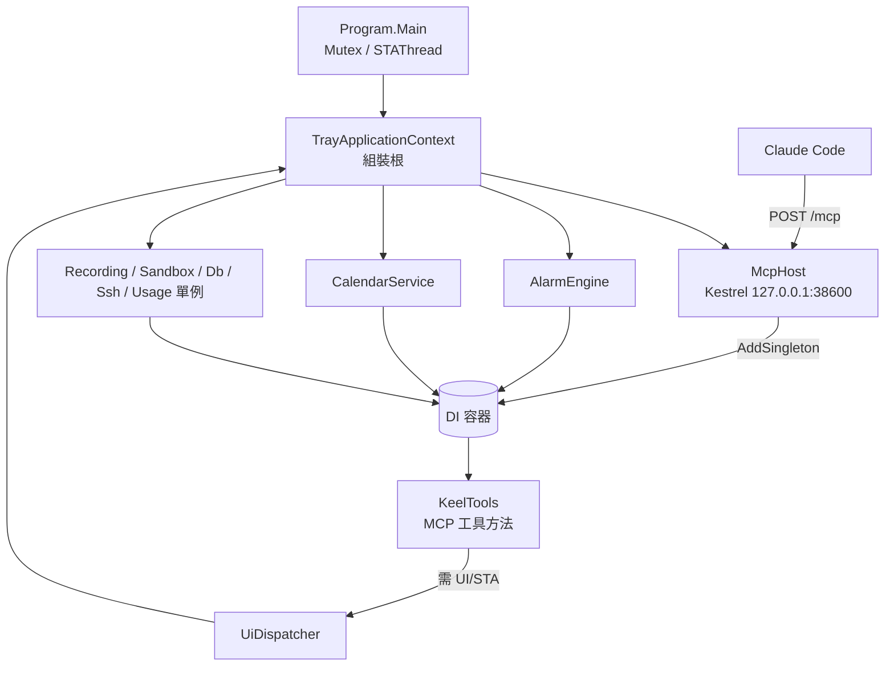

### 核心功能列表（領域層級）

- ⭐ 內嵌 MCP Server，單一行程同時是托盤程式與工具伺服器
- ⭐ `UiDispatcher` 把需 STA／WinForms 的工具呼叫切回 UI 執行緒
- ⭐ `Reportable`／`ReportableAsync` 把例外轉成 `McpException`，讓 Claude 看得到錯誤原因
- ✅ 單一實例（Mutex）、結束時強制 `Environment.Exit(0)`
- ✅ 用量輪詢共享快照（`get_usage_5h` 只讀快照）
- ❌ 音樂播放、生活習慣記憶（2026/11/10 已移除）

### 技術堆疊

| 項目 | 內容 |
|------|------|
| 開發框架 | .NET 8 WinForms（TFM `net8.0-windows10.0.19041.0`）+ `Microsoft.AspNetCore.App` |
| MCP SDK | `ModelContextProtocol.AspNetCore` 1.4.0 |
| ORM | 本領域無此項目 |
| 資料庫 | 本領域無此項目（設定與狀態以 JSON 檔持久化） |
| 服務形式 | 內嵌 Kestrel，MCP Streamable HTTP，`Stateless = true` |
| 日誌系統 | 自製 `FileLoggerProvider`，Warning 以上寫 `mcp-error.log` |
| 加密方式 | 本領域無；SQL／SSH 模組各自以 DPAPI 加密 |
| MQ 系統 | 本領域無此項目 |

---

## 共用資料結構

`Models/Models.cs` 是跨模組共用的資料模型檔。

| 類別 | 用途 | 使用者 |
|------|------|--------|
| `AppSettings` | `appsettings.json` 對應物件 | 全部模組 |
| `OAuthUsageResponse`、`UsageWindow`、`UsageLimit`、`Spend`、`MoneyAmount`、`ExtraUsage` | 官方 usage API 回應；`FiveHour`／`SevenDay` 優先讀 `limits[]`，舊欄位為 fallback | Usage、`get_usage_5h`、托盤選單 |
| `CredentialsFile`、`OAuthCredentials`、`TokenRefreshResponse` | 本機 OAuth 憑證 | Usage |
| `TokenStats` | transcript 掃描統計 | Usage、托盤 |
| `ScheduledAction`、`ScheduledTask` | 鬧鐘／計時任務（`tasks.json`） | Alarm、鬧鐘類工具 |
| `DbProvider`、`DbConnectionEntry`、`SqlQueryResult` | SQL 連線與結果 | Db、`sql_*` |
| `SandboxRunResult`、`SandboxOutputFile` | Python 沙盒結果 | Sandbox、`python_run` |
| `SshAuthMode`、`SshConnectionEntry`、`SshExecResult` | SSH 連線與結果 | Ssh、`ssh_*` |
| ~~`MemoryEntry`~~ | 已於 2026/11/10 移除 | — |

### AppSettings 重要欄位

| 欄位名稱 | 資料型態 | 預設 | 說明 | 備註 |
|---------|---------|------|------|------|
| ApiPort | int | 38600 | MCP 埠 | 🔑 埠衝突時改此值重啟 |
| AlarmSoundPath | string | `assets/alarm.wav` | 響鈴音檔 | 相對路徑以 exe 目錄為基準 |
| PollIntervalSeconds | int | 300 | 用量輪詢間隔 | 🔑 程式強制 `>= 180` |
| WarnThresholdPercent / CriticalThresholdPercent | double | 80 / 95 | 用量警示門檻 | 跨越時跳氣泡 |
| SandboxRoot | string | `C:\Vista\_sandbox` | 沙盒根目錄 | 🔑 MCP 參數不可覆寫 |
| SshEnabled | bool | false | SSH 模組開關 | 預設關閉 |
| NotificationWatchEnabled | bool | true | 通知監看開關 | — |

### 資料關係圖

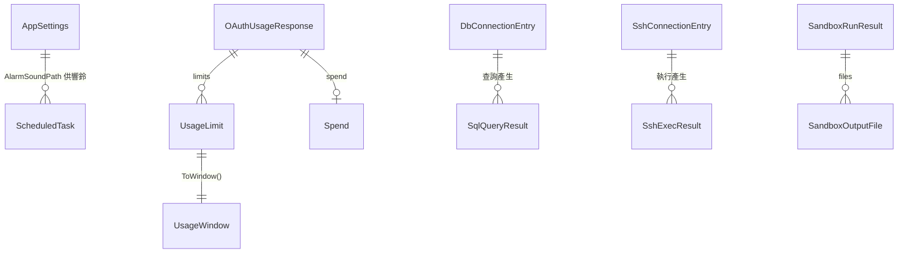

---

## McpHost MCP 主機

### 核心功能列表

- ⭐ `WebApplication.CreateSlimBuilder()` + Kestrel 只 `Listen(IPAddress.Loopback, port)`，不對外曝露
- ✅ 把各模組單例以 `AddSingleton` 注入 DI，工具方法以參數注入取得
- ✅ `WithHttpTransport(o => o.Stateless = true)`、`WithToolsFromAssembly()`、`MapMcp("/mcp")`
- ✅ `ClearProviders()` 靜音 ASP.NET 記錄，只保留 `FileLoggerProvider`（Warning 以上）
- ✅ `Stop()`：`StopAsync` 3 秒上限 + `DisposeAsync` 2 秒上限，避免 in-flight 連線卡住結束
- ✅ `UiDispatcher`：以 UI `SynchronizationContext.Send` 同步執行並回拋例外
- ✅ `UsageProvider`：以委派讀取托盤持有的用量快照與取得時間

### 系統架構

#### 專案結構

```
Api/
├── McpHost.cs     # McpHost、UiDispatcher、UsageProvider
└── FileLogger.cs  # FileLoggerProvider / FileLogger
```

#### 核心執行流程（建構與啟動）

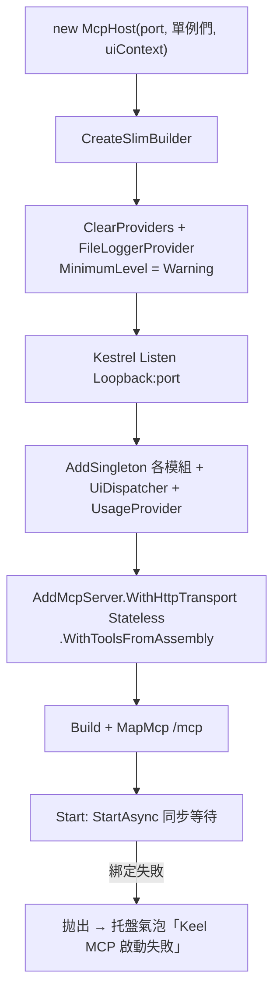

#### 多執行緒架構

| 執行緒 | 負責模組 | 功能 | 控制參數 |
|--------|----------|------|----------|
| UI 執行緒（STA） | WinForms、AlarmEngine Timer、錄音 pump、Outlook COM | 視窗、托盤、COM | 由 `Application.Run` 驅動 |
| Kestrel 執行緒池 | McpHost／KeelTools | 處理 MCP 請求 | `Stateless = true`，多 session 共用 |
| 切回 UI | `UiDispatcher.Send` | 同步執行瞬間完成的 UI／COM 動作 | 🔑 不可包耗時操作 |

#### 整合架構序列圖

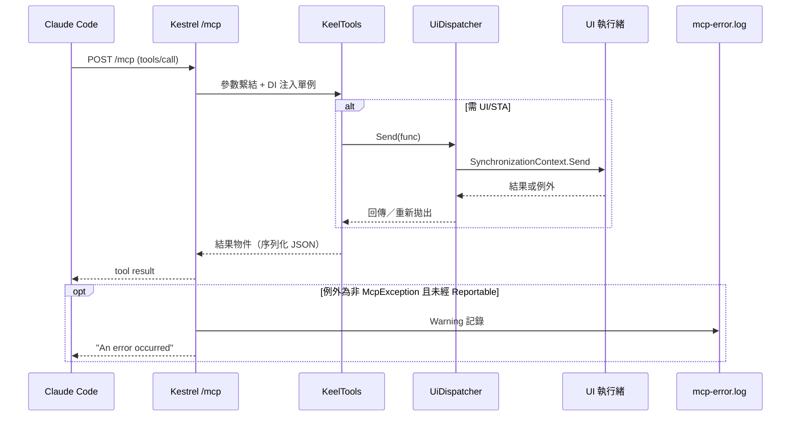

### 模組專屬資料結構

| 類別 | 說明 |
|------|------|
| `UiDispatcher(SynchronizationContext ui)` | `Send<T>(Func<T>)`、`Send(Action)`；在 UI 執行緒內 try/catch，回到呼叫端再 `throw err` |
| `UsageProvider(Func<OAuthUsageResponse?>, Func<DateTime?>)` | `Current`、`CurrentAt`；每次讀取都即時呼叫委派，拿到托盤最新快照 |
| `FileLoggerProvider(string logPath)` | `IsEnabled` 只認 Warning 以上；以 static lock 串行寫檔，寫檔失敗忽略 |

### 核心業務邏輯

- **檔案位置**：`Api/McpHost.cs`
- **核心概念**：MCP 行程即托盤行程；工具方法是 static，狀態全部來自 DI 單例。
- **關鍵限制**：
  - 🔑 只綁 loopback；`ApiPort` 由設定檔決定。
  - 🔑 `UiDispatcher.Send` 會同步佔住 UI 執行緒。耗時工作（Python 沙盒、SSH 執行）需在執行緒池 `await`，只把「送出／取消」切回 UI。
  - `UiDispatcher` 重新拋出時用 `throw err`，原始堆疊會被重設（診斷時注意）。
- **執行邏輯**：`Start()` 同步等待綁定；`Stop()` 有逾時上限，最後由 `Program` 的 `Environment.Exit(0)` 兜底。

### API 規格

本模組本身不定義工具，只提供端點。工具規格見 [KeelTools MCP 工具集](#keeltools-mcp-工具集)。

| 項目 | 內容 |
|------|------|
| 服務類型 | MCP（Model Context Protocol）Streamable HTTP |
| 服務端點 | `http://127.0.0.1:{ApiPort}/mcp`（預設 38600） |
| Content-Type | `application/json`（JSON-RPC 2.0） |
| 認證方式 | 無；以只綁 loopback 限制來源 |
| 字元編碼 | UTF-8 |
| 資料格式 | JSON-RPC `tools/list`、`tools/call` |

### 認證與安全機制

- 無 Token 認證。防線是「只綁 127.0.0.1」：遠端主機連不到。
- 本機其他程式可以呼叫此端點（同使用者權限）；高風險工具（`sql_exec`、`ssh_exec`、`python_run` 讀檔）另有人工確認視窗。
- 註冊方式：`claude mcp add --scope user --transport http keel http://127.0.0.1:38600/mcp`。

### 例外處理

| 情境 | 處理 |
|------|------|
| 埠綁定失敗 | `Start()` 拋出，`TrayApplicationContext` 捕捉並跳錯誤氣泡；托盤其他功能照常 |
| 工具內一般例外（未經 `Reportable`） | SDK 回 client「An error occurred」，詳細寫入 `mcp-error.log` |
| 結束時 in-flight 請求 | `StopAsync` 3 秒逾時後放棄，`DisposeAsync` 2 秒逾時 |

### 外部系統整合

本模組無此項目（外部整合在各功能模組）。

### 資料庫架構

本模組無此項目。

---

## KeelTools MCP 工具集

### 核心功能列表

- ⭐ 27 個 `[McpServerTool]`，分 9 類：時間、鬧鐘計時、通知、會議錄音、逐字稿／模型、行事曆、SQL、SSH、Python 沙盒、用量
- ⭐ `Reportable`／`ReportableAsync`：把一般例外包成 `McpException`，錯誤訊息可傳回 Claude
- ✅ 參數驗證失敗一律拋例外
- ✅ SQL／SSH 代號制：工具不列舉連線，錯誤訊息不洩漏可用代號
- ❌ `play_music`、`stop_music`、`memory_set`、`memory_get`、`memory_list`、`memory_delete`（2026/11/10 移除）

### 系統架構

#### 工具分類與相依單例

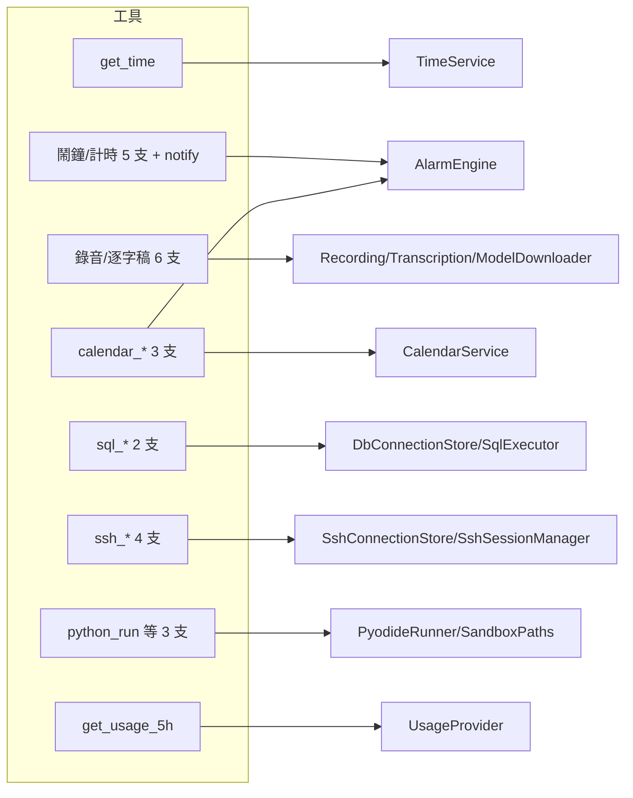

#### 錯誤透出流程

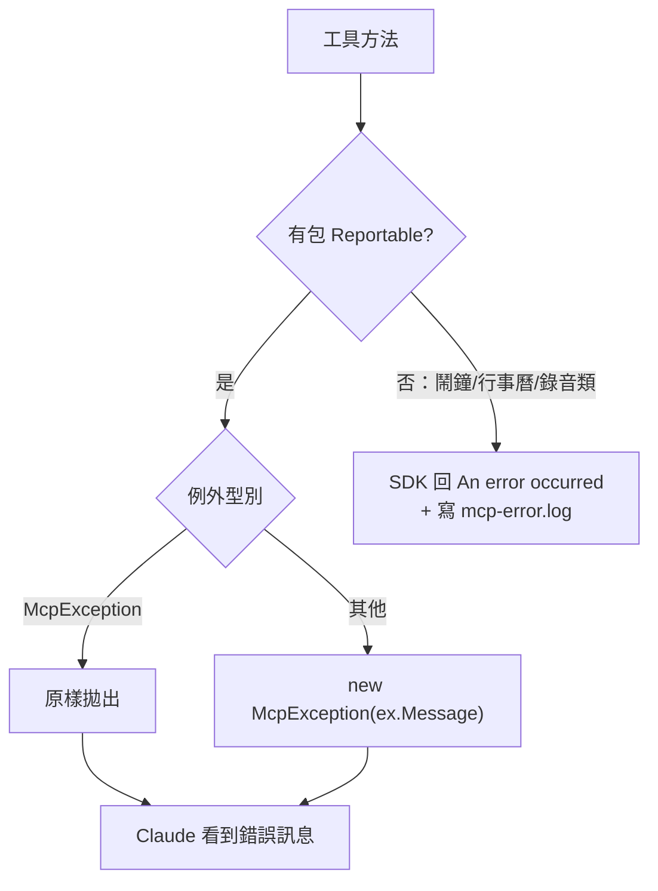

> 🔑 只有 SQL、SSH、Python 沙盒、`get_usage_5h` 包了 `Reportable`。鬧鐘、行事曆、錄音類工具的 `ArgumentException`／`InvalidOperationException` 不會把訊息傳給 Claude（SDK 會換成通用訊息，依 SDK 行為而定），排查時看 `mcp-error.log`。

### API 規格

#### 通用設定

| 項目 | 內容 |
|------|------|
| 服務類型 | MCP Tool（JSON-RPC `tools/call`） |
| 服務端點 | `http://127.0.0.1:38600/mcp` |
| Content-Type | `application/json` |
| 認證方式 | 無（loopback）；SQL／SSH 以代號 + 人工確認 |
| 字元編碼 | UTF-8 |
| 資料格式 | 參數為 JSON 物件；回應為匿名物件序列化後的 JSON。日期字串格式統一 `yyyy/MM/dd HH:mm` |

#### 工具總覽

| 類別 | 工具 | UI 切換 | Reportable | 人工確認 |
|------|------|:------:|:---------:|:-------:|
| 時間 | get_time | ❌ | ❌ | ❌ |
| 鬧鐘 | list_tasks、set_alarm、set_timer、cancel_task | ❌ | ❌ | ❌ |
| 鬧鐘 | stop_alarm、notify | ✅ | ❌ | ❌ |
| 錄音 | open_recorder | ✅ | ❌ | ❌ |
| 錄音 | get_recording_status、list_recordings | ❌ | ❌ | ❌ |
| 逐字稿 | transcribe_recording、get_transcription_status、get_model_status、download_whisper_model | ❌ | ❌ | ❌ |
| 行事曆 | calendar_list、calendar_sync_alarms、calendar_add | ✅ | ❌ | ❌ |
| SQL | sql_query | ❌ | ✅ | ❌ |
| SQL | sql_exec | ✅ | ✅ | ✅ |
| SSH | ssh_exec | ✅ | ✅（async） | ✅ |
| SSH | ssh_status、ssh_close | ❌ | ✅ | ❌ |
| SSH | ssh_open | ❌ | ✅（async） | ❌ |
| 沙盒 | python_run | ✅（確認視窗） | ✅（async） | 有 readPaths 時 ✅ |
| 沙盒 | list_sandbox_files、sandbox_info | ❌ | ✅ | ❌ |
| 用量 | get_usage_5h | ❌ | ✅ | ❌ |

---

#### 時間類

##### get_time

- **功能描述**：取得當下時間、星期與時段。取代舊 `get_local_time.py`。
- **請求格式**：無參數。
- **回應格式**：`{full_datetime, date, time, weekday, period, hour}`。`period` 依小時：5–8 清晨、9–11 上午、12–13 中午、14–17 下午、18–21 傍晚、其他深夜。
- **主要驗證規則**：無。
- **資料表更新**：無。
- **觸發的外部呼叫**：無。

---

#### 鬧鐘 / 計時類

業務流程（本類共用）：

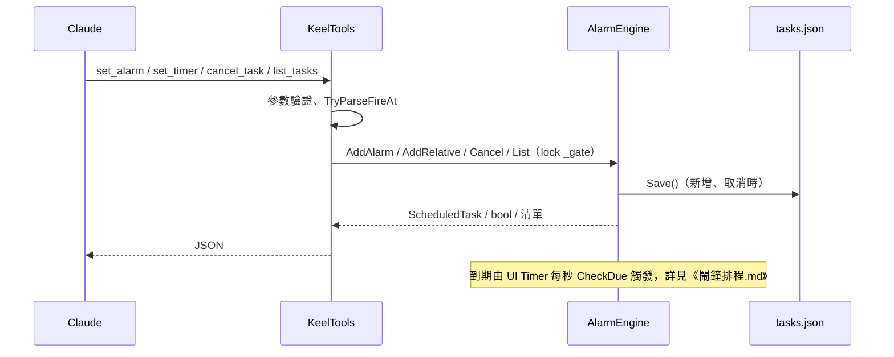

##### list_tasks

- **功能描述**：列出所有待命任務，依 `FireAt` 排序。
- **請求格式**：無參數。
- **回應格式**：`ScheduledTask[]`（`id, fireAt, label, action, loop, enabled`）。
- **驗證規則**：無。
- **資料表更新**：無（只讀記憶體）。

##### set_alarm

- **功能描述**：設定絕對時間鬧鐘。
- **請求格式**：`at`（必填，`HH:mm` 或完整日期時間）、`label`（選填，預設「鬧鐘」）、`loop`（選填，預設 true）。
- **回應格式**：成功回傳新建的 `ScheduledTask`；失敗拋例外。
- **主要驗證規則**：
  - `at` 空白 → `缺少 at（HH:mm 或完整日期時間）`。
  - 先試 `TimeOnly.TryParse`：成功則取今天該時刻，若 `<= 現在` 改排明天。
  - 否則 `DateTime.TryParse`；失敗 → `無法解析時間：{at}`。完整日期時間若已過去，仍會建立，並在下一秒觸發。
- **資料表更新**：

| 檔案 | 操作 | 說明 |
|------|------|------|
| tasks.json | 覆寫 | 新增一筆 Action=Alarm |

##### set_timer

- **功能描述**：`minutes` 分鐘後響鈴提醒。2026/11/10 起移除 `action` 參數（原可選 `music-stop`）。
- **請求格式**：`minutes`（必填，double）、`label`（選填，預設「計時提醒」）。
- **回應格式**：新建 `ScheduledTask`（`action=Alarm`、`loop=true`）。
- **主要驗證規則**：`minutes <= 0` → `minutes 需 > 0`。
- **資料表更新**：tasks.json 覆寫（新增一筆）。

##### stop_alarm

- **功能描述**：停止目前正在響的鬧鈴（音效 + 視窗）。
- **請求格式**：無參數。
- **回應格式**：`{stopped: true}`（沒在響也回 true）。
- **業務流程**：`ui.Send(() => alarm.StopRinging())`。
- **資料表更新**：無。

##### cancel_task

- **功能描述**：依 id 取消單一任務。
- **請求格式**：`id`（必填）。
- **回應格式**：`{cancelled: true, id}`。
- **主要驗證規則**：`id` 空白 → `缺少 id`；找不到 → `找不到該任務`。
- **資料表更新**：tasks.json 覆寫（移除一筆）。

---

#### 即時通知類

##### notify

- **功能描述**：立即響鈴一次（不循環）並彈出 `AlarmForm`，用於提醒 Arlen 查看 Claude 的重要回覆。
- **請求格式**：`message`（選填，預設「Keel 有重要訊息！」）。
- **回應格式**：`{notified: true, message}`。
- **業務流程**：`ui.Send(() => alarm.Notify(label))`；不寫入 tasks.json。
- **驗證規則**：無（空白改用預設字串）。

---

#### 會議錄音與逐字稿類

業務流程（本類共用）：

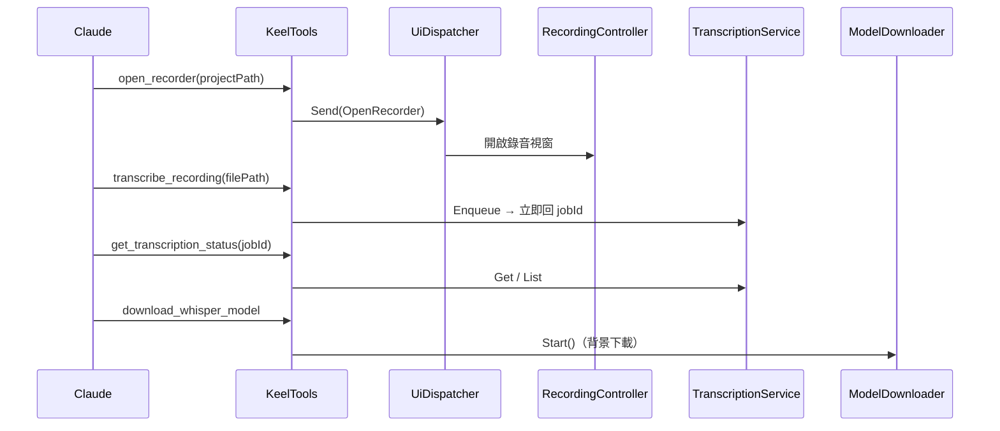

| 工具 | 參數 | 回應 | 驗證規則 | 檔案異動 |
|------|------|------|----------|----------|
| open_recorder | `projectPath`（必填） | `{opened, outputDir}` | 空白 → `缺少 projectPath`；目錄不存在 → `找不到專案目錄` | 錄音由 Arlen 在視窗操作，檔案寫入 `{projectPath}\_Project\Recordings\` |
| get_recording_status | 無 | `{state: idle/recording/paused, elapsed: hh:mm:ss, filePath, outputDir}` | 無 | 無 |
| list_recordings | `projectPath`（必填） | 陣列 `{fileName, filePath, sizeMb, recordedAt, transcribed, transcriptPath, notesPath}`，依建立時間新到舊 | 空白 → `缺少 projectPath`；目錄不存在回空陣列 | 無 |
| transcribe_recording | `filePath`（必填） | `{jobId, status, audioPath}`，不等待完成 | 空白 → `缺少 filePath`；其餘由 `TranscriptionService.Enqueue` 驗證 | 完成後產生同名 `.txt`、`.srt` |
| get_transcription_status | `jobId`（選填） | 單筆或全部 `{jobId, status, percent, audioPath, textPath, srtPath, error}` | 指定 jobId 找不到 → `找不到該轉檔工作` | 無 |
| get_model_status | 無 | `{installed, downloading, percent, path, error}` | 無 | 無 |
| download_whisper_model | 無 | `{installed, downloading, path}` | 已安裝或下載中不重複 | 下載 `models/ggml-medium.bin`（約 1.5GB） |

外部呼叫：`download_whisper_model` 連 Hugging Face。錄音、轉檔細節屬錄音模組，本文件未深入。

---

#### 行事曆類（Outlook COM）

業務流程：

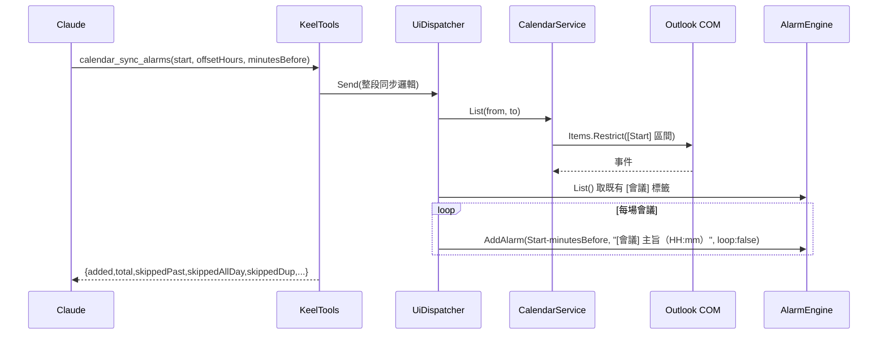

##### calendar_list

- **功能描述**：列出 `[start, start+offsetHours]` 內的行事曆事件（含週期性展開）。
- **請求格式**：`start`（選填，解析失敗或省略 = 現在）、`offsetHours`（選填，預設 24，負值改 0）。
- **回應格式**：陣列 `{Id, Subject, start, end, Location, IsAllDay}`（注意 `Id` 等欄位為 PascalCase）。
- **驗證規則**：無拋例外的驗證；Outlook 不存在 → `找不到 Outlook…`。

##### calendar_sync_alarms

- **功能描述**：把區間內會議同步成單次鬧鐘。
- **請求格式**：`start`、`offsetHours`（預設 24）、`minutesBefore`（預設 10，負值改 0）。
- **回應格式**：`{added, total, skippedPast, skippedAllDay, skippedDup, minutesBefore, offsetHours}`。
- **主要驗證規則**：跳過整日事件；`開始 - minutesBefore <= 現在` 跳過；標籤 `[會議] {主旨}（HH:mm）` 已存在則跳過（同批次內也去重）。
- **資料表更新**：tasks.json（每新增一筆就 Save 一次）。

##### calendar_add

- **功能描述**：新增 Outlook 行程。
- **請求格式**：`subject`、`start`（必填）；`end`（預設 start+1h）、`location`、`body`、`reminder`（分鐘）選填。
- **回應格式**：`{entryId}`。
- **主要驗證規則**：`subject` 空白 → `缺少 subject`；`start` 無法解析 → `缺少或無法解析 start`；`end` 無法解析 → `無法解析 end`；`end < start` → `end 不可早於 start`；`reminder < 0` 視為 null（沿用 Outlook 預設），`reminder = 0` 也不設提醒。
- **外部呼叫**：Outlook COM `CreateItem(olAppointmentItem)`、`Save()`。

---

#### SQL 類

業務流程：

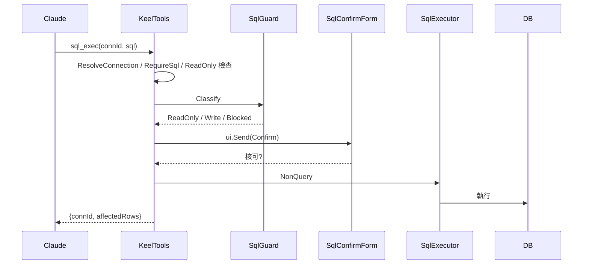

##### sql_query

- **請求格式**：`connId`、`sql`（必填）；`maxRows`（預設 200，夾在 1–1000）、`timeoutSec`（預設 30，夾在 1–300）。
- **回應格式**：`{connId, columns, rows, rowCount, truncated, elapsedMs}`。
- **主要驗證規則**：`connId` 空白 → `缺少 connId`；不存在 → `找不到連線「x」，請向 Arlen 確認正確的 SQLConnID。`（不列出可用代號）；`sql` 空白 → `缺少 sql`；`SqlGuard` 判 Blocked → `語句遭拒：…`；判 Write → 要求改用 `sql_exec`。

##### sql_exec

- **請求格式**：`connId`、`sql`（必填）；`timeoutSec`（預設 60，夾在 1–300）。
- **回應格式**：`{connId, affectedRows}`。
- **主要驗證規則**：同上；唯讀連線 → `連線「x」為唯讀，不允許寫入。`；Blocked 拒絕；ReadOnly 語句仍可執行但確認視窗會提示可改用 `sql_query`；Arlen 取消 → `Arlen 取消了這次 SQL 執行。`
- **資料表更新**：由 SQL 內容決定（外部資料庫）。

詳細安全設計（三層防線、DPAPI）屬 Db 模組，本文件未深入。

---

#### SSH 類

| 工具 | 參數 | 回應 | 驗證／行為 |
|------|------|------|-----------|
| ssh_exec | `sshId`、`command`（必填）、`timeoutSec`（0 = 用設定預設，上限 1800） | `{sshId, exitCode, cwd, output, truncated, timedOut, elapsedMs}` | `command` 空白 → `缺少 command`；`connections.Resolve` 驗證代號；每條指令經 `SshConfirmForm` 確認，拒絕 → `Arlen 取消了這次遠端指令執行。`；執行在執行緒池 await |
| ssh_status | `sshId` | `SshSessionManager.Status` 結果 | 不主動連線 |
| ssh_open | `sshId` | `{sshId, opened: true}` | 建立連線並把終端視窗帶到前景 |
| ssh_close | `sshId` | `{sshId, closed}` | 斷線並清除持續 shell 的 cwd／環境變數 |

業務流程：與 SQL 類相同（解析代號 → `ui.Send` 確認視窗 → 執行緒池執行）。`SshEnabled=false` 時由 `SshSessionManager` 拒絕。SSH 細節本文件未深入。

---

#### Python 沙盒類

| 工具 | 參數 | 回應 | 驗證／行為 |
|------|------|------|-----------|
| python_run | `code`（必填）、`readPaths`（選填字串陣列） | `{ok, stdout, stderr, value, error, truncated, elapsedMs, outputs[{name,path,bytes}], outputsTruncated}` | `code` 空白 → `缺少 code`；先全部 `ResolveInputFile`（黑名單、大小上限）再一次顯示確認視窗；拒絕 → `Arlen 拒絕了這次的檔案讀取要求。`；檔案以檔名掛到沙盒 `input/`；`/output` 內容經 `ResolveOutputFile` 落地（同名不覆蓋） |
| list_sandbox_files | `pattern`（選填） | `{inputDir, count, files[{path, bytes, modifiedAt}]}` | 不需確認 |
| sandbox_info | 無 | `{available, disabledReason, root, inputDir, outputDir, readOnly, network:false, timeoutSeconds, memoryLimitMb, maxFileSizeMb, python, packages, notes}` | `packages` 含 numpy 2.4.3、pandas 3.0.2、openpyxl 3.1.5、Pillow 12.2.0、python-dateutil、pytz、six |

業務流程與 SQL 類相似：解析 → 確認 → `await sandbox.RunAsync` → 寫出檔案。沙盒內部本文件未深入。

---

#### 用量類

##### get_usage_5h

- **功能描述**：回報 5 小時（session）額度用量。只讀托盤輪詢的共享快照，🔑 不可改成即時打官方 API（429 桶）。
- **請求格式**：無參數。
- **回應格式**：`{window:"5h", utilization, remainingPercent, severity, resetsAt, resetsInMinutes, snapshotAt, snapshotAgeSeconds}`。
- **主要驗證規則**：無快照 → `目前沒有用量快照…`；快照無 5h 視窗 → `用量回應中找不到 5 小時視窗資料…`。
- **業務流程**：`UsageProvider.Current` → `FiveHour`（優先 `limits[]` 的 session）→ 取 `limits[]` session 的 `severity` → 計算剩餘分鐘（不低於 0）。

---

#### 輔助方法

| 方法 | 用途 |
|------|------|
| `Reportable(Func<object>)` / `ReportableAsync` | 一般例外轉 `McpException` |
| `ResolveConnection` | 取 SQL 連線；錯誤訊息不列代號 |
| `RequireSql` | 空白檢查 + Trim |
| `ParseStartOrNow` | 行事曆起始時間；失敗回現在 |
| `TryParseFireAt` | 鬧鐘時間；`HH:mm` 已過排明天 |
| ~~`ParseTags`~~ | 2026/11/10 隨記憶模組移除 |

### 測試案例

| 測試場景 | 輸入條件 | 預期結果 | 驗證重點 |
|----------|----------|----------|----------|
| 鬧鐘：時分已過 | `set_alarm at="08:00"`，現在 09:00 | fireAt 為明天 08:00 | `TryParseFireAt` 跨日 |
| 鬧鐘：無效時間 | `at="abc"` | 錯誤 `無法解析時間：abc` | 例外傳回 |
| 計時：非正數 | `set_timer minutes=0` | 錯誤 `minutes 需 > 0` | 驗證 |
| 計時：舊參數 | `set_timer minutes=5 action="music-stop"` | 工具 schema 已無 `action`；建立的任務 action=Alarm | 音樂移除後相容性 |
| 取消不存在任務 | `cancel_task id="xxxx"` | 錯誤 `找不到該任務` | — |
| 通知 | `notify` 無參數 | 響一次 + 視窗顯示「Keel 有重要訊息！」 | 不寫 tasks.json |
| 會議同步去重 | 連續呼叫兩次 `calendar_sync_alarms` | 第二次 `added=0`、`skippedDup>0` | 標籤去重 |
| 行程時間錯置 | `calendar_add end` 早於 `start` | 錯誤 `end 不可早於 start` | — |
| SQL 寫入走 query | `sql_query sql="DELETE …"` | 錯誤，提示改用 sql_exec | SqlGuard |
| SQL 不存在代號 | `sql_query connId="nope"` | 錯誤訊息不含其他代號 | 不可列舉 |
| 唯讀連線寫入 | `sql_exec` 唯讀 connId | 錯誤 `為唯讀，不允許寫入` | — |
| 沙盒讀憑證 | `python_run readPaths=["…\\appsettings.json"]` | 直接拒絕，不跳視窗 | 黑名單 |
| 用量無快照 | 啟動後尚未輪詢 | 錯誤 `目前沒有用量快照…` | 不即時打 API |
| 已移除工具 | 呼叫 `play_music` / `memory_get` | `tools/call` 回找不到工具 | 移除完整 |

### 認證與安全機制

- **代號制**：SQL（`connId`）、SSH（`sshId`）只接受代號；`ResolveConnection` 錯誤訊息刻意不列出可用代號。🔑 不可新增列舉連線的工具。
- **人工確認**：`sql_exec`、`ssh_exec`、`python_run`（有 readPaths）。
- **SQL Injection**：工具本身就是執行任意 SQL；防護靠 DB 唯讀帳號、`SqlGuard`、唯讀交易三層。
- **敏感資料**：DB 例外的主機名與帳號由 `SqlExecutor` 遮蔽，才允許 `Reportable` 透出訊息。

### 例外處理

| 類型 | 格式 | 說明 |
|------|------|------|
| 業務錯誤 | `ArgumentException`（參數）、`InvalidOperationException`（狀態） | 中文訊息，說明原因與下一步 |
| 透出給 Claude | `McpException(message)` | 經 `Reportable` 包裝 |
| 未包裝例外 | SDK 通用錯誤 + `mcp-error.log` | 鬧鐘、行事曆、錄音類 |

### 外部系統整合

| 服務 | 設定項目 | 呼叫方式 |
|------|----------|----------|
| Outlook 桌面版 | 無 | COM late-binding（`calendar_*`） |
| MSSQL / PostgreSQL | `dbconnections.json` | `SqlExecutor` |
| SSH 主機 | `sshconnections.json`、`Ssh*` 設定 | `SshSessionManager` |
| Pyodide（WebView2） | `Sandbox*` 設定 | `PyodideRunner` |
| Hugging Face | `TranscriptionModelPath` | `ModelDownloader` |
| Anthropic usage API | `OAuthClientId`、`PollIntervalSeconds` | 托盤輪詢（工具只讀快照） |

### 資料庫架構

| 項目 | 說明 |
|------|------|
| 主要資料表 | 本模組無此項目；持久化檔：`tasks.json`、`dbconnections.json`、`sshconnections.json` |
| 外部 Web Service 依賴 | 見上表 |
| 資料庫連線 | 由 `DbConnectionStore` 以 DPAPI 保存，工具端不接觸連線字串 |

---

## Tray 托盤組裝根

### 核心功能列表

- ⭐ `Program.Main`：`[STAThread]`、Mutex `KeelAssistant.SingleInstance` 防多開、`using` 包住 context 確保 Dispose、最後 `Environment.Exit(0)`
- ⭐ `TrayApplicationContext` 建構子依序建立所有模組單例並注入 `McpHost`
- ✅ 托盤選單每次 `Opening` 由 `RebuildMenuItems` 全部重建
- ✅ 選單區塊：時間、鬧鐘／計時（含取消、同步今日會議、停止響鈴）、會議錄音、SQL 連線、SSH、LINE 提醒、Claude 用量、MCP 位址、重新整理、結束
- ✅ 用量輪詢：間隔 `max(180, PollIntervalSeconds)`；無 `claude` 行程時退避 10 分鐘
- ✅ 錄音中托盤圖示改紅點；轉逐字稿進度顯示在 Tooltip
- ❌ 托盤「🎵 音樂」選單（2026/11/10 移除）

### 系統架構

#### 建構流程

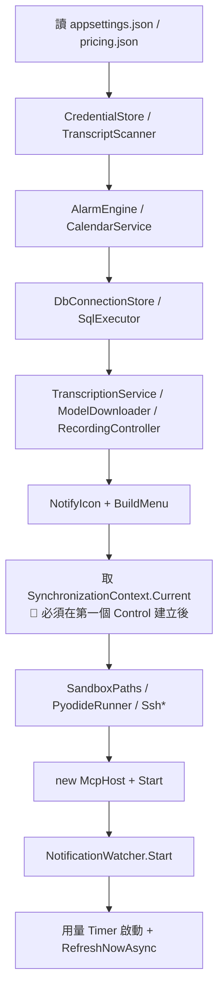

#### 用量輪詢序列

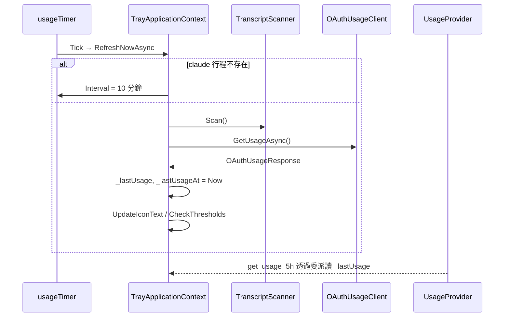

### 模組專屬資料結構

| 欄位 | 說明 |
|------|------|
| `_lastUsage` / `_lastUsageAt` | 用量快照與取得時間；失敗時兩者都清為 null |
| `_notified` | 各視窗已通知的門檻，避免重複跳警示 |
| `_busy` | 防止輪詢重入 |
| `_uiContext` | UI `SynchronizationContext`，供 McpHost、沙盒、SSH 使用 |

### 核心業務邏輯

- **檔案位置**：`TrayApplicationContext.cs`、`Program.cs`
- **核心概念**：組裝根 + 托盤 UI + 用量輪詢。
- **關鍵限制**：
  - 🔑 `SynchronizationContext.Current` 必須在 `BuildMenu()` 之後取得，否則為 null。
  - 🔑 `McpHost.Start()` 失敗只跳氣泡，不讓程式結束。
  - 無 Claude Code 行程時不查用量，避免 Keel 自行 refresh token 讓 Claude Code 端登入失效。
- **SyncTodayMeetings**：托盤版的會議同步，固定今天整天、提前 10 分鐘，邏輯與 `calendar_sync_alarms` 相同（另有實作，非共用方法）。
- **Dispose 順序**：`_api.Stop()` → 用量 Timer → `_alarm` → 錄音／轉檔／模型 → SQL 視窗 → 通知 → 沙盒 → SSH → 托盤圖示。

### API 規格

本模組無此項目（不直接公開工具；透過 McpHost 公開）。

### 測試案例

| 測試場景 | 輸入條件 | 預期結果 | 驗證重點 |
|----------|----------|----------|----------|
| 重複啟動 | 已有一個實例時再執行 exe | 第二個行程立刻結束 | Mutex |
| 埠被占用 | ApiPort 已被使用 | 跳「Keel MCP 啟動失敗」氣泡，托盤可用 | 例外不擴散 |
| 結束 | 右鍵「結束」 | 行程完全退出，無殘留 msedgewebview2 | Dispose + Exit |
| 無 Claude Code | 關閉所有 claude.exe | 狀態列顯示暫停，10 分鐘後重試 | 退避 |
| 托盤選單 | 開啟選單 | 無「音樂」項目 | 移除完整 |

### 認證與安全機制

- 托盤讀取本機 OAuth 憑證（`CredentialStore`）呼叫官方 usage API；細節屬 Usage 模組。
- SQL、SSH 連線設定只能經托盤視窗維護（DPAPI 加密），不能手動編輯 json。

### 例外處理

- 用量取得失敗：`_statusLine` 顯示 `取得失敗：{訊息}`，快照清空。
- 同步今日會議失敗：錯誤氣泡。
- 開啟錄音視窗失敗：錯誤氣泡。

### 外部系統整合

| 服務 | 用途 |
|------|------|
| Anthropic OAuth usage API | 用量輪詢 |
| Windows 通知中心 | `NotificationWatcher` |
| Outlook | 同步今日會議 |

### 資料庫架構

本模組無此項目。

---

## 附錄

### 代碼對照表

| 代碼 | 值 | 說明 |
|------|----|------|
| ScheduledAction | Alarm | 響鈴 |
| ScheduledAction | MusicStop | 僅相容舊 tasks.json，到期略過，不可新建 |
| 錄音 state | idle / recording / paused | `get_recording_status` |
| 轉檔 status | queued / running / completed / failed | `get_transcription_status` |
| SqlKind | ReadOnly / Write / Blocked | `SqlGuard` 判定 |
| DbProvider | Mssql / Postgresql | SQL 連線種類 |
| SshAuthMode | PrivateKey / Password | SSH 認證 |

### 外部元件參考

| 套件 | 版本 | 功能 |
|------|------|------|
| ModelContextProtocol.AspNetCore | 1.4.0 | MCP Server |
| Microsoft.AspNetCore.App | 框架 | Kestrel |
| Microsoft.Web.WebView2 | 1.0.2792.45 | 沙盒、SSH 終端 |
| NAudio | 2.3.0 | 錄音 |
| Whisper.net / Runtime | 1.9.1 | 逐字稿 |
| Microsoft.Data.SqlClient / Npgsql | 5.2.2 / 8.0.5 | SQL |
| System.Security.Cryptography.ProtectedData | 8.0.0 | DPAPI |
| SSH.NET | 2026.0.0 | SSH |
| Outlook.Application（COM） | 不綁版本 | 行事曆 |

### 常見問題排查

| 問題現象 | 可能原因 | 排查步驟 | 解決方案 |
|----------|----------|----------|----------|
| Claude 看不到 keel 工具 | exe 未啟動或未註冊 | 托盤選單看 MCP 位址；`claude mcp list` | 啟動 exe 後新開 session |
| 工具回「An error occurred」 | 未包 `Reportable` 的工具拋例外 | 看 exe 目錄 `mcp-error.log` | 依訊息修正參數 |
| MCP 啟動失敗氣泡 | 埠被占用 | `netstat -ano` 查 38600 | 改 `ApiPort` 重啟 |
| 呼叫 play_music / memory_* 失敗 | 工具已移除 | — | 改用其他方式 |
| 程式看起來當掉、鬧鐘延遲 | `UiDispatcher.Send` 包了耗時操作 | 檢查新加的工具 | 改用執行緒池 await |
| 用量一直「Claude Code 未執行」 | 找不到 `claude` 行程 | 工作管理員確認行程名 | 啟動 Claude Code |
| 結束後行程殘留 | 新模組未 Dispose | 檢查 `Dispose(bool)` | 補釋放 |

### 名詞解釋

| 名詞 | 定義 |
|------|------|
| MCP | Model Context Protocol，LLM 呼叫外部工具的協定 |
| Streamable HTTP | MCP 的 HTTP transport |
| Stateless | 每個請求不保留 session，多個 Claude session 共用同一伺服器 |
| STA | Single-Threaded Apartment，WinForms 與 Outlook COM 需要的執行緒模型 |
| 組裝根 | 集中建立物件並注入相依的位置 |
| 代號制 | Claude 只拿到 connId／sshId，看不到主機與帳密 |

### 相關文件

- `README.md`、`MCP-Setup.md`
- `_Docs/鬧鐘排程.md`（AlarmEngine、CalendarService 細節）
- 專案 `CLAUDE.md` 架構段落

### 環境特殊說明

- Windows 10 19041 以上（WinRT 通知 API）。
- 日期顯示統一 `yyyy/MM/dd HH:mm`（以 `\\/` 跳脫，不受地區設定影響）。
- 設定檔與持久化檔都在 exe 目錄（`AppContext.BaseDirectory`）。
