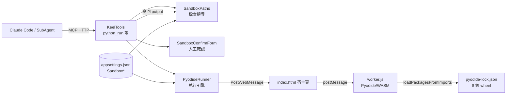
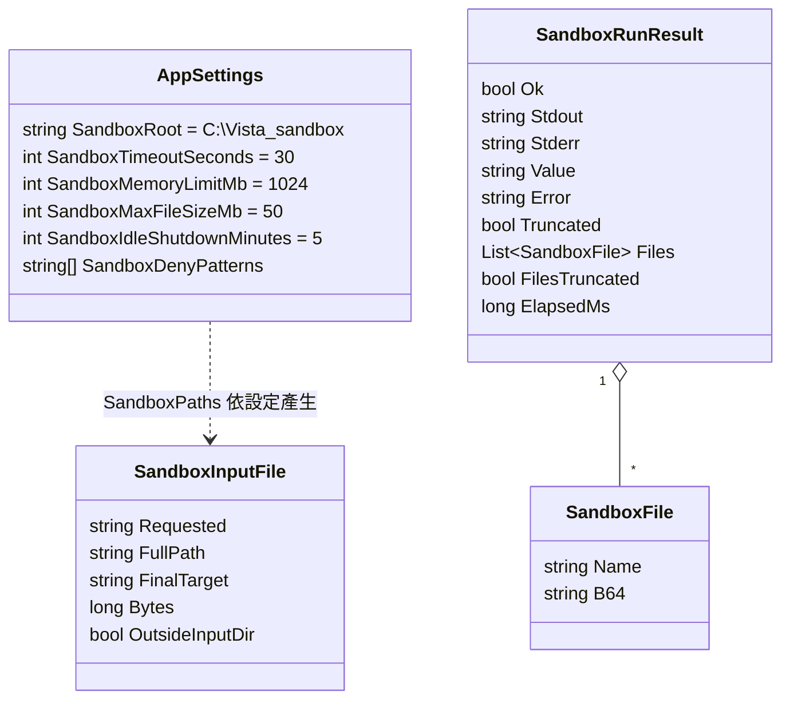
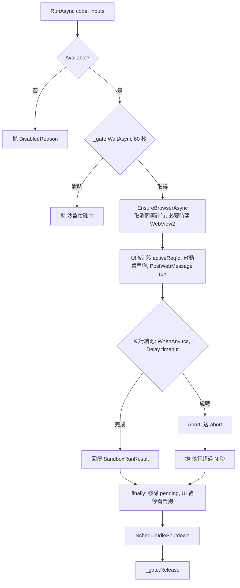
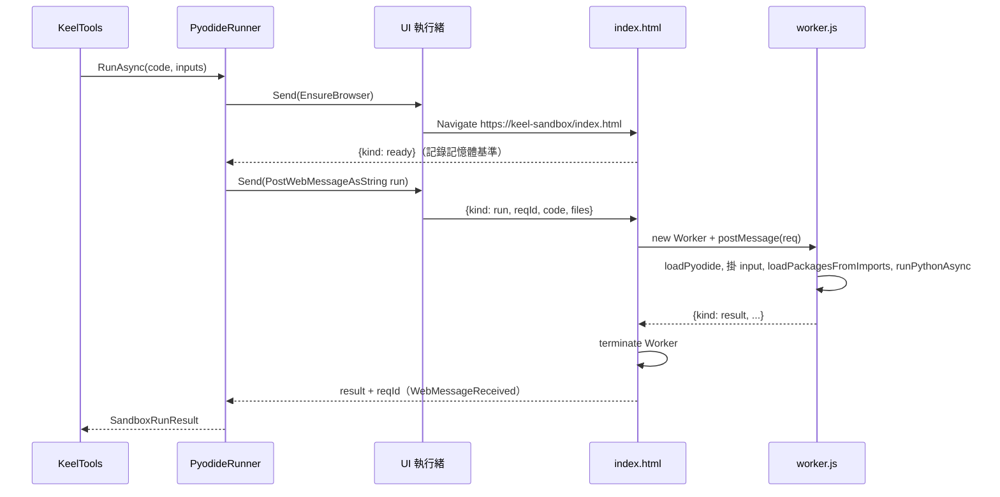
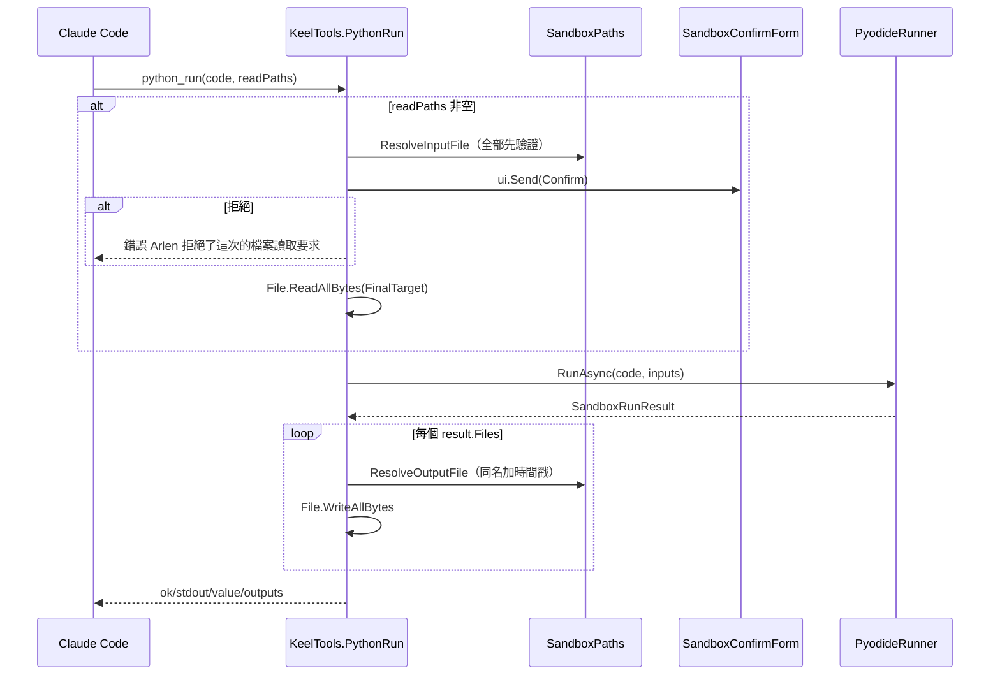
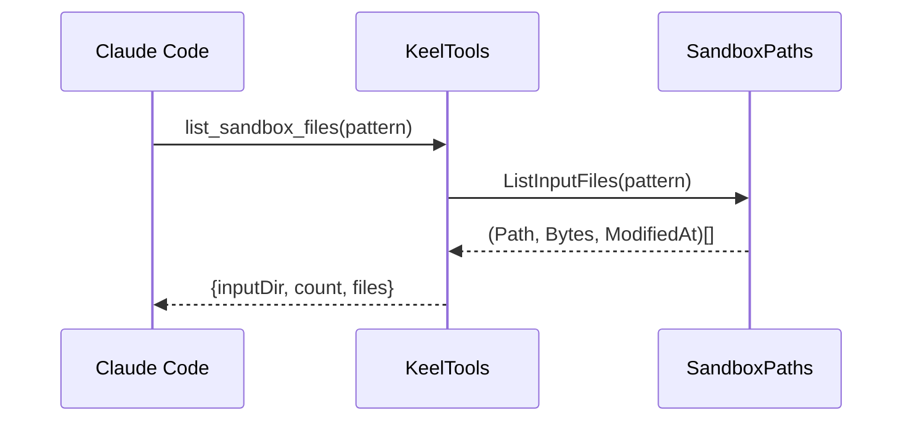
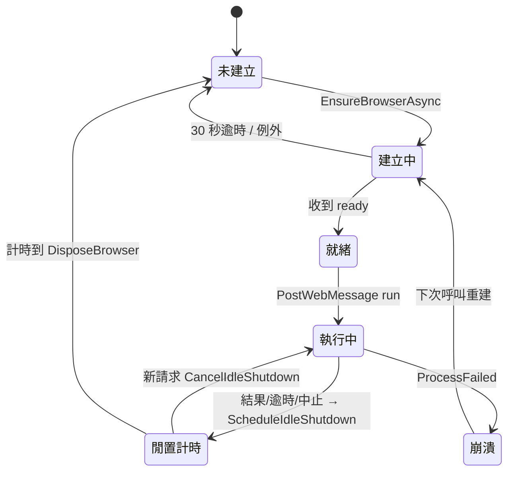
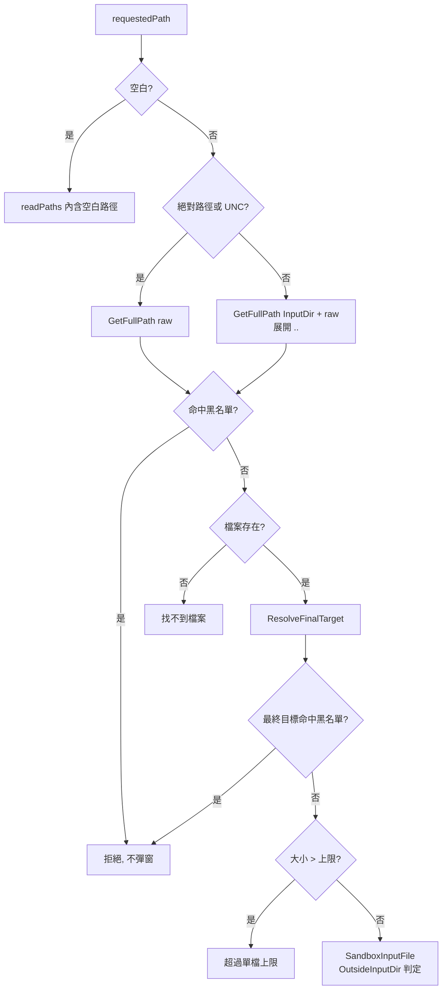
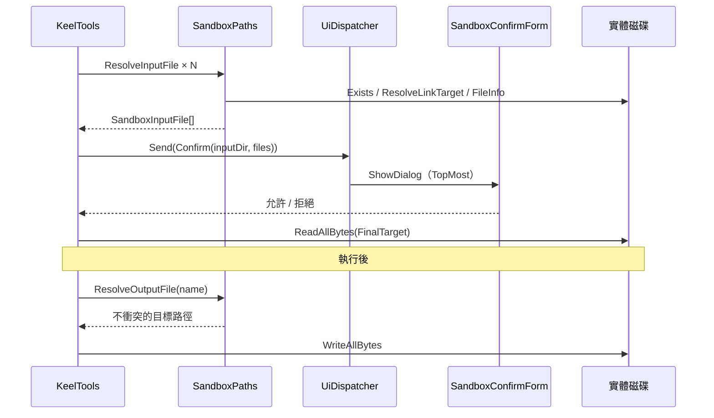
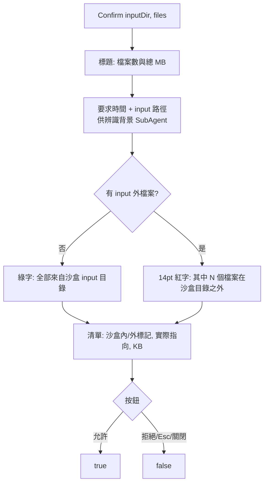

# Python 沙盒

## 目錄

- [文件資訊](#文件資訊)
- [系統概述](#系統概述)
- [共用資料結構](#共用資料結構)
- [PyodideRunner 執行引擎](#pyodiderunner-執行引擎)
- [SandboxPaths 檔案邊界與人工確認](#sandboxpaths-檔案邊界與人工確認)
- [附錄](#附錄)

---

## 文件資訊

| 項目 | 內容 |
|------|------|
| 系統名稱 | Keel Assistant（系統匣常駐助理，.NET 8 WinForms + 內嵌 MCP Server） |
| 模組位置 | `Sandbox/`、`wwwroot/sandbox/` |
| 業務邏輯位置 | `Sandbox/PyodideRunner.cs`、`Sandbox/SandboxPaths.cs`、`wwwroot/sandbox/worker.js` |
| MCP 工具位置 | `Api/KeelTools.cs`（`python_run`、`list_sandbox_files`、`sandbox_info`） |
| 最後更新 | 2026/11/12 |

### 版本歷史

| 版本 | 日期 | 異動內容 | 異動人員 |
|------|------|----------|----------|
| 1.0 | 2026/07/23 | 新增 Python 沙盒模組（Pyodide 314.0.2 / WASM），提供 `python_run`、`list_sandbox_files`、`sandbox_info` | Arlen |
| 1.1 | 2026/10/06 | `sandbox_info` 的套件清單加入 Pillow 12.2.0（圖片處理，如去背） | Arlen |
| 1.2 | 2026/11/12 | `pyodide-lock.json` 新增 `pillow` 項目（`pillow-12.2.0-cp314-cp314-pyemscripten_2026_0_wasm32.whl`，sha256 `a50d83a8…f575a9`，imports `PIL`，無相依），wheel 檔隨程式打包；本文件首次建立 | Arlen |

### 所有相關程式位置

```
KeelAssistant/
├── Sandbox/
│   ├── PyodideRunner.cs        # 執行引擎：WebView2 生命週期、序列化、逾時、記憶體看門狗、閒置回收
│   ├── SandboxPaths.cs         # 檔案邊界：根目錄、黑名單、連結解析、輸出不覆蓋
│   └── SandboxConfirmForm.cs   # 讀檔前人工確認視窗
├── wwwroot/sandbox/
│   ├── index.html              # 宿主頁：Worker 生命週期 + .NET 訊息轉送
│   ├── worker.js               # 執行 Worker：載入 Pyodide、虛擬 FS、取回 /output
│   └── pyodide/
│       ├── pyodide.mjs / pyodide.asm.mjs / pyodide.asm.wasm / python_stdlib.zip
│       ├── pyodide-lock.json   # 裁剪過的 lockfile（只列 8 個打包 wheel）
│       └── *.whl               # numpy, pandas, python-dateutil, pytz, six, openpyxl, et-xmlfile, Pillow
├── Api/
│   ├── KeelTools.cs            # python_run / list_sandbox_files / sandbox_info / ReportableAsync
│   └── McpHost.cs              # AddSingleton(sandbox, sandboxPaths)、UiDispatcher
├── Models/Models.cs            # AppSettings.Sandbox*、SandboxRunResult、SandboxFile
└── TrayApplicationContext.cs   # new SandboxPaths(_settings)、new PyodideRunner(...)
```

---

## 系統概述

### 簡介

Python 沙盒讓 Claude Code（Keel）以 MCP 工具 `python_run` 執行 LLM 產生的 Python。程式在 WebView2 內的 Pyodide（CPython 3.14 編譯成 WebAssembly）執行。WASM 沒有 syscall、沒有真實檔案系統、沒有 socket，所以誤產生的 `shutil.rmtree` 或 `requests.get` 不會生效。

真正接觸實體磁碟的動作只有兩個：執行前把輸入檔讀進虛擬 FS，執行後把虛擬 `/output` 寫回實體目錄。這兩個動作都經 `SandboxPaths` 驗證。

### 在整體系統中的定位

- 屬於 Keel Assistant 內嵌 MCP Server（`127.0.0.1:38600/mcp`，`Stateless=true`）的一組工具。
- 取代「用 PowerShell 直接跑本機 python」的作法。
- 多個 Claude Code session 與 SubAgent 共用同一個行程，沒有 session 身分可區分。

### 核心價值主張

- 威脅模型是「誤傷」，不是「刻意逃逸」。WASM 對誤傷是完備的，因此不採 Docker 容器（省掉常駐與映像維護）。
- 純計算不打擾 Arlen；只有讀實體檔案時才彈窗確認。

### 模組關係圖



---

## 共用資料結構



| 類別 | 位置 | 用途 |
|------|------|------|
| `AppSettings`（Sandbox* 欄位） | `Models/Models.cs` | 沙盒設定，從 `appsettings.json` 讀入 |
| `SandboxInputFile` | `Sandbox/SandboxPaths.cs` | 解析後的輸入檔；`OutsideInputDir` 決定確認視窗是否紅字警示 |
| `SandboxRunResult` | `Models/Models.cs` | Worker 回傳的結果（JSON camelCase 反序列化） |
| `SandboxFile` | `Models/Models.cs` | `/output` 取回的檔案（相對路徑 + Base64） |

🔑 設定值與限制（建構子以 `Math.Clamp` 鉗制）：

| 設定 | 預設 | 允許範圍 | 用途 |
|------|------|----------|------|
| `SandboxRoot` | `C:\Vista\_sandbox` | 必須是絕對路徑 | 沙盒根目錄；下有 `input/`、`output/` |
| `SandboxTimeoutSeconds` | 30 | 1–300 | 單次執行逾時 |
| `SandboxMemoryLimitMb` | 1024 | 128–8192 | 相對基準值的記憶體增量上限 |
| `SandboxMaxFileSizeMb` | 50 | 1–2048 | 單一輸入檔上限 |
| `SandboxIdleShutdownMinutes` | 5 | 0–240 | 閒置多久銷毀 WebView2；0 = 每次跑完立即銷毀 |
| `SandboxDenyPatterns` | 15 條（見附錄） | — | 機敏檔黑名單 |

---

## PyodideRunner 執行引擎

### 核心功能列表

- ⭐ 併發三設計：`SemaphoreSlim(1,1)` 全域序列化、每次執行新建 Worker 跑完即銷毀、逾時等待跑在執行緒池而非 `UiDispatcher`
- ⭐ 專屬 WebView2 user data folder（`webview2-sandbox/`），記憶體歸屬可算
- ⭐ WebView2 用時才建、閒置 `SandboxIdleShutdownMinutes` 後整組銷毀
- ⭐ 裁剪過的 `pyodide-lock.json`：未打包套件直接失敗，不去 CDN
- ✅ 逾時硬殺（`worker.terminate()`），可停下無窮迴圈
- ✅ 記憶體看門狗（每 500ms 量測 WebView2 行程群組 WorkingSet）
- ✅ renderer 崩潰（`ProcessFailed`）時等待中請求立即失敗
- ✅ stdout/stderr 各 8000 字元上限；取回檔案總量 200MB 上限
- ✅ 最後一行運算式的 repr 回傳（REPL 行為）
- ✅ 執行失敗仍取回 `/output` 已產出檔案
- ❌ 不支援 `pip install`、網路存取、跨次保留變數或檔案

### 技術堆疊

| 項目 | 內容 |
|------|------|
| 開發框架 | .NET 8 WinForms（`net8.0-windows10.0.19041.0`） |
| 執行環境 | Microsoft WebView2（`Microsoft.Web.WebView2.WinForms`） |
| Python | Pyodide 314.0.2（CPython 3.14.0，emscripten 5.0.3，ABI 2026_0，wasm32） |
| 可用套件 | numpy 2.4.3、pandas 3.0.2、openpyxl 3.1.5、Pillow 12.2.0、python-dateutil 2.9.0.post0、pytz 2026.1.post1、six 1.17.0、et-xmlfile 2.0.0 |
| 服務形式 | MCP 工具（Streamable HTTP，ModelContextProtocol.AspNetCore） |
| ORM / 資料庫 | 本模組無此項目 |
| 日誌系統 | 共用 `mcp-error.log`（Warning 以上，McpHost 設定） |
| 加密方式 | 本模組無此項目 |
| MQ 系統 | 本模組無此項目 |

### 系統架構

#### 專案結構

```
Sandbox/PyodideRunner.cs
wwwroot/sandbox/index.html     # 透過虛擬主機 https://keel-sandbox/ 載入
wwwroot/sandbox/worker.js      # module worker
wwwroot/sandbox/pyodide/       # Pyodide 本體 + lockfile + wheel
webview2-sandbox/              # 執行期產生，不進版控
```

#### 核心執行流程圖



#### 多執行緒架構

| 執行緒 | 負責 | 功能 | 控制參數 |
|--------|------|------|----------|
| MCP 請求執行緒（執行緒池） | `RunAsync` | 排隊、等待結果、逾時判定 | `QueueWaitMs=60000`、`SandboxTimeoutSeconds` |
| UI 執行緒（經 `UiDispatcher.Send`） | 建立/銷毀 WebView2、`PostWebMessageAsString`、看門狗與閒置 Timer | 只做瞬間動作 | `BrowserInitMs=30000`、`WatchdogIntervalMs=500` |
| WebView2 renderer（獨立行程樹） | `index.html` 宿主頁 | Worker 管理、訊息轉送 | — |
| Web Worker | `worker.js` | 載入 Pyodide、執行 Python | `MAX_STREAM_CHARS=8000`、`MAX_OUTPUT_BYTES=200MB` |

🔑 UI 執行緒上還跑著 `AlarmEngine` 的 1 秒 Timer 與錄音的 100ms pump。30 秒的等待若包在 `UiDispatcher.Send` 裡，會讓鬧鐘延遲、錄音掉資料。所以等待一律在執行緒池上 `await TaskCompletionSource`，只把「送出請求」與「取消/銷毀」切回 UI 執行緒。

#### 整合架構序列圖



### API 規格

#### 通用設定

| 項目 | 內容 |
|------|------|
| 服務類型 | MCP（Model Context Protocol）工具 |
| 服務端點 | `http://127.0.0.1:38600/mcp`（埠由 `ApiPort` 決定） |
| Content-Type | `application/json`（JSON-RPC over Streamable HTTP） |
| 認證方式 | 無；只綁 `IPAddress.Loopback` |
| 字元編碼 | UTF-8 |
| 資料格式 | 工具參數與回傳為 JSON 物件；錯誤以 `McpException(訊息)` 透出 |

#### python_run

**功能描述**：在 WASM 沙盒執行 Python。用於計算、資料處理、讀 Excel/CSV、圖片處理（Pillow）。

**請求格式**：

| 參數 | 型態 | 必填 | 說明 |
|------|------|------|------|
| `code` | string | 是 | Python 程式碼 |
| `readPaths` | string[] | 否 | 要讀的檔案；絕對路徑，或相對於沙盒 `input/` 的路徑。沙盒內一律以「檔名」掛在 `input/`（不保留來源目錄結構） |

**回應格式**：

- 成功或 Python 例外：`{ ok, stdout, stderr, value, error, truncated, elapsedMs, outputs: [{name, path, bytes}], outputsTruncated }`
  - `ok=false` 時 `error` 含完整 traceback，`outputs` 仍含已寫出的檔案。
- 失敗（McpException 訊息）：缺少 code、黑名單命中、找不到檔案、超過單檔上限、Arlen 拒絕、沙盒忙碌、逾時、記憶體超標、行程崩潰、環境啟動逾時。

**業務流程**：



**主要驗證規則**：

- `code` 不可空白。
- `readPaths` 先全部解析驗證，再一次顯示確認視窗（不邊問邊讀）。
- 黑名單在存在性檢查之前比對，連結解析後的最終目標也比對。
- 單檔大小 ≤ `SandboxMaxFileSizeMb`。
- 輸出檔名不可為絕對路徑，不可超出 `output/`。

**資料表更新**：

| 資料表 | 操作 | 說明 |
|--------|------|------|
| （檔案）`{SandboxRoot}\output\…` | 新增 | 取回 `/output` 內容；同名不覆蓋，加 `_yyyyMMdd_HHmmss[_n]` |

**觸發的外部呼叫**：WebView2 runtime（本機）；無任何網路請求（資源走虛擬主機 `keel-sandbox` 對應本機資料夾）。

#### list_sandbox_files

**功能描述**：列出沙盒 `input/` 下的檔案，供指定 `readPaths` 前確認。不需人工確認。

**請求格式**：`pattern`（string，選填，例 `*.csv`；省略為 `*`，含子目錄）。

**回應格式**：
- 成功：`{ inputDir, count, files: [{ path(相對, / 分隔), bytes, modifiedAt(yyyy/MM/dd HH:mm:ss) }] }`，依完整路徑排序。
- 失敗：沙盒不可用時回 `DisabledReason`。

**業務流程**：



**主要驗證規則**：`EnsureAvailable()`。

**資料表更新**：本工具無此項目（唯讀）。

**觸發的外部呼叫**：本工具無此項目。

#### sandbox_info

**功能描述**：查詢沙盒目前設定。路徑可能變動，需要路徑時先查此工具，不沿用記憶。

**請求格式**：無參數。

**回應格式**：`{ available, disabledReason, root, inputDir, outputDir, readOnly: true, network: false, timeoutSeconds, memoryLimitMb, maxFileSizeMb, python: "3.14 (Pyodide 314.0.2 / WebAssembly)", packages: ["numpy 2.4.3","pandas 3.0.2","openpyxl 3.1.5","Pillow 12.2.0","python-dateutil","pytz","six"], notes }`

**業務流程**：直接讀 `PyodideRunner` 與 `SandboxPaths` 的屬性，無外部互動（流程同上圖，略）。

**主要驗證規則**：無；不可用時仍回傳 `available=false` 與原因。

**資料表更新**：本工具無此項目。

**觸發的外部呼叫**：本工具無此項目。

> 🔑 `packages` 清單是寫死在 `KeelTools.cs` 的字串，與 `pyodide-lock.json` 分開維護。新增 wheel 時兩處都要改。

#### 測試案例

| 測試場景 | 輸入條件 | 預期結果 | 驗證重點 |
|----------|----------|----------|----------|
| 純計算 | `code="1+1"` | `ok=true, value="2"`，不彈窗 | repr 回傳、不打擾 |
| 讀 input 內檔案 | `readPaths=["a.csv"]` | 彈窗綠字「全部來自沙盒 input 目錄」 | 相對路徑解析 |
| 讀外部檔案 | 絕對路徑 `D:\x.xlsx` | 彈窗紅字警示 | `OutsideInputDir=true` |
| 讀憑證 | `readPaths=["C:\…\appsettings.json"]` | 直接拒絕、不彈窗 | 黑名單先於存在性 |
| 連結繞過 | input 內 `data.csv` 連到 `dbconnections.json` | 拒絕 | 比對 `FinalTarget` |
| 無窮迴圈 | `while True: pass` | 30 秒後「執行超過 30 秒已強制中止」 | `terminate()` 硬殺 |
| 記憶體爆量 | 配置數 GB 陣列 | 「記憶體用量超過 N MB 上限」或「沙盒行程異常結束」 | 看門狗 / ProcessFailed |
| 未打包套件 | `import scipy` | `ok=false`，載入失敗訊息（非逾時） | 裁剪 lockfile |
| Pillow | `from PIL import Image` | 正常載入 | 2026/11/12 新增 wheel |
| pandas 寫 Excel | `df.to_excel("output/r.xlsx")` | `outputs` 含 r.xlsx | openpyxl 掛為 pandas 相依 |
| 同名輸出 | 連跑兩次寫 `output/r.csv` | 第二個為 `r_yyyyMMdd_HHmmss.csv` | 不覆蓋 |
| 中途失敗 | 寫檔後 `raise` | `ok=false` 且 `outputs` 有檔 | 失敗仍 harvest |
| 併發 | 兩個 session 同時呼叫 | 依序執行；等候超過 60 秒回「沙盒忙碌中」 | `SemaphoreSlim` |

### 資料結構定義

**主要資料物件**：見[共用資料結構](#共用資料結構)。另有 WebView2 訊息協定：

| 方向 | kind | 欄位 | 說明 |
|------|------|------|------|
| .NET → 頁面 | `run` | `reqId`(8 碼 GUID)、`code`、`files[{name,b64}]` | 啟動一次執行 |
| .NET → 頁面 | `abort` | — | 逾時或記憶體超標，頁面 `terminate()` 後不回報 |
| 頁面 → .NET | `ready` | — | 頁面就緒；.NET 記錄記憶體基準 |
| 頁面 → .NET | `result` | `reqId`、`ok`、`stdout`、`stderr`、`truncated`、`value`、`error`、`files`、`filesTruncated`、`elapsedMs` | 執行結果；未知 `reqId`（逾時後才回來）丟棄 |

**資料表欄位說明**：本模組無資料表。`pyodide-lock.json` 的套件項目欄位如下：

| 欄位 | 型態 | 說明 | 備註 |
|------|------|------|------|
| `name` / `version` | string | 套件名與版本 | — |
| `file_name` | string | 同目錄下的 wheel 檔名 | 必須實際存在 |
| `sha256` | string | wheel 雜湊 | 取自官方 Pyodide 314.0.2 套件庫並驗證 |
| `imports` | string[] | `loadPackagesFromImports` 掃描用的頂層模組 | Pillow 為 `PIL` |
| `depends` | string[] | 相依套件 | `pandas` 刻意加 `openpyxl` |

### 核心業務邏輯

#### 併發三設計

- **檔案位置**：`Sandbox/PyodideRunner.cs`
- **核心概念**：MCP 為 `Stateless=true`，無 session 身分可區分。三個設計不可拿掉。

| 設計 | 實作 | 若拿掉會怎樣 |
|------|------|--------------|
| 全域序列化 | `SemaphoreSlim(1,1)`，等候上限 60 秒 | 共用直譯器，輸出交錯、變數互相覆寫 |
| 每次新 Worker | `index.html` 的 `startRun` 先 `killWorker()` 再 `new Worker`，收到 result 即 terminate | 全域變數、虛擬 FS、monkey-patch 跨次殘留 |
| 等待在執行緒池 | `Task.WhenAny(tcs.Task, Task.Delay)` 於執行緒池 await | 卡住 UI 執行緒，鬧鐘延遲、錄音掉資料 |

#### WebView2 生命週期與閒置回收



- **關鍵限制**：
  - 🔑 user data folder 固定為 `{BaseDirectory}\webview2-sandbox`，與其他 WebView2 分屬不同行程樹。沙盒不共用 cookie/storage，看門狗用 `_environment.GetProcessInfos()` 才能只算這組行程的記憶體。修改時請維持分開。
  - 宿主視窗移到 `(-32000,-32000)`、`Opacity=0`，而非隱藏：WebView2 在未顯示的視窗上不會完成初始化。
  - 用虛擬主機 `https://keel-sandbox/` 而非 `file://`：module worker 在 `file://` 下無法建立。
  - 常駐需 150–250MB 待機記憶體，因此用時才建。`SandboxIdleShutdownMinutes=0` 時每次跑完立即銷毀。實測銷毀後不殘留 `msedgewebview2.exe`。
- **執行邏輯說明**：`_host`、`_web`、`_environment`、Timer 等欄位只在 UI 執行緒讀寫，不加鎖。`EnsureBrowserAsync` 由已持有 `_gate` 的呼叫端進入，不會併發建立。

#### 記憶體看門狗與中止

- Pyodide 沒有 WASM 線性記憶體上限設定，只能從外部觀察。
- `ready` 時記錄基準 `_memoryBaseline`；每 500ms 算 `目前總 WorkingSet − 基準`，超過 `SandboxMemoryLimitMb` 就讓目前請求失敗並送 `abort`。
- `worker.terminate()` 是唯一能停下無窮迴圈的手段（Worker 內部無法自我中止）。
- 改用 `PostWebMessageAsString` 而非 `ExecuteScriptAsync`：Python 程式碼含大量引號與反斜線，走訊息通道不經 JS 解析器。

#### worker.js 執行步驟

1. `loadPyodide`（stdout/stderr 導入 `CappedText`，各 8000 字元）。
2. 建立虛擬 `/input`、`/output`、`/work`；把 `files` 解 Base64 寫入 `/input/{name}`。
3. `chdir('/work')`，並建 `/work/output → /output`、`/work/input → /input` 連結，讓 `output/x.csv` 與 `/output/x.csv` 指到同一處。
4. `loadPackagesFromImports(code)`：只載入實際 import 的套件。
5. `runPythonAsync(code)`；回傳值非 null 時 `String(value)` 當 `value`，並 `destroy()` PyProxy。
6. `harvest`：遞迴收集 `/output`（保留相對路徑），總量超過 200MB 標 `filesTruncated`。成功與失敗路徑都會執行。

#### 裁剪過的 pyodide-lock.json

- 只列 8 個隨程式打包的 wheel：numpy、pandas、python-dateutil、pytz、six、openpyxl、et-xmlfile、Pillow。
- 未列出的套件 → `loadPackagesFromImports` 直接失敗，而不是去 CDN 抓（沙盒無網路，否則會變成難懂的逾時錯誤）。
- `openpyxl` 刻意掛成 `pandas` 的相依：pandas 在 `to_excel` 內部才延遲 import，靜態掃描抓不到。
- 2026/11/12：新增 `pillow` 項目（`depends: []`，`imports: ["PIL"]`）。

### 外部系統整合

| 服務名稱 | 設定項目 | 呼叫的方法 |
|----------|----------|------------|
| Microsoft WebView2 Runtime | user data folder `webview2-sandbox` | `CoreWebView2Environment.CreateAsync`、`EnsureCoreWebView2Async`、`SetVirtualHostNameToFolderMapping`、`PostWebMessageAsString`、`GetProcessInfos` |
| Pyodide（本機打包） | `wwwroot/sandbox/pyodide/` | `loadPyodide`、`loadPackagesFromImports`、`runPythonAsync`、`FS.*` |

### 認證與安全機制

- **Token 認證機制**：本模組無此項目（MCP 只綁 loopback）。
- **安全規範**：
  - 隔離來自 WASM：無 syscall、無真實 FS、無 socket。
  - 不連外：所有資源來自本機虛擬主機；lockfile 裁剪避免 CDN 請求。
  - 停用右鍵選單與狀態列（`AreDefaultContextMenusEnabled=false`、`IsStatusBarEnabled=false`）。
  - 檔案邊界見 [SandboxPaths 檔案邊界與人工確認](#sandboxpaths-檔案邊界與人工確認)。

### 例外處理

- **例外處理模式**：`RunAsync` 以 `InvalidOperationException` 拋出可讀訊息；`KeelTools.ReportableAsync` 轉成 `McpException`，讓 Claude 讀到原因自我修正（其他例外 MCP SDK 只會回「An error occurred」）。Python 例外不拋，而是 `ok=false` + `error`（traceback）。
- **錯誤代碼格式**：

| 類型 | 訊息 | 來源 |
|------|------|------|
| 業務錯誤 | `沙盒忙碌中（已等候 60 秒仍未輪到），請稍後再試。` | `_gate` 逾時 |
| 業務錯誤 | `執行超過 {N} 秒已強制中止（常見原因是無窮迴圈或資料量過大）。` | 逾時 |
| 業務錯誤 | `記憶體用量超過 {N} MB 上限，已強制中止。` | 看門狗 |
| 系統例外 | `沙盒行程異常結束（{ProcessFailedKind}），常見原因是記憶體耗盡。` | `ProcessFailed` |
| 系統例外 | `沙盒執行環境啟動逾時（30 秒）。` | `EnsureBrowserAsync` |
| 系統例外 | `找不到沙盒執行環境：…\index.html` | `DisabledReason` |
| Python 例外 | `ok=false`，`error`=traceback | `worker.js` catch |
| Worker 崩潰 | `沙盒 Worker 異常終止：…` | `index.html` `onerror` |
| 初始化失敗 | `Pyodide 初始化失敗：…` | `worker.js` |

### 資料庫架構

- **主要資料表**：本模組無此項目。
- **外部 Web Service 依賴**：本模組無此項目（不連外）。
- **資料庫連線**：本模組無此項目。

---

## SandboxPaths 檔案邊界與人工確認

### 核心功能列表

- ⭐ 根目錄只能由 `appsettings.json` 的 `SandboxRoot` 決定，MCP 參數不可覆寫；啟動時正規化並快取
- ⭐ 機敏檔黑名單：先於存在性檢查、也比對連結最終目標；命中不彈窗、不給人為放行
- ⭐ 讀外部檔案時確認視窗以紅字警示；預設焦點在「拒絕」
- ✅ 相對路徑相對於 `input/`；接受絕對路徑與 UNC
- ✅ 輸出同名不覆蓋（加時間戳，同秒再加序號）
- ✅ 根目錄無效時停用工具，不 fallback 到其他目錄
- ❌ 不支援輸出到 `output/` 以外、不支援絕對輸出路徑

### 技術堆疊

| 項目 | 內容 |
|------|------|
| 開發框架 | .NET 8 WinForms |
| 路徑比對 | `Path.GetFullPath`、`File.ResolveLinkTarget(returnFinalTarget: true)`、`FileSystemName.MatchesSimpleExpression` |
| 服務形式 | 由 MCP 工具呼叫的類別庫；確認視窗經 `UiDispatcher` 顯示 |
| ORM / 資料庫 / 日誌 / 加密 / MQ | 本模組無此項目 |

### 系統架構

#### 專案結構

```
Sandbox/SandboxPaths.cs        # SandboxInputFile record + SandboxPaths
Sandbox/SandboxConfirmForm.cs  # 確認視窗（Confirm 靜態方法）
{SandboxRoot}/input/           # 唯讀來源
{SandboxRoot}/output/          # 唯一可寫回實體磁碟的位置
```

#### 核心執行流程圖（ResolveInputFile）



#### 多執行緒架構

| 執行緒 | 負責 | 功能 | 控制參數 |
|--------|------|------|----------|
| MCP 請求執行緒 | `ResolveInputFile`、`ResolveOutputFile`、`ListInputFiles` | 路徑驗證、讀寫檔 | `SandboxMaxFileSizeMb` |
| UI 執行緒 | `SandboxConfirmForm.Confirm` | 模態確認視窗（等待 Arlen 決定） | — |

#### 整合架構序列圖



> 註：確認視窗是模態對話框，會等待 Arlen 操作。這是刻意的人工關卡，與「`UiDispatcher.Send` 只包瞬間動作」的一般原則屬已知例外（等待期間 WinForms 訊息迴圈仍在運轉）。

### API 規格

#### 通用設定

同 [PyodideRunner 執行引擎 › API 規格](#api-規格)。

#### API 功能說明

本模組不直接對外，由 `python_run`（`readPaths` 驗證、輸出落地）與 `list_sandbox_files`、`sandbox_info` 使用，完整規格見 [PyodideRunner 執行引擎](#pyodiderunner-執行引擎) 的 API 規格段。本模組相關的驗證規則：

| 方法 | 驗證規則 |
|------|----------|
| `ResolveInputFile` | 非空白；黑名單（完整路徑、不分大小寫、支援 `*` `?`）；存在；連結最終目標再比黑名單；大小 ≤ 上限 |
| `ResolveOutputFile` | 非空；非絕對路徑/UNC；正規化後須在 `OutputDir` 下；同名加 `_{yyyyMMdd_HHmmss}`，仍衝突再加 `_2`、`_3`… |
| `ListInputFiles` | `pattern` 空白視為 `*`；`SearchOption.AllDirectories` |
| `IsUnder` | 比對前補分隔符，避免 `input2` 被誤判為 `input` 子路徑 |

#### 測試案例

| 測試場景 | 輸入條件 | 預期結果 | 驗證重點 |
|----------|----------|----------|----------|
| `..` 逃逸讀取 | `readPaths=["..\\..\\x.txt"]` | 解析為 input 外路徑，彈窗紅字 | 先 Combine 再 GetFullPath |
| `..` 逃逸寫出 | Python 寫 `output/../../x` | 「超出沙盒輸出目錄範圍」 | `IsUnder(OutputDir)` |
| 不存在的機敏檔 | `C:\nope\.env` | 黑名單訊息（不是「找不到」） | 不洩漏存在性 |
| SandboxRoot 空白 | 設定為 `""` | 三個工具回「沙盒根目錄設定無效」 | 不 fallback |
| 確認視窗 Enter | 視窗開啟後按 Enter/空白 | 不放行 | `AcceptButton=null`、焦點在拒絕 |

### 資料結構定義

- **主要資料物件**：`SandboxInputFile`（見[共用資料結構](#共用資料結構)）。
  - `FullPath`：正規化後路徑（確認視窗顯示）。
  - `FinalTarget`：連結解析後的實際檔案（真正讀取的對象，與 FullPath 不同時視窗會顯示「↳ 實際指向」）。
  - `OutsideInputDir`：FullPath 或 FinalTarget 任一不在 `input/` 下即為 true。
- **資料表欄位說明**：本模組無此項目。

### 核心業務邏輯

#### 檔案邊界

- **檔案位置**：`Sandbox/SandboxPaths.cs`
- **核心概念**：讀取本身是非破壞性的；真正的風險是檔案內容進入對話後上傳外流。因此用兩道機制：黑名單硬擋，以及 input 目錄外一律彈窗紅字。
- **主要流程圖**：見上方「核心執行流程圖」。
- **關鍵限制**：
  - 🔑 `SandboxRoot` 刻意與專案目錄平行（`C:\Vista\_sandbox`），路徑驗證一旦有疏漏，逃逸的第一站不該是放憑證的地方。
  - 🔑 黑名單命中不彈窗；要放行只能請 Arlen 改 `SandboxDenyPatterns`。
- **執行邏輯說明**：建構子正規化根目錄並建立 `input/`、`output/`。失敗時 `Available=false` 並記錄 `DisabledReason`。

#### 人工確認視窗

- **檔案位置**：`Sandbox/SandboxConfirmForm.cs`
- **核心概念**：只在 `readPaths` 非空時彈出。純計算不彈，避免養成「不看就按允許」的習慣。



- **關鍵限制**：
  - 刻意不顯示 Python 程式碼：程式碼長，只會稀釋對「要讀哪些檔」的注意力。
  - `TopMost=true`；`CancelButton=拒絕`；`AcceptButton=null`；`ActiveControl=拒絕`。
  - 底部 Firebrick 字提醒：內容會出現在對話中並上傳到 Anthropic。

### 外部系統整合

| 服務名稱 | 設定項目 | 呼叫的方法 |
|----------|----------|------------|
| Windows 檔案系統 | `SandboxRoot`、`SandboxMaxFileSizeMb`、`SandboxDenyPatterns` | `Directory.CreateDirectory`、`File.ResolveLinkTarget`、`FileInfo`、`DirectoryInfo.EnumerateFiles` |

### 認證與安全機制

- **Token 認證機制**：本模組無此項目。
- **安全規範**：
  - 路徑穿越：先 `Combine` 再 `GetFullPath`，讓 `..` 在比對前展開。
  - 符號連結/junction：比對 `FinalTarget`，並讀取 `FinalTarget`。
  - 資訊洩漏：黑名單先於存在性檢查，錯誤訊息不透露機敏檔在不在。
  - 不可逆損失：輸出不覆蓋。
  - 根目錄不可由 MCP 參數覆寫（可覆寫等於沒有邊界）。

### 例外處理

- **例外處理模式**：拋 `InvalidOperationException` / `ArgumentException`，由 `ReportableAsync` 轉 `McpException` 透出。
- **錯誤代碼格式**：

| 類型 | 訊息 |
|------|------|
| 設定錯誤 | `沙盒根目錄設定無效：appsettings.json 未設定 SandboxRoot` / `SandboxRoot 必須是絕對路徑` |
| 設定錯誤 | `無法建立沙盒目錄 {root}：…` |
| 業務錯誤 | `「{path}」命中機敏檔案黑名單（樣式 {pattern}），一律拒絕讀取。…` |
| 業務錯誤 | `找不到檔案「{path}」。相對路徑會相對於 {InputDir}；要讀其他位置請給完整絕對路徑。` |
| 業務錯誤 | `「{path}」大小 {x} MB，超過單檔上限 {N} MB。` |
| 業務錯誤 | `輸出檔名「{name}」不可為絕對路徑` / `輸出路徑「{name}」超出沙盒輸出目錄範圍` / `輸出檔名為空` |
| 人工拒絕 | `Arlen 拒絕了這次的檔案讀取要求。` |

### 資料庫架構

- **主要資料表**：本模組無此項目。
- **外部 Web Service 依賴**：本模組無此項目。
- **資料庫連線**：本模組無此項目。

---

## 附錄

### 代碼對照表

**SandboxDenyPatterns 預設值**（比對完整路徑）：

| 樣式 | 擋下的對象 |
|------|------------|
| `*\dbconnections.json` | SQL 連線設定（DPAPI 密文） |
| `*\.credentials.json`、`*\credentials.json` | Claude OAuth 憑證等 |
| `*\secrets.json` | .NET User Secrets |
| `*\appsettings*.json` | 應用程式設定 |
| `*\web.config` | IIS 設定 |
| `*\.env`、`*\.env.*` | 環境變數檔 |
| `*\.ssh\*`、`*\id_rsa*` | SSH 金鑰 |
| `*\.aws\*` | AWS 憑證 |
| `*.pfx`、`*.p12`、`*.key`、`*.pem` | 憑證與私鑰 |

**確認視窗標記**：

| 標記 | 意義 |
|------|------|
| `  沙盒內` | 位於 `input/` |
| `⚠ 沙盒外` | 不在 `input/`（或連結目標不在） |
| `↳ 實際指向` | 連結的最終目標 |

### 外部元件參考

| 元件 | 版本 | 功能 |
|------|------|------|
| Microsoft.Web.WebView2 | （csproj 定義） | 承載 Pyodide 的瀏覽器引擎 |
| Pyodide | 314.0.2 | CPython 3.14 on WebAssembly |
| numpy | 2.4.3 | 數值運算 |
| pandas | 3.0.2 | 資料處理 |
| openpyxl / et-xmlfile | 3.1.5 / 2.0.0 | Excel 讀寫 |
| Pillow | 12.2.0 | 圖片處理（2026/11/12 加入 lockfile） |
| python-dateutil / pytz / six | 2.9.0.post0 / 2026.1.post1 / 1.17.0 | pandas 相依 |

### 常見問題排查

| 問題現象 | 可能原因 | 排查步驟 | 解決方案 |
|----------|----------|----------|----------|
| `import X` 失敗 | X 不在裁剪 lockfile | 看 `sandbox_info.packages` | 告知 Arlen；需新增 wheel 與 lockfile 項目（含 sha256） |
| 新增 wheel 後仍說找不到 | lockfile 未加、`file_name` 不符或 `imports` 錯 | 比對 `pyodide-lock.json` 與資料夾檔名 | 修正 lockfile；同步改 `sandbox_info` 清單 |
| 「沙盒執行環境啟動逾時」 | WebView2 Runtime 未安裝或首次初始化慢 | 檢查 `webview2-sandbox/` 是否建立 | 安裝 Runtime；重試 |
| 「沙盒忙碌中」 | 其他 session 正在長時間執行 | 等前一個完成 | 稍後再試 |
| 每次都很慢 | 每次新 Worker 重載 Pyodide；閒置回收後重建 WebView2 | 量 `elapsedMs` | 設計如此；可調大 `SandboxIdleShutdownMinutes` |
| 寫了檔卻沒取回 | 寫到 `/work` 而非 `output/` | 檢查程式路徑 | 寫到 `output/` 之下 |
| `to_excel` 失敗 | lockfile 中 pandas 相依少了 openpyxl | 檢查 `depends` | 保持 `openpyxl` 掛在 pandas |
| 記憶體超標誤報 | 基準值在 ready 時量，其他頁面活動 | 檢查 `SandboxMemoryLimitMb` | 調整上限 |
| 結束後殘留 `msedgewebview2.exe` | 閒置計時尚未到 | 等 `SandboxIdleShutdownMinutes` | 設為 0 立即回收 |

### 名詞解釋

| 名詞 | 定義 |
|------|------|
| Pyodide | 將 CPython 編譯為 WebAssembly 的發行版 |
| WASM | WebAssembly，瀏覽器內的沙盒化位元碼 |
| Worker | Web Worker，瀏覽器背景執行緒；可被 `terminate()` 硬殺 |
| 虛擬 FS | Emscripten 記憶體內檔案系統，寫入不落地 |
| 裁剪 lockfile | 只列本機打包 wheel 的 `pyodide-lock.json` |
| user data folder | WebView2 存放設定與快取的目錄，也決定行程樹分組 |
| harvest | 執行後收集 `/output` 檔案的動作 |

### 相關文件

- `CLAUDE.md`（架構 › Sandbox）
- `README.md`（MCP 工具清單、使用範例）
- `MCP-Setup.md`（MCP 註冊）
- [_Docs/用量監控.md](用量監控.md)

### 環境特殊說明

- 作業系統：Windows 10 19041 以上（TFM `net8.0-windows10.0.19041.0`），需 WebView2 Runtime。
- 字元編碼：UTF-8；輸入/輸出檔以 Base64 傳遞。
- 日期格式：`yyyy/MM/dd HH:mm:ss`；輸出檔時間戳 `yyyyMMdd_HHmmss`。
- `webview2-sandbox/` 執行期產生，不進版控。
