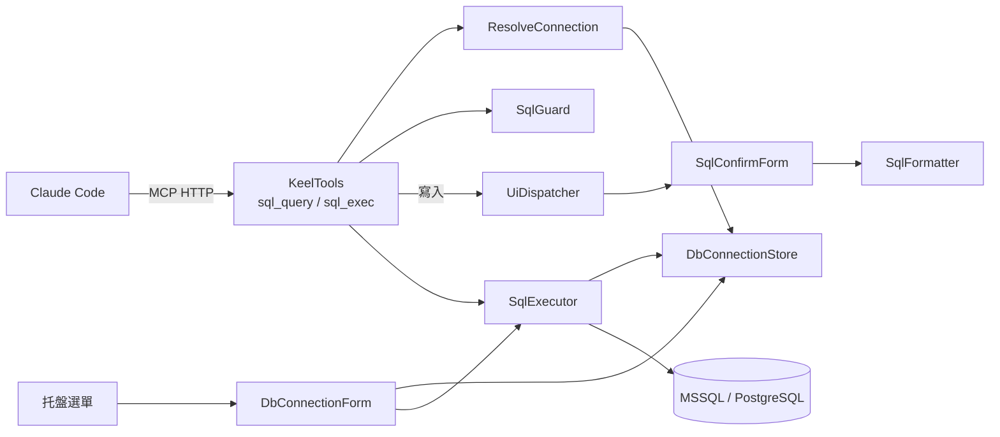
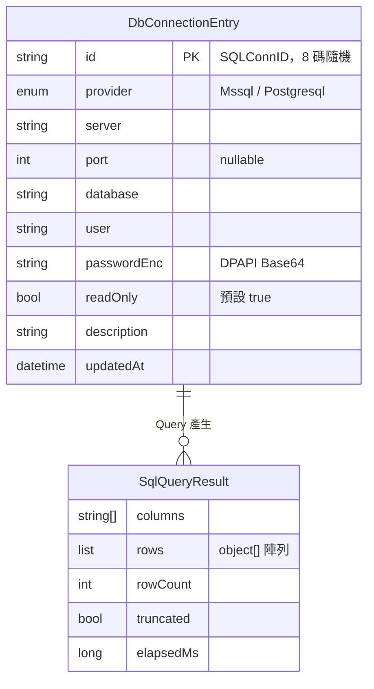
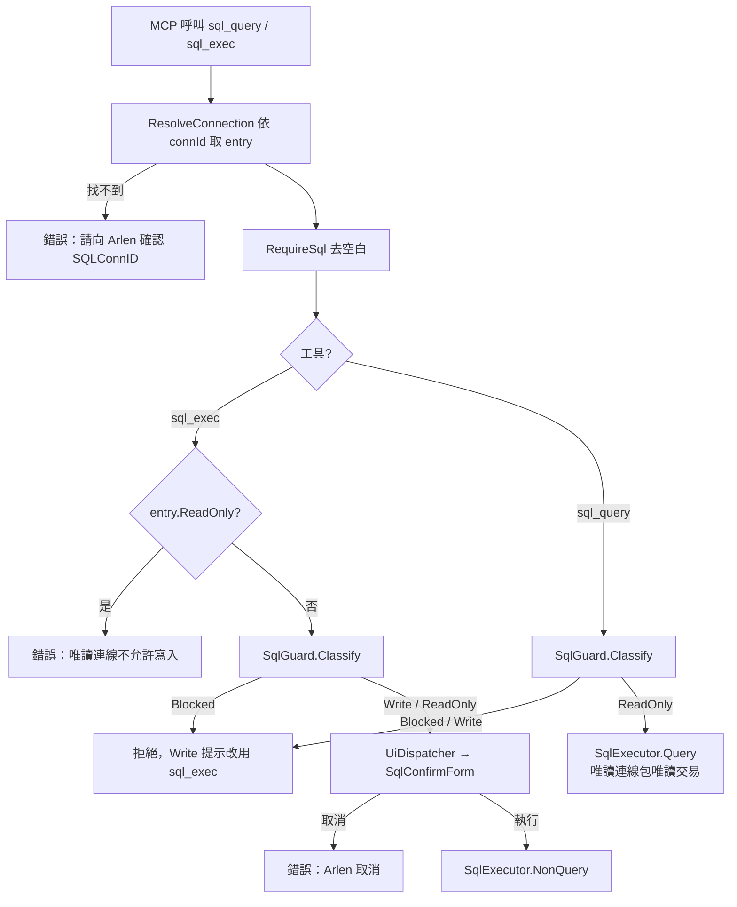
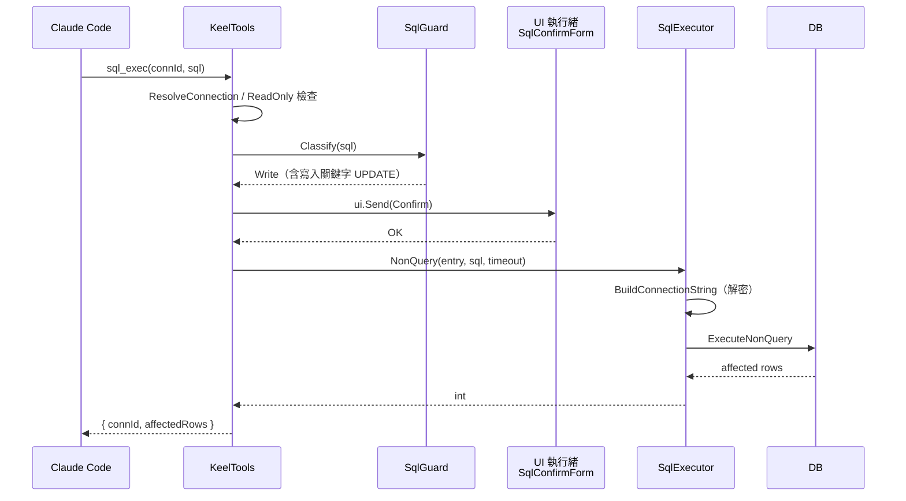
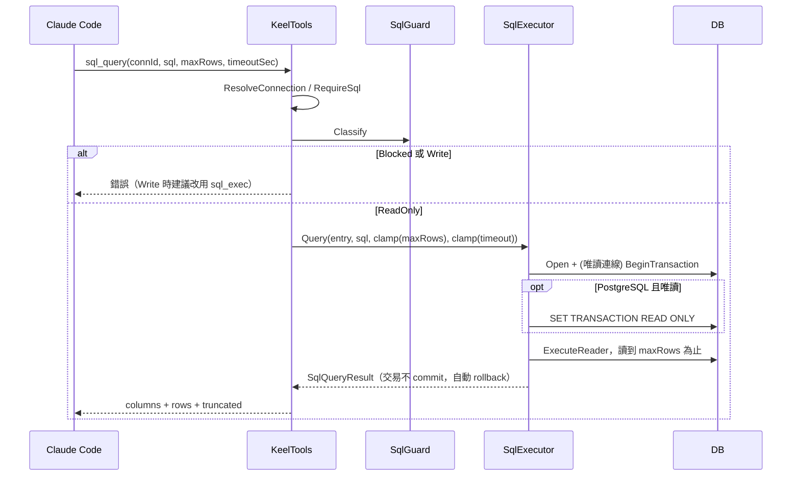
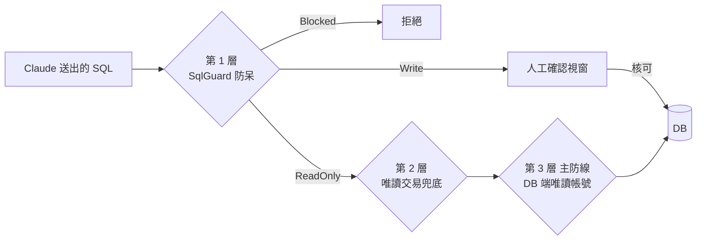

# SQL執行

## 目錄

- [文件資訊](#文件資訊)
- [系統概述](#系統概述)
- [共用資料結構](#共用資料結構)
- [Db SQL執行](#db-sql執行)
  - [核心功能列表](#核心功能列表)
  - [技術堆疊](#技術堆疊)
  - [系統架構](#系統架構)
  - [API 規格](#api-規格)
  - [資料結構定義](#資料結構定義)
  - [核心業務邏輯](#核心業務邏輯)
  - [外部系統整合](#外部系統整合)
  - [認證與安全機制](#認證與安全機制)
  - [例外處理](#例外處理)
  - [資料庫架構](#資料庫架構)
- [附錄](#附錄)

---

## 文件資訊

| 項目 | 內容 |
|------|------|
| 系統名稱 | Keel Assistant（系統匣常駐助理，.NET 8 WinForms + 內嵌 MCP Server） |
| 模組位置 | `Db/` |
| 業務邏輯位置 | `Db/SqlGuard.cs`、`Db/SqlExecutor.cs`、`Db/DbConnectionStore.cs`；MCP 進入點 `Api/KeelTools.cs`（`sql_query`、`sql_exec`） |
| 最後更新 | 2026/11/12 |

### 版本歷史

| 版本 | 日期 | 異動內容 | 異動人員 |
|------|------|----------|----------|
| 1.0 | 2026/07/22 | 新增 SQL 執行模組：DPAPI 連線儲存、SqlGuard、SqlExecutor、設定與確認視窗、`sql_query`／`sql_exec` 工具 | Arlen |
| 1.1 | 2026/11/12 | `DbConnectionStore` 類別註解：原 `<see cref="Memory.MemoryStore"/>` 改為純文字「MemoryStore（已移除）」，配合記憶模組移除，避免 cref 指向不存在的型別。無行為變更 | Arlen |

### 所有相關程式位置

```
KeelAssistant/
├── Api/
│   ├── KeelTools.cs          # sql_query / sql_exec、Reportable、ResolveConnection、RequireSql
│   └── McpHost.cs            # DI 註冊 DbConnectionStore、SqlExecutor 單例
├── Db/
│   ├── DbConnectionStore.cs  # dbconnections.json 持久化 + DPAPI 加解密 + 連線字串組裝
│   ├── DbConnectionForm.cs   # 托盤「SQL 連線設定」視窗
│   ├── SqlGuard.cs           # 語句分類器（ReadOnly / Write / Blocked）
│   ├── SqlExecutor.cs        # 執行、唯讀交易、結果正規化、例外遮蔽
│   ├── SqlConfirmForm.cs     # 寫入前人工確認視窗
│   └── SqlFormatter.cs       # 確認視窗用的 SQL 排版（不改 token）
├── Models/Models.cs          # DbProvider、DbConnectionEntry、SqlQueryResult
├── TrayApplicationContext.cs # 建立 store/executor 單例、開啟設定視窗
└── dbconnections.json        # 執行期產生，不進版控
```

---

## 系統概述

### 簡介

SQL 執行模組讓 Claude Code（Keel）透過 MCP 工具對 MSSQL 與 PostgreSQL 下 SQL，而不必在程式或指令列中拼接連線字串。連線帳密由 Arlen 在托盤選單「SQL 連線設定」輸入，以 DPAPI 加密存檔；Claude 只拿得到一個隨機的連線代號 `connId`（SQLConnID）。

在整體系統中，本模組屬於「高風險工具」三兄弟之一（SQL、Python 沙盒、SSH）。它的隔離靠三層：DB 端唯讀帳號（主防線）、`SqlGuard` 語句分類（防呆）、唯讀交易（兜底）。寫入類語句另外要經過人工確認視窗。

核心價值：AI 看不到主機、帳號與密碼，也無法列舉有哪些連線，但仍能依 Arlen 給的代號查資料。

### 模組關係圖



---

## 共用資料結構

本領域僅一個模組，資料結構集中於 [資料結構定義](#資料結構定義)。連線設定與結果物件的關係如下：



---

## Db SQL執行

### 核心功能列表

- ⭐ 代號制連線：Claude 只拿得到 `connId`，**MCP 不提供列舉連線的工具**，找不到代號時錯誤訊息也不列出可用代號
- ⭐ 三層安全設計：DB 唯讀帳號 → `SqlGuard` → 唯讀交易
- ⭐ 寫入前人工確認：`SqlConfirmForm` 置頂、預設焦點在「取消」、Enter 不放行
- ✅ 支援 MSSQL（Microsoft.Data.SqlClient）與 PostgreSQL（Npgsql）
- ✅ 密碼以 DPAPI（CurrentUser + 額外熵值 `KeelAssistant.Db.v1`）加密存檔
- ✅ 結果以 `columns` + `rows` 回傳，超過 `maxRows` 截斷並標 `truncated`
- ✅ 例外訊息遮蔽主機名稱與帳號
- ✅ 設定視窗可測試連線（未儲存也能測）、隨機產生連線 ID
- ❌ 不支援多語句（分號分隔）
- ❌ 不支援系統預存程序（`sp_` / `xp_`）、`OPENROWSET`、`DBCC`、`BULK` 等
- ❌ 不支援參數化查詢參數（SQL 以完整字串送出）
- ❌ 不提供列舉連線的 MCP 工具（刻意設計）

### 技術堆疊

| 項目 | 內容 |
|------|------|
| 開發框架 | .NET 8 WinForms（`net8.0-windows10.0.19041.0`） |
| ORM | 無，直接用 ADO.NET `DbConnection` / `DbCommand` |
| 資料庫 | MSSQL（Microsoft.Data.SqlClient 5.2.2）、PostgreSQL（Npgsql 8.0.5） |
| 服務形式 | 內嵌 Kestrel 的 MCP Server（Streamable HTTP，`127.0.0.1:38600/mcp`，Stateless） |
| 日誌系統 | 無獨立日誌；錯誤以 `McpException` 回給 Claude，UI 端以 MessageBox 呈現 |
| 加密方式 | DPAPI（System.Security.Cryptography.ProtectedData 8.0.0，CurrentUser scope + entropy） |
| MQ 系統 | 無 |
| 持久化 | `dbconnections.json`（System.Text.Json，enum 以字串序列化） |

### 系統架構

#### 專案結構

見 [所有相關程式位置](#所有相關程式位置)。

#### 核心執行流程圖



#### 多執行緒架構

| 執行緒 | 負責模組 | 功能 | 控制參數 |
|--------|----------|------|----------|
| Kestrel 執行緒池 | `KeelTools.SqlQuery/SqlExec`、`SqlExecutor` | 解析、分類、執行 SQL（同步） | `timeoutSec`（Query 1~300，預設 30；Exec 1~300，預設 60） |
| UI 執行緒（STA） | `SqlConfirmForm`、`DbConnectionForm` | 確認視窗（`ui.Send` 同步切入，`ShowDialog` 內有巢狀訊息迴圈，不會餓死 UI Timer） | 無 |
| 任意執行緒 | `DbConnectionStore` | 讀寫 `_entries`，以 `lock (_gate)` 序列化 | 無 |

🔑 `sql_*` 沒有全域序列化（不像 Python 沙盒的 `SemaphoreSlim`）；多個 session 可同時查詢，各自開關連線。

#### 整合架構序列圖



### API 規格

#### 通用設定

| 項目 | 內容 |
|------|------|
| 服務類型 | MCP Tool（ModelContextProtocol.AspNetCore 1.4.0，`[McpServerTool]`） |
| 服務端點 | `http://127.0.0.1:38600/mcp`（埠由 `appsettings.json` 的 `ApiPort` 決定） |
| Content-Type | `application/json`（JSON-RPC over Streamable HTTP） |
| 認證方式 | 無 token；只綁 Loopback，僅本機可呼叫 |
| 字元編碼 | UTF-8 |
| 資料格式 | 工具回傳匿名物件序列化為 JSON；錯誤以 `McpException`（`Reportable` 包裝）回傳訊息文字 |

#### sql_query

**功能描述**：以指定 SQLConnID 執行單一查詢並回傳結果集。典型情境：查 schema（`INFORMATION_SCHEMA`）、查資料驗證。

**請求格式**：

| 參數 | 型別 | 必填 | 說明 |
|------|------|------|------|
| connId | string | 是 | 連線代號，由 Arlen 提供；前後空白會被 Trim，比對不分大小寫 |
| sql | string | 是 | 單一 SELECT/WITH/SHOW/EXPLAIN 語句 |
| maxRows | int | 否 | 預設 200，`Math.Clamp` 至 1~1000 |
| timeoutSec | int | 否 | 預設 30，`Math.Clamp` 至 1~300 |

**回應格式**：
- 成功：`{ connId, columns: string[], rows: object[][], rowCount, truncated, elapsedMs }`
  - `DateTime` → `yyyy/MM/dd HH:mm:ss`；`DateTimeOffset` 附 `zzz`；`TimeSpan` → `hh:mm:ss`；`byte[]` → `"<binary N bytes>"`；`DBNull` → `null`；`Guid` → 字串
- 失敗：MCP 錯誤，訊息為中文原因（見 [錯誤代碼格式](#錯誤代碼格式)）

**業務流程**：



**主要驗證規則**：
- `connId` 必填，必須存在於 `dbconnections.json`
- `sql` 必填，Trim 後不可空白
- `SqlGuard.Classify` 必須為 `ReadOnly`；`Write` 與 `Blocked` 一律拒絕
- `maxRows`、`timeoutSec` 超出範圍時夾回邊界值，不報錯

**資料表更新**：

| 資料表 | 操作 | 說明 |
|--------|------|------|
| （目標 DB 任意表） | SELECT | 唯讀連線包在不 commit 的交易內 |
| dbconnections.json | 讀 | 僅讀取連線設定 |

**觸發的外部呼叫**：目標 MSSQL / PostgreSQL 伺服器。

#### sql_exec

**功能描述**：以指定 SQLConnID 執行單一寫入語句（INSERT/UPDATE/DELETE/DDL），回傳受影響列數。執行前一律彈出確認視窗。

**請求格式**：

| 參數 | 型別 | 必填 | 說明 |
|------|------|------|------|
| connId | string | 是 | 連線代號 |
| sql | string | 是 | 單一寫入語句 |
| timeoutSec | int | 否 | 預設 60，`Math.Clamp` 至 1~300 |

**回應格式**：
- 成功：`{ connId, affectedRows }`（`ExecuteNonQuery` 回傳值；DDL 通常為 -1）
- 失敗：MCP 錯誤訊息

**業務流程**：見 [整合架構序列圖](#整合架構序列圖)。

**主要驗證規則**：
- `connId`、`sql` 必填（同 `sql_query`）
- 🔑 連線 `ReadOnly = true` 時直接拒絕，**在分類之前**檢查
- `SqlGuard` 為 `Blocked` 拒絕；`Write` 以分類原因顯示於確認視窗；`ReadOnly` 也允許執行，但視窗判定欄顯示「查詢語句（可改用 sql_query）」
- Arlen 在 `SqlConfirmForm` 按「執行」才送出；取消、關閉視窗、按 Esc 均視為拒絕
- `sql_exec` 不包交易，語句由 DB 自動 commit

**資料表更新**：

| 資料表 | 操作 | 說明 |
|--------|------|------|
| （目標 DB 任意表） | INSERT/UPDATE/DELETE/DDL | 經人工核可後執行 |

**觸發的外部呼叫**：目標 DB；UI 執行緒上的 `SqlConfirmForm`。

#### 測試案例

| 測試場景 | 輸入條件 | 預期結果 | 驗證重點 |
|----------|----------|----------|----------|
| 正常查詢 | `sql_query` 有效 connId，`SELECT 1 AS x` | `columns=["x"]`，`rows=[[1]]` | 回傳結構 |
| 代號不存在 | connId=`xxx` | 錯誤「找不到連線「xxx」，請向 Arlen 確認正確的 SQLConnID。」 | 不列出可用代號 |
| 截斷 | `maxRows=5`，表有 100 列 | `rowCount=5`，`truncated=true` | 截斷標記 |
| maxRows 超上限 | `maxRows=5000` | 視為 1000 | Clamp |
| 多語句 | `SELECT 1; DROP TABLE t` | Blocked「偵測到多個語句」 | 多語句防線 |
| 註解繞過 | `/*x*/DROP TABLE t` | `sql_query` 拒絕（Write） | Sanitize 移除註解 |
| 字串內關鍵字 | `SELECT 'DROP TABLE'` | ReadOnly，正常執行 | 字串常值不誤判 |
| 欄位名相似 | `SELECT updated_at FROM t` | ReadOnly | 字界比對 |
| 系統預存程序 | `EXEC sp_who` | Blocked「系統預存程序」 | sp_/xp_ 規則 |
| SELECT INTO | `SELECT * INTO t2 FROM t` | `sql_query` 拒絕（Write） | 建新表判寫入 |
| 認不出的語句 | `SET NOCOUNT ON` | Write「無法確認為純查詢語句」 | 保守預設 |
| 唯讀連線寫入 | `sql_exec` 於 ReadOnly 連線 | 錯誤「為唯讀，不允許寫入」 | 不跳視窗 |
| 人工取消 | `sql_exec` 按取消 | 錯誤「Arlen 取消了這次 SQL 執行。」 | 未送出 DB |
| PG 唯讀交易 | PG 唯讀連線 `SELECT nextval('s')` 等寫入副作用 | DB 拒絕（read-only transaction） | 第三層防線 |
| 連線錯誤遮蔽 | 主機不可達 | 訊息中主機名與帳號為 `<server>`/`<user>` | Sanitize |

### 資料結構定義

#### 主要資料物件

| 類別 | 檔案 | 用途 |
|------|------|------|
| `DbProvider` | Models/Models.cs | `Mssql`、`Postgresql` |
| `DbConnectionEntry` | Models/Models.cs | 一組具名連線；`PasswordEnc` 為 DPAPI 密文，絕不對外回傳 |
| `SqlQueryResult` | Models/Models.cs | 查詢結果，columns/rows 分離以避免每列重複欄位名 |
| `SqlKind` / `SqlClassification` | Db/SqlGuard.cs | 分類結果（ReadOnly/Write/Blocked）與中文原因 |

#### 資料表欄位說明

本模組不使用資料庫表儲存自身狀態，持久化在 `dbconnections.json`（`DbConnectionEntry` 陣列）：

| 欄位名稱 | 資料型態 | 說明 | 備註 |
|----------|----------|------|------|
| id | string | 連線代號（SQLConnID），主鍵 | 不分大小寫；預設 8 碼隨機（`Guid.N[..8]`） |
| provider | enum 字串 | `Mssql` / `Postgresql` | |
| server | string | 主機 | 必填；錯誤訊息中會被遮蔽 |
| port | int? | 埠 | 省略時 MSSQL 走預設、PG 用 5432；1~65535 |
| database | string | 資料庫名稱 | 必填 |
| user | string | 帳號 | 錯誤訊息中會被遮蔽 |
| passwordEnc | string | DPAPI Base64 密文 | 新增時密碼必填；編輯留空沿用原值 |
| readOnly | bool | 唯讀連線 | 🔑 預設 true，開放寫入必須刻意取消勾選 |
| description | string | 說明 | 設定清單顯示用 |
| updatedAt | DateTime | 最後更新 | `Upsert` 時寫入 |

### 核心業務邏輯

#### SqlGuard 語句分類

- **檔案位置**：`Db/SqlGuard.cs`
- **核心概念**：定位是「防呆」不是「防駭」。擋的是 Claude 誤產生的破壞性 SQL；動態 SQL 仍有繞過空間，所以認不出來的語句一律歸 `Write`（需人工確認），不放行。

```mermaid
flowchart TD
    S[輸入 SQL] --> E{空白?}
    E -->|是| B0[Blocked: SQL 內容為空]
    E -->|否| SZ[Sanitize: 移除 -- 與巢狀 /* */<br/>清空 ' \" [] 內容 → 轉大寫]
    SZ --> E2{清完後空白?}
    E2 -->|是| B1[Blocked: 無實際內容]
    E2 -->|否| M{分號切段 > 1?}
    M -->|是| B2[Blocked: 多語句]
    M -->|否| K{含禁用關鍵字?}
    K -->|是| B3[Blocked]
    K -->|否| SP{符合 SP_/XP_ 前綴?}
    SP -->|是| B4[Blocked]
    SP -->|否| SI{SELECT 開頭且含 INTO?}
    SI -->|是| W1[Write]
    SI -->|否| WK{含寫入關鍵字?}
    WK -->|是| W2[Write]
    WK -->|否| ST{起首為 SELECT/WITH/SHOW/EXPLAIN?}
    ST -->|是| R[ReadOnly]
    ST -->|否| W3[Write: 保守視為寫入]
```

**關鍵限制**：
- 禁用關鍵字：`XP_CMDSHELL`、`OPENROWSET`、`OPENQUERY`、`OPENDATASOURCE`、`SHUTDOWN`、`RECONFIGURE`、`DBCC`、`BULK`
- 寫入關鍵字：`INSERT`、`UPDATE`、`DELETE`、`MERGE`、`DROP`、`TRUNCATE`、`ALTER`、`CREATE`、`GRANT`、`REVOKE`、`EXEC`、`EXECUTE`、`CALL`
- 關鍵字比對用字界 `(?<![\w_])KW(?![\w_])`，`updated_at` 不會命中 `UPDATE`
- 起首判斷允許前導括號 `(SELECT ...)`
- 單引號 `''` 視為逸出；`[DROP]` 這類識別字內容會被清空
- 結尾單一分號允許（空段落不計入語句數）

**執行邏輯說明**：KeelTools 依結果決定拒絕、直接執行或跳確認視窗。`sql_query` 只接受 `ReadOnly`；`sql_exec` 接受 `ReadOnly` 與 `Write`，但都要人工確認。

#### SqlExecutor 執行與唯讀交易

- **檔案位置**：`Db/SqlExecutor.cs`
- **核心概念**：連線字串與明文密碼只在內部短暫存在；對外例外先經 `Sanitize` 遮蔽主機與帳號。
- **唯讀交易（第三層）**：`entry.ReadOnly` 時 `Query` 開交易且永不 commit，`using` 結束自動 rollback。
  - PostgreSQL：額外執行 `SET TRANSACTION READ ONLY`，寫入當場被 DB 引擎拒絕（強制唯讀）。
  - MSSQL：無等價語法，只能靠不 commit 撤銷。🔑 **不保證完全還原**：IDENTITY/SEQUENCE 消耗、觸發程序的外部副作用撤不回來。
- **結果截斷**：讀到第 `maxRows + 1` 列時設 `Truncated = true` 並停止讀取。
- `NonQuery` 不開交易；`TestConnection` 執行 `SELECT 1`（逾時 15 秒），錯誤訊息**不遮蔽**（給 Arlen 診斷用）。

#### DbConnectionStore 與 DPAPI

- **檔案位置**：`Db/DbConnectionStore.cs`
- **核心概念**：沿用已移除的 MemoryStore 的 Load/Save + lock 模式；密碼加密後才寫檔。
- `Upsert(entry, plainPassword)`：`plainPassword` 為 null 表示沿用原密碼——先取同 ID 既有密文，查不到才用 entry 自帶的 `PasswordEnc`（改 ID 重新命名時由呼叫端先帶入舊密文）；空字串表示清空密碼。
- `BuildConnectionString`：明文密碼唯一出現的位置。
  - MSSQL：`Server={server}[,{port}];Database=…;User Id=…;Password=…;TrustServerCertificate=True;Encrypt=True;Connect Timeout=15`
  - PostgreSQL：`Host=…;Port={port ?? 5432};Database=…;Username=…;Password=…;Timeout=15`
- `Load` 遇壞檔靜默忽略（視為無連線）；`Save` 寫入失敗靜默忽略。

#### DbConnectionForm 設定視窗

- **檔案位置**：`Db/DbConnectionForm.cs`
- 新增時連線 ID 預設隨機 8 碼（可按「隨機」重產），讓 AI 無法從代號猜環境，也無法試錯撞出可用代號
- 密碼永不回填畫面；編輯留空 = 沿用原密碼；新增時密碼必填
- 新增遇 ID 重複先詢問是否覆寫；編輯時改 ID 視為重新命名（Upsert 新 ID 後 Delete 舊 ID，並帶舊密文）
- 「測試連線」用畫面值組暫時 entry，密碼留空時沿用已存密文
- 驗證：ID、主機、資料庫名稱必填；埠需 1~65535

#### SqlConfirmForm 與 SqlFormatter

- **檔案位置**：`Db/SqlConfirmForm.cs`、`Db/SqlFormatter.cs`
- 視窗顯示連線 Id、Provider、Database 與分類原因；`TopMost`、`AcceptButton = null`、預設焦點在「取消」
- SQL 以 `SqlFormatter.Format` 排版顯示，可勾「顯示原始 SQL」切回原文；🔑 **實際送出的永遠是原文**
- `SqlFormatter` 只在 token 間插換行與縮排，不改任何 token 內容；排版途中發生例外一律退回原文。刻意不引入第三方 formatter（需同時吃 T-SQL 與 PG）

### 外部系統整合

| 服務名稱 | 設定項目 | 呼叫的方法 |
|----------|----------|------------|
| Microsoft SQL Server | `dbconnections.json`（provider=Mssql） | `SqlConnection.Open`、`ExecuteReader`、`ExecuteNonQuery` |
| PostgreSQL | `dbconnections.json`（provider=Postgresql） | `NpgsqlConnection.Open`、`SET TRANSACTION READ ONLY`、`ExecuteReader`、`ExecuteNonQuery` |
| Windows DPAPI | 無（綁目前 Windows 使用者） | `ProtectedData.Protect/Unprotect` |
| Claude Code（MCP client） | `claude mcp add ... http://127.0.0.1:38600/mcp` | `sql_query`、`sql_exec` |

### 認證與安全機制

#### Token 認證機制

本模組無此項目。MCP Server 只綁 `IPAddress.Loopback`，不做 token 驗證；資料庫認證使用各連線設定的帳密。

#### 三層安全設計



> 依 CLAUDE.md 的定義，防線依重要度排序為：**DB 端唯讀帳號（主防線）→ SqlGuard（防呆）→ 唯讀交易（兜底）**。上圖依資料流方向繪製。🔑 `SqlGuard` 是啟發式的，**不可當成唯一防線**；MSSQL 唯讀交易也不保證完全還原，故唯讀帳號不可省略。

#### 安全規範

- 🔑 **MCP 不提供列舉連線的工具**：`DbConnectionStore.List()` 只給設定 UI 使用；`ResolveConnection` 的錯誤訊息不列出可用代號。修改本模組時必須維持此約束。
- **SQL Injection 防護**：本模組的 SQL 本來就由 Claude 產生並整段執行，不存在「使用者輸入拼進 SQL」的情境；防護重點改為多語句阻擋、禁用關鍵字與人工確認。
- **敏感資料處理**：
  - 密碼 DPAPI 加密（CurrentUser + entropy），json 複製到別台或別帳號解不開
  - 明文只存在於 `BuildConnectionString` 回傳的連線字串，用完即丟
  - MCP 回傳只含 `connId`，不含主機、帳號
  - 例外訊息以 `<server>`、`<user>` 取代主機與帳號
  - `dbconnections.json` 不進版控；只能透過設定視窗維護（手動編輯無法產生正確密文）
- **Python 沙盒黑名單**：`dbconnections.json` 在 `SandboxDenyPatterns` 中，沙盒無法讀取

### 例外處理

#### 例外處理模式

- 所有工具方法以 `Reportable` 包裝：`McpException` 直接拋出；其他例外轉成 `McpException(ex.Message)`，讓 Claude 看得到中文原因並自我修正（SDK 預設會把非 McpException 換成「An error occurred」）
- `SqlExecutor` 捕捉 DB 例外，包成 `InvalidOperationException("查詢失敗：…"／"執行失敗：…")` 並遮蔽敏感字串
- 設定視窗以 MessageBox 顯示錯誤，`TestConnection` 不遮蔽
- 持久化失敗靜默忽略

#### 錯誤代碼格式

本模組無數字錯誤代碼，以中文訊息區分：

| 類別 | 訊息 | 來源 |
|------|------|------|
| 參數錯誤 | 缺少 connId／缺少 sql | `ResolveConnection`、`RequireSql` |
| 業務錯誤 | 找不到連線「{connId}」，請向 Arlen 確認正確的 SQLConnID。 | `ResolveConnection` |
| 業務錯誤 | 語句遭拒：{原因} | `SqlGuard` Blocked |
| 業務錯誤 | 這不是純查詢語句（{原因}），請改用 sql_exec… | `sql_query` 遇 Write |
| 業務錯誤 | 連線「{id}」為唯讀，不允許寫入。 | `sql_exec` |
| 業務錯誤 | Arlen 取消了這次 SQL 執行。 | `sql_exec` |
| 系統例外 | 查詢失敗：{遮蔽後 DB 訊息}／執行失敗：{…} | `SqlExecutor` |
| 系統例外 | 密碼解密失敗（可能是設定檔來自其他電腦或使用者帳號）… | `DbConnectionStore.Unprotect` |
| 系統例外 | 不支援的資料庫類型：{provider} | `BuildConnectionString`、`OpenConnection` |

### 資料庫架構

#### 主要資料表

本模組無此項目（本身不建資料表；操作對象為 Arlen 指定的任意外部 DB）。

#### 外部 Web Service 依賴

本模組無此項目。

#### 資料庫連線

- 主要／次要資料庫：無固定對象，依 `dbconnections.json` 中的連線設定而定
- 連線字串儲存方式：不儲存連線字串，只儲存欄位與 DPAPI 密文，執行時由 `BuildConnectionString` 組出
- 每次呼叫開新連線，`using` 結束即關閉（依賴 ADO.NET 連線池）

---

## 附錄

### 代碼對照表

| 代碼 | 值 | 說明 |
|------|----|------|
| SqlKind | ReadOnly | 純查詢，`sql_query` 可直接執行 |
| SqlKind | Write | 會異動或無法確認，需走 `sql_exec` + 人工確認 |
| SqlKind | Blocked | 一律拒絕 |
| DbProvider | Mssql | Microsoft SQL Server |
| DbProvider | Postgresql | PostgreSQL，預設埠 5432 |

### 外部元件參考

| 套件 | 版本 | 功能 |
|------|------|------|
| Microsoft.Data.SqlClient | 5.2.2 | MSSQL 驅動 |
| Npgsql | 8.0.5 | PostgreSQL 驅動 |
| System.Security.Cryptography.ProtectedData | 8.0.0 | DPAPI |
| ModelContextProtocol.AspNetCore | 1.4.0 | MCP 工具框架 |

### 常見問題排查

| 問題現象 | 可能原因 | 排查步驟 | 解決方案 |
|----------|----------|----------|----------|
| 「找不到連線」 | connId 打錯或已刪除 | 托盤「SQL 連線設定」查清單 | 由 Arlen 提供正確代號 |
| 「密碼解密失敗」 | json 來自別台電腦或別的 Windows 帳號 | 確認目前登入帳號 | 設定視窗重新輸入密碼並儲存 |
| 正常 SELECT 被拒為 Write | 起首不是 SELECT/WITH/SHOW/EXPLAIN（如 `DECLARE`、`SET`） | 檢查語句開頭 | 改寫為單一 SELECT，或改用 `sql_exec` |
| 查詢被判 Blocked「多語句」 | 字串外含分號 | 檢查 SQL 中段是否有 `;` | 拆成多次呼叫 |
| 函式名含 `sp_` 被擋 | 規則比對 `\b(SP\|XP)_\w+` | 檢查識別字 | 識別字加 `[]` 或 `""` 包住（內容會被清空不比對） |
| 連線逾時 | 主機不可達、防火牆 | 設定視窗「測試連線」（訊息不遮蔽） | 修正主機／埠 |
| MSSQL 憑證錯誤 | 已設 TrustServerCertificate=True，通常不會發生 | 查驅動版本 | — |
| 結果 `truncated: true` | 超過 maxRows | — | 加 WHERE 縮小範圍或提高 maxRows（上限 1000） |
| 確認視窗沒出現 | 被其他視窗遮住（已 TopMost）或 UI 執行緒忙碌 | 查工作列 | 等待或切換視窗 |

### 名詞解釋

| 名詞 | 定義 |
|------|------|
| SQLConnID / connId | 連線代號，Claude 唯一能拿到的連線識別 |
| DPAPI | Windows Data Protection API，以使用者帳號金鑰加解密 |
| Entropy | DPAPI 額外熵值，本模組為 `KeelAssistant.Db.v1` |
| 唯讀交易 | 唯讀連線上永不 commit 的交易 |
| Sanitize | SqlGuard：移除註解與字串常值；SqlExecutor：遮蔽主機與帳號 |
| UiDispatcher | 把呼叫切回 UI 執行緒同步執行的工具類別 |

### 相關文件

- `CLAUDE.md`（架構 → Db 段落）
- `README.md`、`MCP-Setup.md`（工具清單與註冊方式）
- `_Docs/SSH終端.md`（比照本模組代號制與 DPAPI 設計）

### 環境特殊說明

- 作業系統：Windows 10 19041 以上（DPAPI、WinForms）
- 日期格式：結果中的日期一律 `yyyy/MM/dd HH:mm:ss`
- `dbconnections.json` 位於執行檔目錄（`AppContext.BaseDirectory`），不進版控
