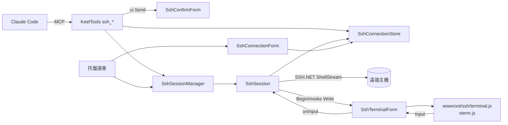
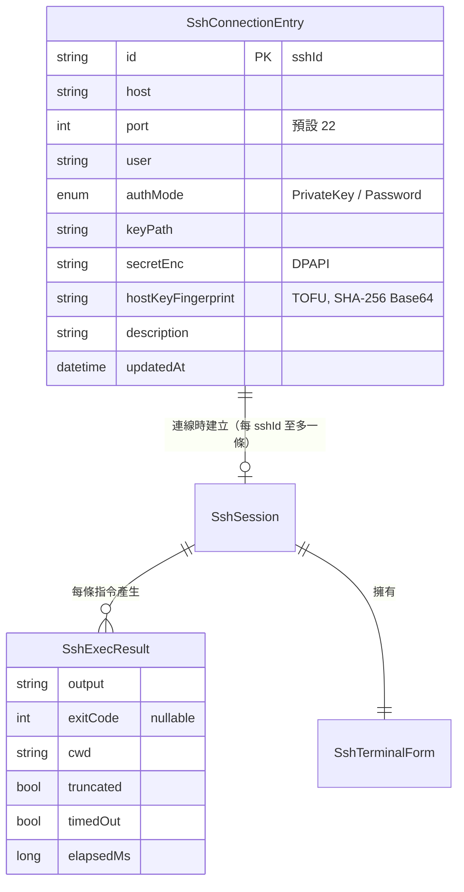
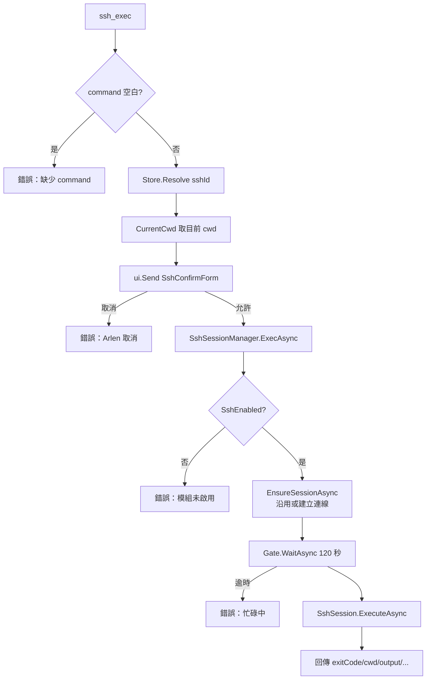
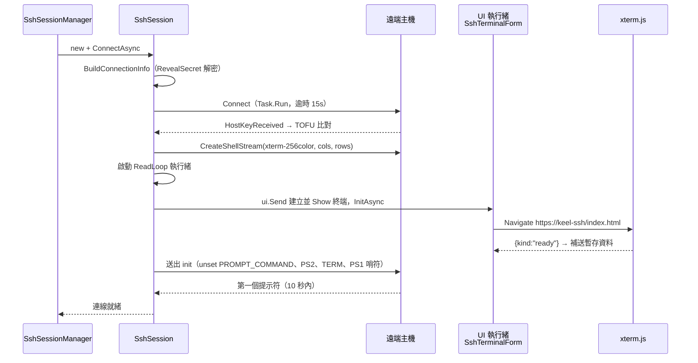
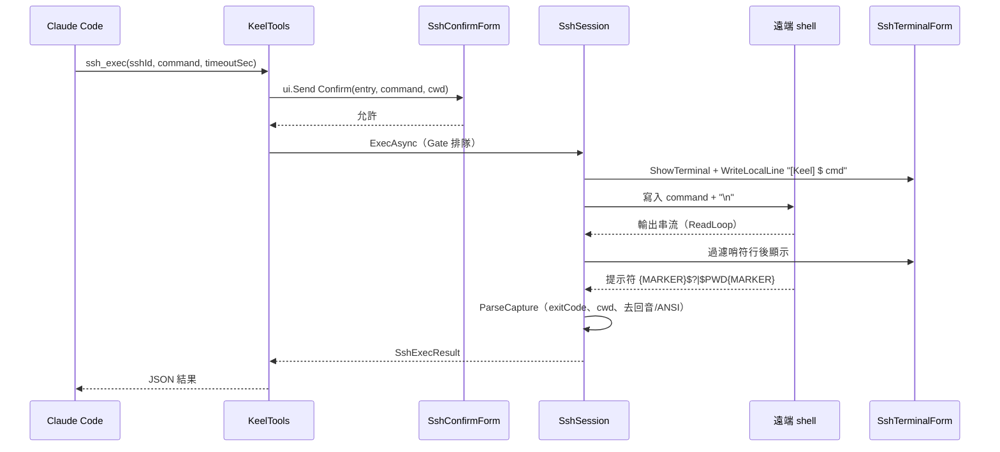
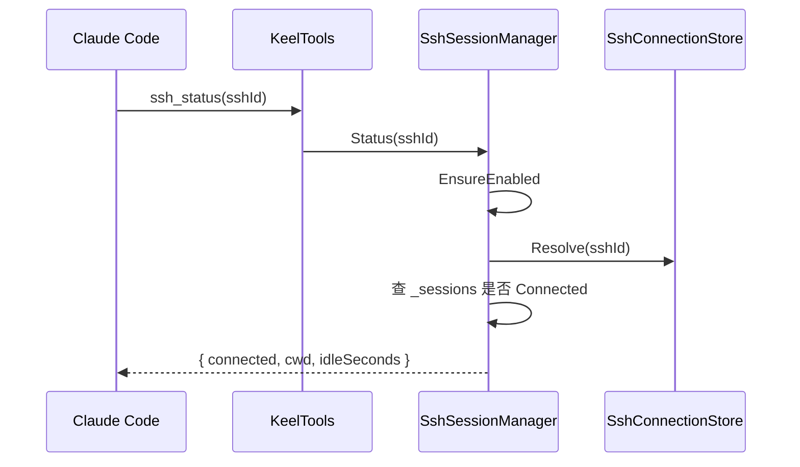
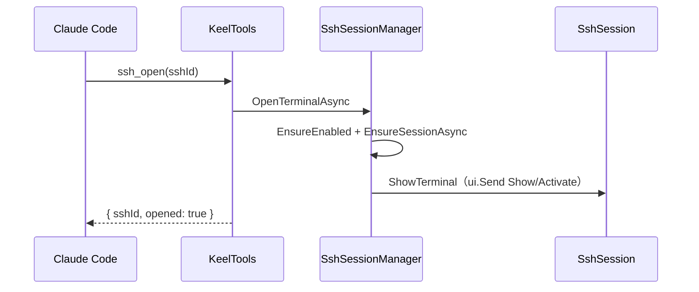
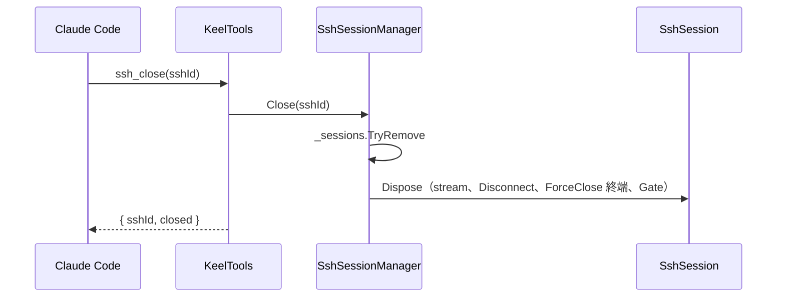
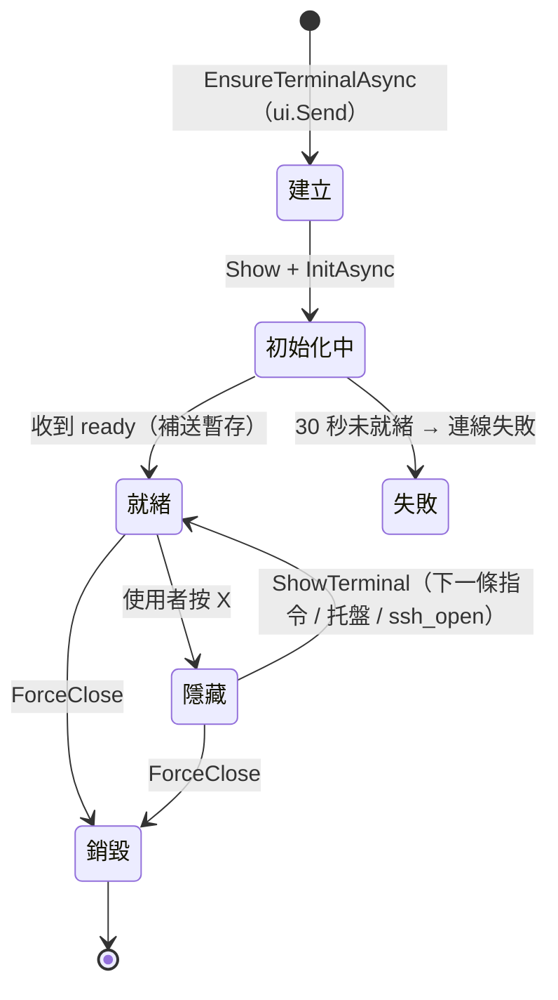
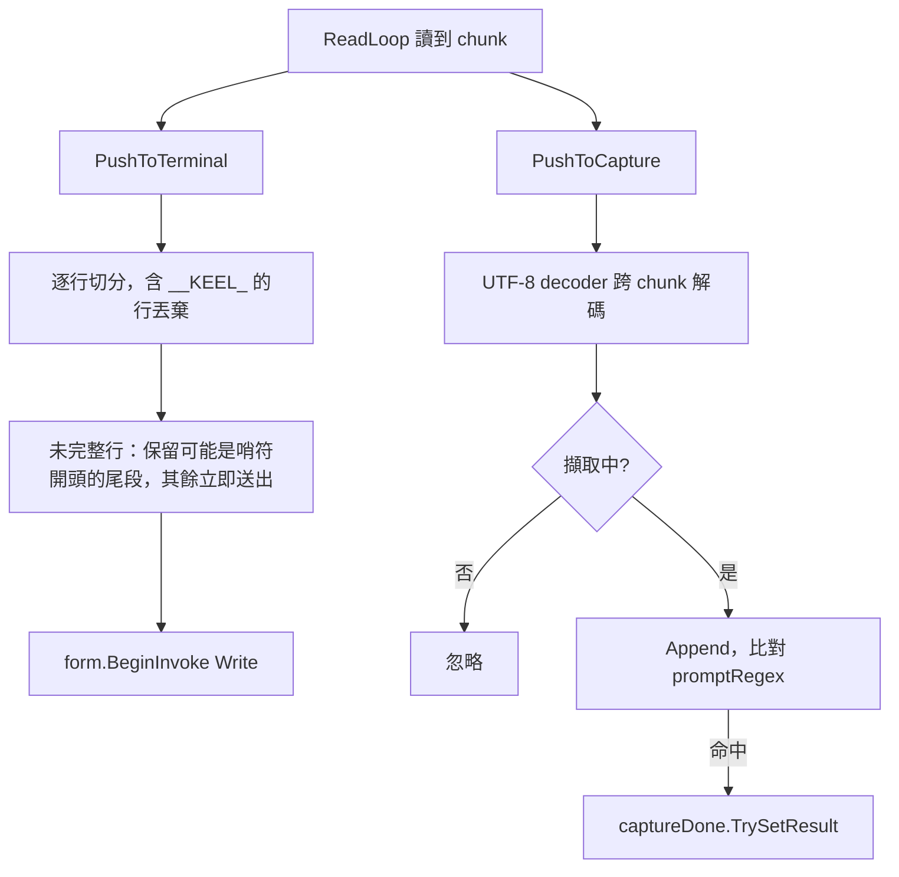

# SSH終端

## 目錄

- [文件資訊](#文件資訊)
- [系統概述](#系統概述)
- [共用資料結構](#共用資料結構)
- [Ssh SSH終端](#ssh-ssh終端)
  - [核心功能列表](#核心功能列表)
  - [技術堆疊](#技術堆疊)
  - [系統架構](#系統架構)
  - [API 規格](#api-規格)
  - [資料結構定義](#資料結構定義)
  - [核心業務邏輯](#核心業務邏輯)
  - [外部系統整合](#外部系統整合)
  - [認證與安全機制](#認證與安全機制)
  - [例外處理](#例外處理)
  - [資料庫架構](#資料庫架構)
- [附錄](#附錄)

---

## 文件資訊

| 項目 | 內容 |
|------|------|
| 系統名稱 | Keel Assistant（系統匣常駐助理，.NET 8 WinForms + 內嵌 MCP Server） |
| 模組位置 | `Ssh/`、`wwwroot/ssh/` |
| 業務邏輯位置 | `Ssh/SshSessionManager.cs`（含 `SshSession`）；MCP 進入點 `Api/KeelTools.cs`（`ssh_exec`、`ssh_status`、`ssh_open`、`ssh_close`） |
| 進入點（UI） | `Ssh/SshTerminalForm.cs` |
| 最後更新 | 2026/11/12 |

### 版本歷史

| 版本 | 日期 | 異動內容 | 異動人員 |
|------|------|----------|----------|
| 1.0 | 2026/09/01 | 新增 SSH 遠端執行模組：持續 shell（PTY）、PS1 哨符、xterm.js 可視終端、TOFU 主機指紋、每條指令人工確認、`ssh_*` 四個工具 | Arlen |
| 1.1 | 2026/11/12 | `SshTerminalForm` 類別註解：原 `<see cref="Music.MusicForm"/>` 改為純文字「原 MusicForm（已移除）」，配合音樂模組移除，避免 cref 指向不存在的型別。無行為變更 | Arlen |

### 所有相關程式位置

```
KeelAssistant/
├── Api/
│   ├── KeelTools.cs             # ssh_exec / ssh_status / ssh_open / ssh_close、ReportableAsync
│   └── McpHost.cs               # DI 註冊 SshConnectionStore、SshSessionManager 單例
├── Ssh/
│   ├── SshTerminalForm.cs       # WebView2 + xterm.js 可視終端（雙向、關閉改隱藏）
│   ├── SshSessionManager.cs     # SshSessionManager / SshSession / SshSessionManagerConstants
│   ├── SshConnectionStore.cs    # sshconnections.json 持久化 + DPAPI + TOFU 指紋
│   ├── SshConnectionForm.cs     # 托盤「SSH 連線設定」視窗
│   └── SshConfirmForm.cs        # 每條指令的人工確認視窗
├── wwwroot/ssh/
│   ├── index.html               # 終端頁面
│   ├── terminal.js              # xterm.js ↔ .NET 訊息橋接
│   ├── xterm.js / xterm.css     # xterm.js 本體（離線打包）
├── Models/Models.cs             # SshAuthMode、SshConnectionEntry、SshExecResult、AppSettings.Ssh*
├── TrayApplicationContext.cs    # 托盤 SSH 子選單、建立單例
├── appsettings.json             # SshEnabled、SshDefaultTimeoutSeconds 等
├── sshconnections.json          # 執行期產生，不進版控
└── webview2-ssh/                # 執行期產生，終端專屬 WebView2 user data folder
```

---

## 系統概述

### 簡介

SSH 終端模組讓 Claude Code（Keel）透過 MCP 工具對遠端 Linux 主機下 shell 指令。每個 `sshId` 對應一條**持續的** shell（PTY），`cd` 與 `export` 的效果會延續到下一條指令。所有輸出同步顯示在一個可視終端視窗（WebView2 + xterm.js），Arlen 可隨時在視窗中直接打字接手。

在整體系統中，本模組是三個高風險模組（SQL、Python 沙盒、SSH）中**唯一沒有隔離層**的：SQL 有唯讀帳號與唯讀交易，Python 有 WASM 邊界，SSH 送出去就是遠端的真實指令。因此 `SshEnabled` 預設為 false，且**每一條**指令都要經人工確認。

核心價值：AI 只拿得到 `sshId`，看不到主機與帳密；畫面上即時可見 AI 做了什麼；互動式程式卡住時人可以接手。

### 模組關係圖



---

## 共用資料結構

本領域僅一個模組，資料結構集中於 [資料結構定義](#資料結構定義)。



---

## Ssh SSH終端

### 核心功能列表

- ⭐ 持續 shell：同一 `sshId` 的 cwd 與環境變數跨指令延續，每次回傳都附 `cwd`
- ⭐ PS1 哨符判斷指令結束：哨符只放在提示符，指令本身不包裝
- ⭐ 每條指令人工確認（`SshConfirmForm`），不做白名單、不做危險分級
- ⭐ 雙向可視終端：AI 的指令與輸出即時呈現，Arlen 可直接打字接手
- ✅ 私鑰檔（可含 passphrase）與密碼兩種認證；密碼模式同時掛 keyboard-interactive
- ✅ TOFU 主機指紋：首次記錄，之後不符即拒絕（不詢問）
- ✅ 逾時送 Ctrl+C 並回報 `timedOut`
- ✅ 輸出去 ANSI、去回音、超過 `SshMaxOutputChars` 截斷
- ✅ 閒置自動斷線（`SshIdleShutdownMinutes`）
- ✅ 托盤選單顯示連線數，可顯示終端或中斷連線
- ❌ 不可執行互動式程式（nano、vim、top、less、apt 對話框）——會等到逾時
- ❌ 不提供列舉連線的 MCP 工具（刻意設計）
- ❌ 遠端 shell 必須是 bash 相容（依賴 PS1 的 `\u`、`\h`、`\w`、`$?`）
- ❌ 不支援 SFTP 檔案傳輸、port forwarding

### 技術堆疊

| 項目 | 內容 |
|------|------|
| 開發框架 | .NET 8 WinForms（`net8.0-windows10.0.19041.0`） |
| ORM | 本模組無此項目 |
| 資料庫 | 本模組無此項目（持久化於 `sshconnections.json`） |
| 服務形式 | 內嵌 MCP Server（Streamable HTTP，Stateless） |
| SSH 函式庫 | SSH.NET 2026.0.0（`SshClient`、`ShellStream`） |
| 終端呈現 | WebView2 1.0.2792.45 + xterm.js（本機虛擬主機 `https://keel-ssh/`） |
| 日誌系統 | 無；終端視窗即為操作紀錄（scrollback 10000 行） |
| 加密方式 | DPAPI（CurrentUser + entropy `KeelAssistant.Ssh.v1`）；主機指紋 SHA-256 |
| MQ 系統 | 無 |

### 系統架構

#### 專案結構

見 [所有相關程式位置](#所有相關程式位置)。

#### 核心執行流程圖（ssh_exec）



🔑 確認視窗出現在 `EnsureEnabled` 之前：`SshEnabled = false` 時仍會先跳確認視窗，核可後才收到「未啟用」錯誤（見 [常見問題排查](#常見問題排查)）。

#### 多執行緒架構

| 執行緒 | 負責模組 | 功能 | 控制參數 |
|--------|----------|------|----------|
| Kestrel 執行緒池 | `KeelTools.Ssh*`、`SshSessionManager` | 解析、等待指令完成（async，不佔 UI） | `timeoutSec` 1~1800 |
| UI 執行緒 | `SshConfirmForm`、`SshTerminalForm`、`ShowTerminal` | 確認視窗（`ShowDialog` 巢狀迴圈不餓死 UI Timer）、終端建立與寫入 | — |
| `ssh-read-{id}`（背景 Thread） | `SshSession.ReadLoop` | 阻塞讀 ShellStream，分流到終端與擷取緩衝 | 緩衝 16KB |
| 執行緒池 Timer | `SshSessionManager.SweepIdle` | 每 1 分鐘檢查閒置連線並斷線 | `SshIdleShutdownMinutes` |
| `Task.Run` | `SshClient.Connect` | 同步阻塞的連線動作移出呼叫端 | 連線逾時 15 秒 |

🔑 併發：MCP 是 Stateless，多 session 與 SubAgent 共用同一條持續 shell。每個 session 有一個 `SemaphoreSlim(1,1)`（`Gate`）序列化指令，排隊上限 120 秒（含前一條的執行時間）；每次回傳都帶 `cwd`，讓「狀態被別人改過」看得見。

#### 整合架構序列圖（首次連線）



### API 規格

#### 通用設定

| 項目 | 內容 |
|------|------|
| 服務類型 | MCP Tool（ModelContextProtocol.AspNetCore 1.4.0） |
| 服務端點 | `http://127.0.0.1:38600/mcp`（`ApiPort`） |
| Content-Type | `application/json`（JSON-RPC over Streamable HTTP） |
| 認證方式 | 無 token；只綁 Loopback |
| 字元編碼 | UTF-8（遠端輸出以 UTF-8 decoder 跨 chunk 解碼） |
| 資料格式 | 匿名物件序列化為 JSON；錯誤以 `McpException` 回傳中文訊息（`Reportable` / `ReportableAsync`） |

#### ssh_exec

**功能描述**：在指定遠端主機的持續 shell 執行一條指令並回傳輸出。典型情境：部署、查 log、套件安裝。

**請求格式**：

| 參數 | 型別 | 必填 | 說明 |
|------|------|------|------|
| sshId | string | 是 | 連線代號，Arlen 提供；Trim 後比對，不分大小寫 |
| command | string | 是 | 單一 shell 指令，可用管線與 `&&`；結尾換行會被移除後補一個 `\n` |
| timeoutSec | int | 否 | 預設 0 = 用 `SshDefaultTimeoutSeconds`（120）；實際等待以 `Math.Clamp(1, 1800)` 秒為準 |

**回應格式**：
- 成功：`{ sshId, exitCode, cwd, output, truncated, timedOut, elapsedMs }`
  - `exitCode`：取自 PS1 中的 `$?`；逾時或無法解析時為 null
  - `output`：已去 ANSI、去指令回音、去提示符裝飾行、首尾空行；超過 `SshMaxOutputChars`（8000）截斷
  - 逾時時 `timedOut=true`，已送 Ctrl+C，遠端可能仍在收尾
- 失敗：MCP 錯誤訊息

**業務流程**：



**主要驗證規則**：
- `command` 必填（KeelTools 與 `ExecAsync` 各檢查一次）
- `sshId` 必須存在於 `sshconnections.json`，錯誤訊息不列出可用代號
- 🔑 每一條都需 Arlen 在確認視窗按「允許執行」
- `SshEnabled` 必須為 true
- 同一 sshId 排隊超過 120 秒即失敗
- 私鑰模式：`KeyPath` 必須存在
- 主機指紋必須與已記錄值相同（首次除外）

**資料表更新**：

| 資料表 | 操作 | 說明 |
|--------|------|------|
| sshconnections.json | UPDATE（僅首次連線） | `TrustHostKey` 寫入 `hostKeyFingerprint` |

**觸發的外部呼叫**：遠端 SSH 伺服器；UI 執行緒（確認視窗、終端視窗）。

#### ssh_status

**功能描述**：查詢指定 sshId 的連線狀態與工作目錄，不會主動建立連線。建議在執行相對路徑指令前先確認 cwd。

**請求格式**：`sshId`（string，必填）。

**回應格式**：
- 已連線：`{ sshId, connected: true, cwd, idleSeconds }`
- 未連線：`{ sshId, connected: false, cwd: null, idleSeconds: null }`
- 失敗：模組未啟用、代號不存在

**業務流程**：



**主要驗證規則**：`SshEnabled`；`sshId` 必填且存在。

**資料表更新**：本 API 無異動。

**觸發的外部呼叫**：無。

#### ssh_open

**功能描述**：建立（或沿用）連線並把終端視窗帶到前景，讓 Arlen 接手。用於 `ssh_exec` 因互動式程式逾時、需人工介入時。**不經確認視窗**（不送任何指令）。

**請求格式**：`sshId`（string，必填）。

**回應格式**：成功 `{ sshId, opened: true }`；失敗為連線或驗證錯誤訊息。

**業務流程**：



**主要驗證規則**：`SshEnabled`；`sshId` 存在；連線與指紋驗證同 `ssh_exec`。

**資料表更新**：首次連線時寫入指紋（同 `ssh_exec`）。

**觸發的外部呼叫**：遠端 SSH 伺服器（未連線時）。

#### ssh_close

**功能描述**：中斷連線並關閉終端視窗，持續 shell 的 cwd 與環境變數一併清除，下次 `ssh_exec` 會重新登入。

**請求格式**：`sshId`（string，必填）。

**回應格式**：`{ sshId, closed }`；`closed=false` 表示該 sshId 目前沒有 session。

**業務流程**：



**主要驗證規則**：
- 不檢查 `SshEnabled`，也不經 `Resolve`——直接以傳入字串查 `_sessions`（字典不分大小寫，但**不做 Trim**）
- 代號不存在時不報錯，回 `closed=false`

**資料表更新**：本 API 無異動。

**觸發的外部呼叫**：遠端 SSH 伺服器（Disconnect）。

#### 測試案例

| 測試場景 | 輸入條件 | 預期結果 | 驗證重點 |
|----------|----------|----------|----------|
| 正常執行 | `ssh_exec` `pwd` | `exitCode=0`，`output` 為路徑，無回音行 | 回音剝除 |
| 狀態延續 | 先 `cd /tmp`，再 `pwd` | 第二次 `output=/tmp`，`cwd=/tmp` | 持續 shell |
| 失敗離開碼 | `ls /nope` | `exitCode=2`，output 含錯誤 | `$?` 解析 |
| 人工取消 | 確認視窗按取消 | 錯誤「Arlen 取消了這次遠端指令執行。」 | 未送出 |
| 互動式程式 | `top` | 逾時後 `timedOut=true`，`exitCode=null` | Ctrl+C |
| 長輸出 | `seq 1 100000` | `truncated=true`，長度 8000 | 截斷 |
| 代號錯誤 | `sshId=xxx` | 錯誤「查無 sshId「xxx」，請向 Arlen 確認正確代號。」 | 不列舉 |
| 模組停用 | `SshEnabled=false` | 錯誤「SSH 模組未啟用…」 | 開關 |
| 指紋不符 | 遠端重灌後連線 | 連線失敗（CanTrust=false） | TOFU 拒絕不詢問 |
| 非 bash shell | 遠端登入 shell 為 fish | 錯誤「等不到 shell 提示符（10 秒）」 | Init 同步 |
| 併發 | 兩個 session 同時 `ssh_exec` | 依序執行，第二筆等待 | Gate |
| 閒置 | 閒置超過 30 分鐘 | `ssh_status` 回 `connected=false` | SweepIdle |
| 關閉後重連 | `ssh_close` 後 `ssh_exec` | 重新登入，cwd 回登入預設 | 狀態清除 |
| 使用者關閉終端 | 按 X | 視窗隱藏，連線保留，下次指令重新顯示 | OnFormClosing |
| 中文輸出 | `echo 中文` | 不亂碼 | 跨 chunk UTF-8 decoder |

### 資料結構定義

#### 主要資料物件

| 類別 | 檔案 | 用途 |
|------|------|------|
| `SshAuthMode` | Models/Models.cs | `PrivateKey`（建議）、`Password` |
| `SshConnectionEntry` | Models/Models.cs | 一組具名連線；`Display` = `user@host:port`（不含機密，`[JsonIgnore]`） |
| `SshExecResult` | Models/Models.cs | 單條指令結果 |
| `SshSession` | Ssh/SshSessionManager.cs（internal） | 單一 sshId 的 SshClient + ShellStream + 終端 + 讀取執行緒 |
| `SshSessionManagerConstants` | Ssh/SshSessionManager.cs | `ConnectTimeoutSec=15`、`PromptSyncMs=10000`、`TerminalInitMs=30000` |
| `AppSettings.Ssh*` | Models/Models.cs | 模組設定（見 [代碼對照表](#代碼對照表)） |

#### 資料表欄位說明（sshconnections.json）

| 欄位名稱 | 資料型態 | 說明 | 備註 |
|----------|----------|------|------|
| id | string | sshId，主鍵 | 不分大小寫；由 Arlen 自行命名 |
| host | string | 主機位址 | 必填；不出現在 MCP 回傳 |
| port | int | 連接埠 | 預設 22，1~65535 |
| user | string | 登入帳號 | 必填 |
| authMode | enum 字串 | `PrivateKey` / `Password` | |
| keyPath | string | 私鑰檔絕對路徑 | PrivateKey 模式必須存在 |
| secretEnc | string | DPAPI 密文：密碼或 passphrase | 編輯留空沿用原值 |
| hostKeyFingerprint | string | SHA-256 Base64 | 🔑 空值表示首次連線時記錄；已有值不會被自動覆寫 |
| description | string | 說明 | |
| updatedAt | DateTime | 最後更新 | |

### 核心業務邏輯

#### SshTerminalForm 可視終端（進入點）

- **檔案位置**：`Ssh/SshTerminalForm.cs`、`wwwroot/ssh/terminal.js`
- **核心概念**：以 WebView2 內嵌 xterm.js，正確呈現 ANSI 色彩、進度條、游標控制。兩個設計重點：
  1. **雙向**：哨符機制遇互動式程式必然失效，那時唯一的出路是人工接手，所以視窗不能是唯讀的日誌檢視器。
  2. **常駐可重複開啟**：比照原 MusicForm（已移除），`OnFormClosing` 攔截 `UserClosing` 改為 `Hide()`。🔑 不可移除，否則終端歷史與 WebView2 會整組重建。真正關閉走 `ForceClose`（`ssh_close`、閒置斷線、程式結束）。
- **專屬 user data folder**：`webview2-ssh`，與 Python 沙盒的 `webview2-sandbox` 分屬不同行程樹，建立與銷毀互不影響。
- **頁面載入**：`SetVirtualHostNameToFolderMapping("keel-ssh", wwwroot/ssh)`，以 `https://keel-ssh/index.html?cols=&rows=&font=` 載入（`file://` 會被 module CORS 擋下），無任何連外請求。關閉預設右鍵選單、狀態列與 DevTools。
- **訊息協定**（JSON 字串，內容一律 Base64 以免破壞原始位元組與跨 chunk 的 UTF-8）：

| 方向 | kind | 欄位 | 說明 |
|------|------|------|------|
| .NET → JS | `data` | `b64` | 遠端 PTY 輸出，`term.write(Uint8Array)` |
| JS → .NET | `ready` | — | xterm 已建立；.NET 補送 `_pending` 暫存資料 |
| JS → .NET | `input` | `b64` | 使用者按鍵，經 `onInput` 直接寫入遠端並更新 `LastActivity` |

- `WriteLocalLine` 以青色（`ESC[36m`）寫入 `[Keel] $ {command}`，讓畫面分得出 AI 下的與人打的指令；用 `\r\n` 因 PTY 模式游標不會自動回行首。
- 視窗尺寸依欄列數估算：寬 `min(1600, cols × font × 0.62 + 40)`，高 `min(1000, rows × (font+5) + 60)`。



#### PS1 哨符與指令完成偵測

- **檔案位置**：`Ssh/SshSessionManager.cs`（`SshSession`）
- **核心概念**：PTY 是連續位元組流，沒有 ExitStatus，必須自己框出邊界。作法是把哨符放進 PS1：

  `PS1='\n[keel] \u@\h:\w\n{MARKER}$?|${PWD}{MARKER}\n'`

  `MARKER` = `__KEEL_{8 碼隨機}__`，每個 session 不同，避免指令輸出剛好含哨符。指令本身不包裝（包裝會被 PTY 回音，留下雜訊）。
- **Init**：`unset PROMPT_COMMAND`、`export PS2=''`、`export TERM=xterm-256color`、設定 PS1，10 秒內等不到提示符即判定失敗（常見原因：非 bash、互動式登入訊息）。



**ParseCapture 步驟**：
1. 以 `promptRegex` 取出 `exitCode` 與 `cwd`，截掉哨符之後的內容
2. 去 ANSI 控制序列、統一換行
3. 去開頭空行（上一輪 PS1 開頭的 `\n`）
4. 第一行與送出指令第一行相同時才剝除（回音）
5. 去尾端 `[keel] ...` 裝飾行與空行
6. 首尾換行統一 Trim

**關鍵限制**：
- 互動式程式不會回到提示符 → **逾時是必要機制而非保險**；逾時送 `0x03`（Ctrl+C），等 300ms 後收尾
- 終端顯示採串流式過濾，進度條（只有 `\r`）不會一頓一頓；使用者打字不會延遲回顯
- `PushToTerminal` 用 `BeginInvoke` 而非 `Send`，避免遠端輸出節奏被 UI 忙碌牽制

#### 連線生命週期與閒置回收

- `EnsureSessionAsync`：已連線直接沿用；斷線殘骸先移除並 Dispose 再重建；連線失敗時 Dispose 新 session 再拋出
- `SweepIdle`：每分鐘一次，`LastActivity` 超過 `SshIdleShutdownMinutes`（0 = 不自動斷）即移除並 Dispose。使用者在終端打字也會更新 `LastActivity`
- `Dispose`（session）：`_closing=true` → 釋放 stream → 解除 HostKeyReceived、Disconnect、Dispose client → `ui.Send(ForceClose)` → 釋放 Gate

#### SshConnectionStore 與 SshConnectionForm

- **檔案位置**：`Ssh/SshConnectionStore.cs`、`Ssh/SshConnectionForm.cs`
- 沿用 `DbConnectionStore` 的 Load/Save + lock + DPAPI 模式；entropy 刻意與 Db 不同（`KeelAssistant.Ssh.v1`），兩份密文無法互解
- `Upsert`：Id、Host、User 必填；`plainSecret` null = 沿用原密文，空字串 = 清空
- `RevealSecret`：明文唯一出現處，只在 `BuildConnectionInfo` 使用
- `TrustHostKey`：已有指紋時**不覆寫**；`ForgetHostKey` 由設定視窗「重置主機指紋」手動觸發（附警告：只有確知對端換機時才該做）
- 設定視窗：密碼／passphrase 不回填（留空 = 沿用）；儲存時保留同 Id 既有指紋；連接埠驗證 1~65535；新增預設埠 22、認證方式「私鑰檔（建議）」；改 Id 會另存一筆新連線（無重新命名邏輯，舊項目需手動刪除）

### 外部系統整合

| 服務名稱 | 設定項目 | 呼叫的方法 |
|----------|----------|------------|
| 遠端 SSH 伺服器 | `sshconnections.json` | `SshClient.Connect`、`CreateShellStream`、`ShellStream.Read/Write`、`Disconnect` |
| WebView2 Runtime | `webview2-ssh/`、`wwwroot/ssh/` | `CoreWebView2Environment.CreateAsync`、`SetVirtualHostNameToFolderMapping`、`PostWebMessageAsString` |
| Windows DPAPI | 綁目前 Windows 使用者 | `ProtectedData.Protect/Unprotect` |
| 托盤選單 | `TrayApplicationContext.RebuildMenuItems` | `ConnectedIds`、`ShowTerminalIfConnected`、`Close`、開啟 `SshConnectionForm` |
| Claude Code | MCP | `ssh_exec`、`ssh_status`、`ssh_open`、`ssh_close` |

### 認證與安全機制

#### Token 認證機制

本模組無此項目（MCP 只綁 Loopback）。遠端認證：
- **PrivateKey**：`PrivateKeyFile(keyPath[, passphrase])` → `PrivateKeyAuthenticationMethod`
- **Password**：同時掛 `PasswordAuthenticationMethod` 與 `KeyboardInteractiveAuthenticationMethod`（多數 Linux 的密碼登入實際走 keyboard-interactive，只掛前者會出現「密碼正確卻被拒」）

#### 安全規範

- 🔑 **`SshEnabled` 預設 false**：唯一沒有隔離層的模組，要用須自行開啟並重啟
- 🔑 **每條指令人工確認**：`SshConfirmForm` 顯示目標主機（Id 與 `user@host:port`）、目前工作目錄、指令全文；`TopMost`、`FixedDialog`、`AcceptButton=null`、預設焦點在「取消（不執行）」。刻意不做白名單或危險分級——shell 語法（管線、`$()`、別名、eval）比 SQL 難分類一個數量級，分類器只會製造有把關的錯覺
- 🔑 **不提供列舉連線的 MCP 工具**：`List()` 與 `ConnectedIds()` 只供設定 UI 與托盤使用；`Resolve` 錯誤訊息不列出可用代號
- **TOFU 主機指紋**：首次信任並記錄；之後不符一律拒絕且**不詢問**（這種提示人幾乎都會直接按確定）
- **敏感資料處理**：密碼／passphrase DPAPI 加密；MCP 回傳只含 sshId；`sshconnections.json` 不進版控、只能透過設定視窗維護
- **終端頁面**：資源全來自本機資料夾，無連外請求；DevTools 關閉
- **Command Injection**：不適用——指令本身就是 Claude 產生並經人工逐字確認

### 例外處理

#### 例外處理模式

- `ssh_exec`、`ssh_open` 用 `ReportableAsync`；`ssh_status`、`ssh_close` 用 `Reportable`。非 `McpException` 轉成 `McpException(ex.Message)` 透出
- 讀取迴圈、終端寫入、WebMessage 解析的例外一律吞掉，避免終端頁面問題波及主程式
- Init 或終端建立逾時拋 `InvalidOperationException`，`EnsureSessionAsync` 會 Dispose 失敗的 session
- 持久化 Load/Save 失敗靜默忽略

#### 錯誤代碼格式

| 類別 | 訊息 | 來源 |
|------|------|------|
| 參數錯誤 | 缺少 command／缺少 sshId | KeelTools、`Resolve` |
| 業務錯誤 | 查無 sshId「{id}」，請向 Arlen 確認正確代號。 | `SshConnectionStore.Resolve` |
| 業務錯誤 | SSH 模組未啟用（appsettings.json 的 SshEnabled = false）。 | `EnsureEnabled` |
| 業務錯誤 | Arlen 取消了這次遠端指令執行。 | `ssh_exec` |
| 業務錯誤 | sshId「{id}」忙碌中（已等候 120 秒仍未輪到），請稍後再試。 | `ExecAsync` |
| 系統例外 | 找不到私鑰檔：{path} | `BuildConnectionInfo` |
| 系統例外 | 連上 {display} 後等不到 shell 提示符（10 秒）… | `InitShellAsync` |
| 系統例外 | SSH 終端視窗啟動逾時（WebView2 未就緒）。 | `EnsureTerminalAsync` |
| 系統例外 | sshId「{id}」的連線已中斷。 | `ExecuteAsync` |
| 系統例外 | SSH 密碼解密失敗（可能是設定檔來自其他電腦或使用者帳號）… | `Unprotect` |
| 系統例外 | SSH.NET 原生例外（認證失敗、主機金鑰不受信任、連線逾時） | `SshClient.Connect` |

### 資料庫架構

#### 主要資料表

本模組無此項目（設定存於 `sshconnections.json`）。

#### 外部 Web Service 依賴

本模組無此項目。

#### 資料庫連線

本模組無此項目。

---

## 附錄

### 代碼對照表

| 設定 / 代碼 | 預設值 | 說明 |
|-------------|--------|------|
| SshEnabled | false（目前 appsettings.json 為 true） | 關閉時 `ssh_exec/status/open` 拒絕，托盤顯示「未啟用」 |
| SshDefaultTimeoutSeconds | 120 | `timeoutSec<=0` 時採用 |
| SshIdleShutdownMinutes | 30 | 0 = 不自動斷線 |
| SshMaxOutputChars | 8000 | 回傳輸出上限 |
| SshTerminalCols | 120 | Clamp 40~500，同時決定 PTY 寬度，改後需重新連線 |
| SshTerminalRows | 32 | Clamp 10~200 |
| SshTerminalFontSize | 14 | Clamp 8~32 |
| SshAuthMode.PrivateKey | — | 私鑰檔（建議） |
| SshAuthMode.Password | — | 密碼（含 keyboard-interactive） |
| ConnectTimeoutSec | 15 | SSH 連線逾時 |
| PromptSyncMs | 10000 | 等第一個提示符 |
| TerminalInitMs | 30000 | 等終端 WebView2 就緒 |
| QueueWaitMs | 120000 | 同一 sshId 排隊上限 |

### 外部元件參考

| 套件 | 版本 | 功能 |
|------|------|------|
| SSH.NET | 2026.0.0 | SSH 連線與 ShellStream（PTY） |
| Microsoft.Web.WebView2 | 1.0.2792.45 | 終端視窗瀏覽器元件 |
| xterm.js | 隨 `wwwroot/ssh/` 打包 | 終端模擬器 |
| System.Security.Cryptography.ProtectedData | 8.0.0 | DPAPI |
| ModelContextProtocol.AspNetCore | 1.4.0 | MCP 工具框架 |

### 常見問題排查

| 問題現象 | 可能原因 | 排查步驟 | 解決方案 |
|----------|----------|----------|----------|
| `timedOut=true` | 互動式程式、或作業超過逾時 | 看終端視窗是否停在對話框 | `ssh_open` 由 Arlen 接手；長作業加大 `timeoutSec`；分頁輸出加 `\| cat` 或 `--no-pager` |
| 等不到 shell 提示符 | 登入 shell 非 bash，或 MOTD 有互動 | 手動 SSH 看登入流程 | 改登入 shell 為 bash |
| 連線被拒（主機金鑰） | 對端重灌或遭中間人攔截 | 與主機管理者確認 | 確認換機後在設定視窗「重置主機指紋」 |
| 密碼正確卻被拒 | 伺服器只開 keyboard-interactive／帳號被鎖 | 查伺服器 `sshd_config` | 程式已同時掛兩種；改用私鑰 |
| 「找不到私鑰檔」 | 路徑錯誤或檔案移動 | 檢查 `keyPath` | 設定視窗修正路徑 |
| cwd 和預期不同 | 其他 session 或 Arlen 手動 cd 過 | `ssh_status` | 指令改用絕對路徑 |
| 「忙碌中」 | 同 sshId 前一條指令仍在跑 | 看終端視窗 | 稍後重試 |
| 停用狀態仍跳確認視窗 | 確認視窗在 `EnsureEnabled` 之前 | — | 核可後會收到未啟用錯誤；將 `SshEnabled` 設 true 並重啟 |
| 輸出中文亂碼 | 遠端 locale 非 UTF-8 | `locale` | 遠端設 `LANG=*.UTF-8` |
| 終端視窗找不到 | 被按 X 隱藏 | 托盤 SSH → 該連線 → 顯示終端視窗 | 下一條指令也會自動顯示 |
| 改 SshTerminalCols 無效 | PTY 寬度在建立時決定 | — | `ssh_close` 後重連 |

### 名詞解釋

| 名詞 | 定義 |
|------|------|
| sshId | 連線代號，Claude 唯一能拿到的識別 |
| 持續 shell | 每個 sshId 一條常駐 PTY shell，狀態跨指令延續 |
| PTY | 虛擬終端，讓遠端程式以為接在真實終端上 |
| 哨符（MARKER） | 嵌在 PS1 中的隨機字串 `__KEEL_xxxxxxxx__`，用來判斷指令結束並取出 `$?` 與 cwd |
| TOFU | Trust On First Use，首次連線信任主機金鑰，之後比對 |
| 回音 | PTY 把送出的指令文字回顯在輸出中 |
| ForceClose | 真正銷毀終端視窗（相對於按 X 只隱藏） |

### 相關文件

- `CLAUDE.md`（架構段落、UiDispatcher 使用限制）
- `README.md`、`MCP-Setup.md`
- `_Docs/SQL執行.md`（代號制與 DPAPI 設計的原型）

### 環境特殊說明

- 作業系統：Windows 10 19041 以上；需安裝 WebView2 Runtime
- 遠端：bash 相容 shell，建議 UTF-8 locale
- 終端字型：Cascadia Mono → Consolas → Microsoft JhengHei UI
- `sshconnections.json`、`webview2-ssh/` 位於執行檔目錄，不進版控
