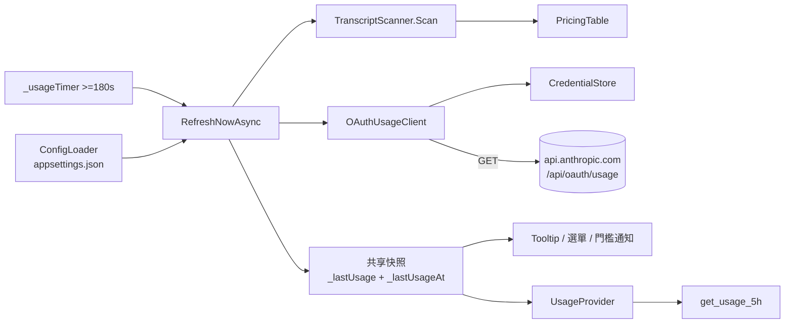
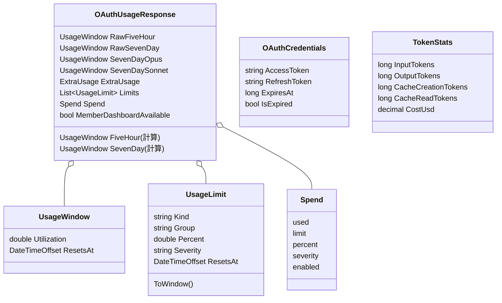
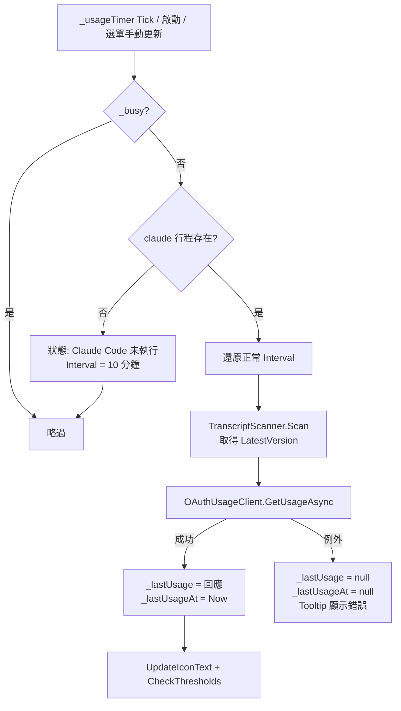
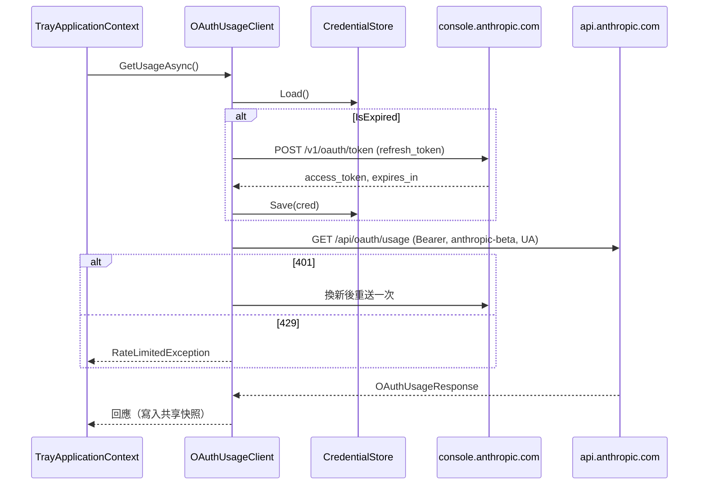
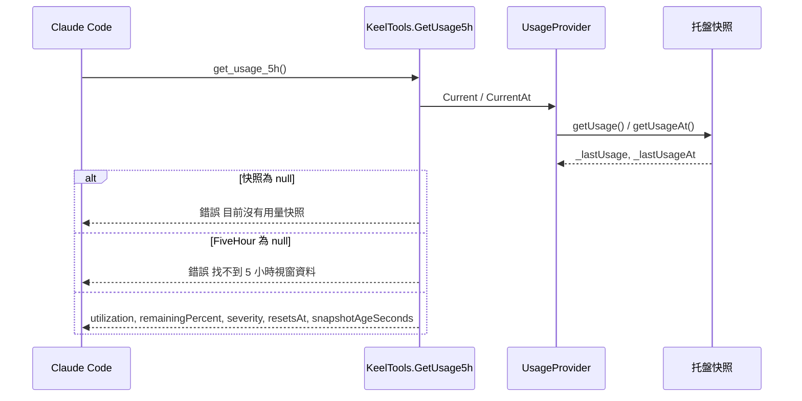
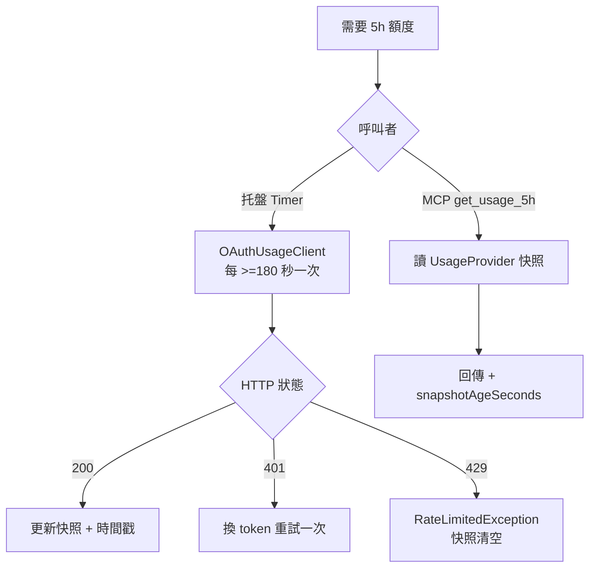
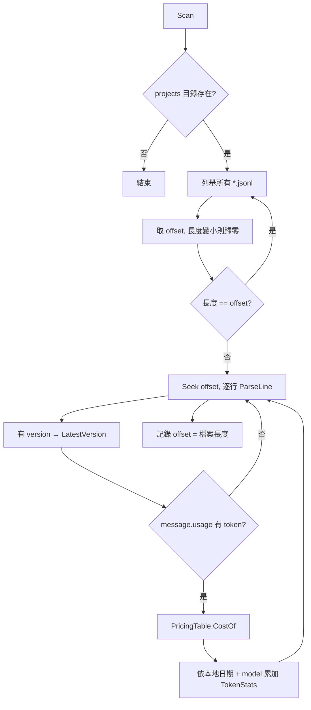
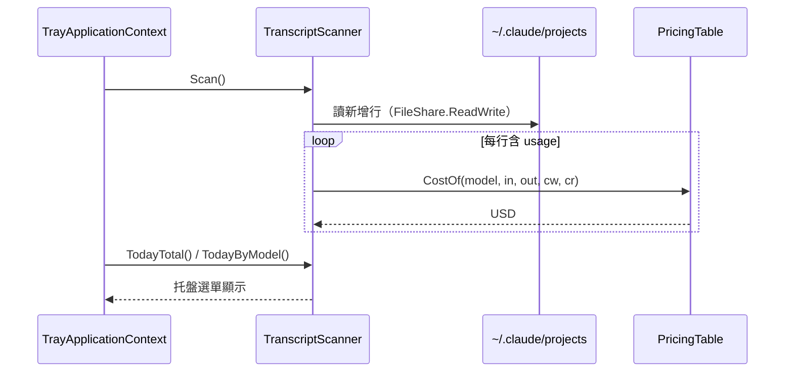
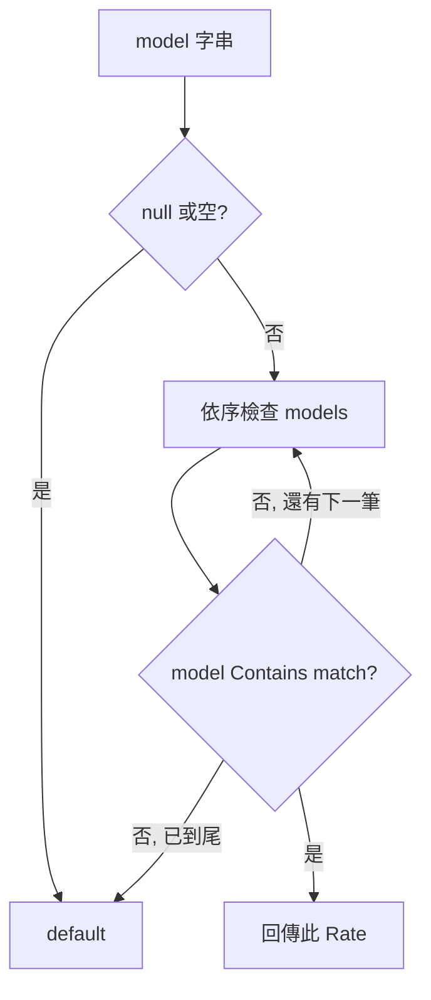

# 用量監控

## 目錄

- [文件資訊](#文件資訊)
- [系統概述](#系統概述)
- [共用資料結構](#共用資料結構)
- [UsagePolling 額度輪詢與快照](#usagepolling-額度輪詢與快照)
- [CostEstimation 本機 Token 成本估算](#costestimation-本機-token-成本估算)
- [附錄](#附錄)

---

## 文件資訊

| 項目 | 內容 |
|------|------|
| 系統名稱 | Keel Assistant（系統匣常駐助理，.NET 8 WinForms + 內嵌 MCP Server） |
| 模組位置 | `Usage/` |
| 業務邏輯位置 | `Usage/OAuthUsageClient.cs`、`Usage/TranscriptScanner.cs`、`TrayApplicationContext.cs`（`RefreshNowAsync`、`CheckThresholds`） |
| MCP 工具位置 | `Api/KeelTools.cs`（`get_usage_5h`）、`Api/McpHost.cs`（`UsageProvider`） |
| 設定檔 | `appsettings.json`、`pricing.json` |
| 最後更新 | 2026/11/12 |

### 版本歷史

| 版本 | 日期 | 異動內容 | 異動人員 |
|------|------|----------|----------|
| 1.0 | — | 移植自 ClaudeUsageMonitor：OAuth usage 輪詢、transcript 成本估算 | Arlen |
| 1.1 | 2026/07/02 | 對應官方新格式 `limits[]` / `spend`，舊 `five_hour` / `seven_day` 保留為 fallback；托盤顯示 spend | Arlen |
| 1.2 | 2026/07/09 | 無 `claude` 行程時暫停查詢並退避 10 分鐘，避免 Keel 自行換掉 refresh token | Arlen |
| 1.3 | 2026/08/18 | 新增 MCP 工具 `get_usage_5h`；`UsageProvider` 帶快照時間，回傳 `snapshotAgeSeconds` | Arlen |
| 1.4 | 2026/10/01 | `pricing.json` 依官方定價更新：新增 fable-5-1、mythos-5-1、fable、mythos、opus-5-5、opus-4-1、opus-4-2025、sonnet-5 規則；通用 `opus` 由 15/75 改為 5/25；註明「由上而下取第一筆命中，精確 key 須排在通用 key 前」 | Arlen |
| 1.5 | 2026/11/12 | 本文件首次建立（記錄 pricing.json 上述變更） | Arlen |

### 所有相關程式位置

```
KeelAssistant/
├── Usage/
│   ├── ConfigLoader.cs        # 讀 appsettings.json（容許註解、尾逗號）
│   ├── CredentialStore.cs     # 讀寫 ~/.claude/.credentials.json
│   ├── OAuthUsageClient.cs    # 打官方 usage 端點、token 換新、RateLimitedException
│   ├── TranscriptScanner.cs   # 增量掃 ~/.claude/projects/**/*.jsonl
│   └── PricingTable.cs        # 讀 pricing.json、計算成本
├── pricing.json               # 每百萬 token 單價表
├── appsettings.json           # PollIntervalSeconds、門檻、OAuthClientId
├── Api/
│   ├── McpHost.cs             # UsageProvider（共享快照存取器）
│   └── KeelTools.cs           # get_usage_5h
├── Models/Models.cs           # OAuthUsageResponse、UsageWindow、UsageLimit、Spend、ExtraUsage、OAuthCredentials、TokenStats、AppSettings
└── TrayApplicationContext.cs  # _usageTimer、RefreshNowAsync、UpdateIconText、CheckThresholds、托盤選單用量項
```

---

## 系統概述

### 簡介

用量監控模組顯示 Claude 訂閱額度的使用狀況。它有兩條資料來源：

1. **官方額度**：托盤以 `_usageTimer`（至少 180 秒）呼叫官方未公開的 OAuth usage 端點，取得 5 小時、7 天等視窗的使用百分比。結果存成一份共享快照，托盤 Tooltip、選單、門檻通知與 MCP 工具 `get_usage_5h` 都讀這份快照。
2. **本機估算**：`TranscriptScanner` 增量掃描 Claude Code 的 transcript（JSONL），依 `pricing.json` 估算今日 token 與成本。

### 在整體系統中的定位

- 托盤常駐功能，也透過 MCP 讓 Claude Code（Keel）查自己的剩餘額度。
- 🔑 MCP 是 `Stateless=true`，多 session 與 SubAgent 共用同一行程。`get_usage_5h` **只讀共享快照，不得改成即時呼叫 `OAuthUsageClient`**。

### 核心價值主張

- 一次輪詢、多處共用，避免撞官方 429 桶。
- 快照新舊以 `snapshotAgeSeconds` 揭露，而不是改抓法。

### 模組關係圖



---

## 共用資料結構



| 類別 | 位置 | 用途 |
|------|------|------|
| `AppSettings`（用量欄位） | `Models/Models.cs` | `PollIntervalSeconds`(預設 300)、`WarnThresholdPercent`(80)、`CriticalThresholdPercent`(95)、`OAuthClientId` |
| `OAuthUsageResponse` | `Models/Models.cs` | usage 端點回應；`FiveHour` 優先取 `limits[]` 中 `kind=session`，沒有才用 `five_hour`；`SevenDay` 優先取 `weekly_all`，沒有才用 `seven_day` |
| `CredentialsFile` / `OAuthCredentials` | `Models/Models.cs` | `.credentials.json` 的 `claudeAiOauth` 節點；`IsExpired` = 到期前 1 分鐘即視為過期 |
| `TokenRefreshResponse` | `Models/Models.cs` | token 換新回應（`access_token`、`refresh_token`、`expires_in`） |
| `TokenStats` | `Models/Models.cs` | 本機估算的 token 與成本累計 |
| `UsageProvider` | `Api/McpHost.cs` | 以兩個委派包裝托盤的 `_lastUsage` / `_lastUsageAt`，注入 MCP DI |

`ConfigLoader.LoadSettings(path)`：檔案不存在回預設 `AppSettings`；以 `JsonCommentHandling.Skip` + `AllowTrailingCommas` 解析。

---

## UsagePolling 額度輪詢與快照

涵蓋 `OAuthUsageClient`、`CredentialStore`、`UsageProvider`、`TrayApplicationContext` 的輪詢段落，以及 MCP 工具 `get_usage_5h`。

### 核心功能列表

- ⭐ 單一輪詢者 + 共享快照：托盤是唯一呼叫 usage 端點的地方，MCP 只讀快照
- ⭐ 429 防護：必帶 `User-Agent: claude-code/<version>`；輪詢間隔硬限 `>= 180` 秒；429 拋 `RateLimitedException`
- ⭐ 無 `claude` 行程時不查用量、不換 token，退避 10 分鐘
- ✅ access token 過期或 401 時自動以 refresh token 換新，寫回 `.credentials.json`，重試一次
- ✅ 托盤 Tooltip 顯示 5h / 7d 百分比；選單顯示各視窗、extra usage、spend
- ✅ 跨過警告/危險門檻時氣泡通知（同一視窗同一門檻只通知一次，降回門檻下重置）
- ✅ `get_usage_5h` 回傳 `snapshotAgeSeconds`
- ❌ 不支援 MCP 即時查詢官方端點
- ❌ `get_usage_5h` 不回傳 7 天視窗

### 技術堆疊

| 項目 | 內容 |
|------|------|
| 開發框架 | .NET 8 WinForms |
| HTTP | `HttpClient`（逾時 30 秒）、`System.Net.Http.Json` |
| 服務形式 | 托盤 `System.Windows.Forms.Timer` 輪詢 + MCP 工具 |
| 日誌系統 | 無專屬日誌；錯誤顯示於托盤 Tooltip / 狀態列 |
| 加密方式 | 無（憑證檔為 Claude Code 自行管理的明文 JSON） |
| ORM / 資料庫 / MQ | 本模組無此項目 |

### 系統架構

#### 專案結構

```
Usage/OAuthUsageClient.cs
Usage/CredentialStore.cs
Api/McpHost.cs           # UsageProvider
Api/KeelTools.cs         # GetUsage5h
TrayApplicationContext.cs
```

#### 核心執行流程圖



#### 多執行緒架構

| 執行緒 | 負責 | 功能 | 控制參數 |
|--------|------|------|----------|
| UI 執行緒 | `_usageTimer`、`RefreshNowAsync`（async void，await 後回到 UI 緒） | 輪詢、更新快照與托盤 | `PollIntervalSeconds`（下限 180）、`NoClaudeBackoffMs=600000`、`_busy` 防重入 |
| MCP 請求執行緒 | `GetUsage5h` | 透過委派讀 `_lastUsage` / `_lastUsageAt` | 無；只讀參考，不發網路請求 |

#### 整合架構序列圖



### API 規格

#### 通用設定

| 項目 | 內容 |
|------|------|
| 服務類型 | MCP 工具 |
| 服務端點 | `http://127.0.0.1:38600/mcp`（埠由 `ApiPort` 決定） |
| Content-Type | `application/json`（JSON-RPC over Streamable HTTP） |
| 認證方式 | 無；只綁 loopback |
| 字元編碼 | UTF-8 |
| 資料格式 | JSON 物件；錯誤以 `McpException(訊息)` 透出 |

#### get_usage_5h

**功能描述**：查詢 Claude 5 小時（session）額度：已用、剩餘百分比、嚴重度、重置時間。供 Claude 判斷是否該節省 token 或提醒 Arlen。

**請求格式**：無參數。

**回應格式**：

| 欄位 | 型態 | 說明 |
|------|------|------|
| `window` | string | 固定 `"5h"` |
| `utilization` | double | 已用百分比（小數 1 位） |
| `remainingPercent` | double | `100 - utilization` |
| `severity` | string? | `limits[]` 中 `kind=session` 的 `severity`；舊格式為 null |
| `resetsAt` | string? | 本機時間 `yyyy/MM/dd HH:mm` |
| `resetsInMinutes` | int? | 距重置分鐘數（最小 0） |
| `snapshotAt` | string? | 快照取得時間 `yyyy/MM/dd HH:mm:ss` |
| `snapshotAgeSeconds` | int? | 快照已過秒數；最舊可達輪詢間隔（>= 180 秒），Claude Code 未執行時可達 10 分鐘以上 |

失敗：
- `目前沒有用量快照（尚未完成第一次輪詢，或上次取得失敗）。請稍後再試，或請 Arlen 從托盤選單手動更新。`
- `用量回應中找不到 5 小時視窗資料（limits[] 的 session 與舊 five_hour 欄位皆無）。`

**業務流程**：



**主要驗證規則**：
- 快照不可為 null（輪詢失敗時托盤會把快照與時間戳一起清掉，避免回報舊時間）。
- `FiveHour`：`limits[kind=session]` 優先，否則 `five_hour`。

**資料表更新**：本工具無此項目（唯讀記憶體快照）。

**觸發的外部呼叫**：無。🔑 刻意不呼叫 `OAuthUsageClient`。

#### 測試案例

| 測試場景 | 輸入條件 | 預期結果 | 驗證重點 |
|----------|----------|----------|----------|
| 正常 | 托盤已成功輪詢 | 回傳各欄位，`snapshotAgeSeconds` ≤ 輪詢間隔 | 只讀快照 |
| 剛啟動 | 第一次輪詢尚未完成 | 「目前沒有用量快照」 | null 處理 |
| 輪詢失敗 | 上次拋 429 或 token 換新失敗 | 「目前沒有用量快照」 | 失敗時清時間戳 |
| 舊格式回應 | 無 `limits[]`，有 `five_hour` | 正常回傳，`severity=null` | fallback |
| 多 session 連打 | 10 個 SubAgent 同時呼叫 | 全部成功，官方端點無額外請求 | 不撞 429 |
| Claude Code 未執行 | 無 `claude` 行程 | 快照不更新，`snapshotAgeSeconds` 增大 | 退避 10 分鐘 |
| 已過重置時間 | `ResetsAt` 早於現在 | `resetsInMinutes = 0` | `Math.Max(0, …)` |

### 資料結構定義

- **主要資料物件**：見[共用資料結構](#共用資料結構)。
- **資料表欄位說明**：本模組無資料表。`.credentials.json`（`claudeAiOauth` 節點）重要欄位：

| 欄位名稱 | 資料型態 | 說明 | 備註 |
|----------|----------|------|------|
| `accessToken` | string | Bearer token | 換新後覆寫 |
| `refreshToken` | string | 換新用 | 回應有新值才覆寫 |
| `expiresAt` | long | Unix 毫秒 | `IsExpired` 提前 1 分鐘判定 |
| `scopes`、`subscriptionType`、`rateLimitTier` | — | 訂閱資訊 | 讀取用 |

### 核心業務邏輯

#### 429 限流與共享快照約束

- **檔案位置**：`Usage/OAuthUsageClient.cs`、`TrayApplicationContext.cs`、`Api/KeelTools.cs`
- **核心概念**：官方 usage 端點有嚴格 429 桶。MCP 多 session 共用同一行程，若各自即時抓，必然撞 429，並連帶讓托盤輪詢也失效。
- **主要流程圖**：



- **關鍵限制**：
  - 🔑 `get_usage_5h` 只讀 `UsageProvider`，不得改成即時呼叫。快照過舊用 `snapshotAgeSeconds` 揭露。
  - 🔑 `User-Agent: claude-code/<version>` 必帶，否則進入嚴格 429 桶。版本取自 `TranscriptScanner.LatestVersion`（預設 `2.1.128`，掃描 JSONL 的 `version` 欄更新）。注意：`_usageClient` 首次建立後即固定該版本字串。
  - 🔑 輪詢間隔 `Math.Max(180, PollIntervalSeconds)`，設定低於 180 無效。
- **執行邏輯說明**：成功才更新 `_lastUsageAt`；任何例外都同時清空 `_lastUsage` 與 `_lastUsageAt`。

#### Claude Code 行程前置條件

- 以 `Process.GetProcessesByName("claude")` 偵測。沒有行程時不查用量、不觸發 token refresh：Keel 自行換掉 refresh token 會讓 Claude Code 端 auth 失效需重登。
- 此時 Interval 改為 10 分鐘；恢復後還原為正常間隔。

#### 門檻通知

- `CheckThresholds` 檢查 5 小時、7 天、7 天 Opus、7 天 Sonnet 四個視窗。
- `Utilization >= Critical`（預設 95）或 `>= Warn`（預設 80）時，若跨過的門檻高於已通知值才跳氣泡；降回門檻下即移除記錄。

### 外部系統整合

| 服務名稱 | 設定項目 | 呼叫的方法 |
|----------|----------|------------|
| Anthropic OAuth usage 端點 | `https://api.anthropic.com/api/oauth/usage`；header `anthropic-beta: oauth-2025-04-20` | `GET`（`SendUsageRequestAsync`） |
| Anthropic OAuth token 端點 | `https://console.anthropic.com/v1/oauth/token`；`OAuthClientId` | `POST grant_type=refresh_token`（`RefreshAsync`） |
| 本機憑證檔 | `%USERPROFILE%\.claude\.credentials.json` | `CredentialStore.Load` / `Save` |

### 認證與安全機制

- **Token 認證機制**：
  - 驗證流程：讀 `.credentials.json` → 過期（到期前 1 分鐘）先換新 → 帶 `Authorization: Bearer` 呼叫 → 401 再換新重試一次。
  - Token 規則：換新後寫回 `accessToken`、`expiresAt`（`UtcNow + expires_in`），有新 `refreshToken` 才覆寫。
  - 取得方式：由 Claude Code 登入（`claude` 指令）產生；Keel 不負責初次登入。
- **安全規範**：
  - 機敏資訊一律從檔案讀取，不寫死於程式碼（`OAuthClientId` 為公開 client id，置於設定）。
  - `CredentialStore.Save` 只序列化 `claudeAiOauth` 節點後覆寫整檔。
  - Python 沙盒黑名單包含 `*\.credentials.json`，避免憑證經沙盒外流。
  - SQL Injection：本模組無此項目。

### 例外處理

- **例外處理模式**：`RefreshNowAsync` 捕捉所有例外，寫入狀態列與 Tooltip，並清空快照；不中斷 Timer。`get_usage_5h` 以 `Reportable` 轉 `McpException`。
- **錯誤代碼格式**：

| 類型 | 例外 / 訊息 | 觸發 |
|------|-------------|------|
| 業務錯誤 | `InvalidOperationException`：找不到 .credentials.json，請先以 claude 登入。 | 憑證檔不存在 |
| 業務錯誤 | `RateLimitedException`：usage 端點回 429，請拉長輪詢間隔（>=180 秒）。 | HTTP 429 |
| 業務錯誤 | `TokenRefreshException`：Token 換新失敗（{status}），請重新執行 claude 登入。 / Token 換新回應無法解析。 | 換新失敗 |
| 系統例外 | `HttpRequestException`（`EnsureSuccessStatusCode`） | 其他非 2xx |
| 系統例外 | `TaskCanceledException` | HttpClient 30 秒逾時 |

### 資料庫架構

- **主要資料表**：本模組無此項目。
- **外部 Web Service 依賴**：

| Service | URL | 用途 |
|---------|-----|------|
| OAuth usage | `https://api.anthropic.com/api/oauth/usage` | 取得額度使用率 |
| OAuth token | `https://console.anthropic.com/v1/oauth/token` | 換新 access token |

- **資料庫連線**：本模組無此項目。

---

## CostEstimation 本機 Token 成本估算

涵蓋 `TranscriptScanner`、`PricingTable`、`pricing.json`。

### 核心功能列表

- ⭐ 增量掃描：記住每個 JSONL 已讀 byte offset，只解析新增內容
- ⭐ `pricing.json` 由上而下取第一筆「包含」命中的規則，精確 key 排在通用 key 前
- ✅ 依本地日期、模型分桶累計 input / output / cacheWrite / cacheRead 與 USD 成本
- ✅ 檔案被截斷或重建（長度變小）時從頭重讀
- ✅ 單一檔案壞行不影響整體
- ✅ 從 JSONL `version` 欄取得最新 Claude Code 版本，供 usage 請求的 User-Agent
- ❌ 不是官方帳單；費率需手動維護
- ❌ 不持久化：重啟後 offset 歸零，重新掃描全部檔案
- ❌ 本模組無 MCP 工具

### 技術堆疊

| 項目 | 內容 |
|------|------|
| 開發框架 | .NET 8 |
| 解析 | `System.Text.Json`（`JsonDocument` 逐行解析；`pricing.json` 允許註解與尾逗號） |
| 服務形式 | 托盤輪詢時呼叫（`RefreshNowAsync` 內 `_scanner.Scan()`） |
| ORM / 資料庫 / 日誌 / 加密 / MQ | 本模組無此項目 |

### 系統架構

#### 專案結構

```
Usage/TranscriptScanner.cs
Usage/PricingTable.cs
pricing.json
%USERPROFILE%\.claude\projects\**\*.jsonl   # 掃描來源
```

#### 核心執行流程圖



#### 多執行緒架構

| 執行緒 | 負責 | 功能 | 控制參數 |
|--------|------|------|----------|
| UI 執行緒 | `Scan`、`TodayTotal`、`TodayByModel` | 掃描與查詢共用字典，未加鎖，只在 UI 緒存取 | 隨 `_usageTimer` |

#### 整合架構序列圖



### API 規格

本模組無此項目（無 MCP 工具；結果僅顯示於托盤選單）。通用設定同 [UsagePolling › API 規格](#api-規格)。

#### 測試案例

| 測試場景 | 輸入條件 | 預期結果 | 驗證重點 |
|----------|----------|----------|----------|
| 精確規則優先 | model `claude-opus-5-5` | 套 `opus-5-5`（4/20/5/0.2） | 第一筆命中 |
| 舊 Opus | model `claude-opus-4-1-…` | 套 `opus-4-1`（15/75） | 排序 |
| 通用 Opus | model `claude-opus-4-6` | 套 `opus`（5/25） | fallback 到通用 key |
| Sonnet 5 | model `claude-sonnet-5-5` | 套 `sonnet-5`（2/10） | `sonnet-5` 排在 `sonnet` 前 |
| 未知模型 | model `foo` 或 null | 套 `default`（3/15/3.75/0.3） | default |
| 增量 | 同一檔追加 1 行 | 只解析該行 | offset |
| 檔案重建 | 檔案長度變小 | 從頭重讀 | 截斷處理 |
| 壞行 | 非 JSON 行 | 該檔停止解析，其他檔不受影響 | try/catch |

### 資料結構定義

**pricing.json 欄位**（單位：USD / 每百萬 token）：

| 欄位名稱 | 資料型態 | 說明 | 備註 |
|----------|----------|------|------|
| `models[].match` | string | 子字串比對 key | 不分大小寫 `Contains`；由上而下第一筆命中 |
| `models[].input` | decimal | 輸入單價 | — |
| `models[].output` | decimal | 輸出單價 | — |
| `models[].cacheWrite` | decimal | 快取寫入（5 分鐘）單價 | — |
| `models[].cacheRead` | decimal | 快取讀取單價 | — |
| `default` | Rate | 無命中時套用 | `match="*"` |

**目前費率（2026/10/01 更新後）**：

| match | input | output | cacheWrite | cacheRead |
|-------|-------|--------|------------|-----------|
| `fable-5-1` | 10.0 | 50.0 | 12.5 | 0.25 |
| `mythos-5-1` | 10.0 | 50.0 | 12.5 | 0.25 |
| `fable` | 10.0 | 50.0 | 12.5 | 1.0 |
| `mythos` | 10.0 | 50.0 | 12.5 | 1.0 |
| `opus-5-5` | 4.0 | 20.0 | 5.0 | 0.2 |
| `opus-4-1` | 15.0 | 75.0 | 18.75 | 1.5 |
| `opus-4-2025` | 15.0 | 75.0 | 18.75 | 1.5 |
| `opus` | 5.0 | 25.0 | 6.25 | 0.5 |
| `sonnet-5` | 2.0 | 10.0 | 2.5 | 0.2 |
| `sonnet` | 3.0 | 15.0 | 3.75 | 0.3 |
| `haiku` | 1.0 | 5.0 | 1.25 | 0.1 |
| `default` (`*`) | 3.0 | 15.0 | 3.75 | 0.3 |

**JSONL 讀取欄位**：`version`、`timestamp`（轉本地日期；缺少時用今天）、`message.model`、`message.usage.input_tokens` / `output_tokens` / `cache_creation_input_tokens` / `cache_read_input_tokens`。四者皆 0 的行略過。

### 核心業務邏輯

- **檔案位置**：`Usage/PricingTable.cs`、`Usage/TranscriptScanner.cs`
- **核心概念**：成本 = (input×Input + output×Output + cacheWrite×CacheWrite + cacheRead×CacheRead) / 1,000,000。
- **主要流程圖**：



- **關鍵限制**：
  - 🔑 規則順序就是優先序。新增版本精確 key（如 `opus-5-5`）必須排在通用 key（`opus`）之前，否則被通用 key 搶先命中。
  - `pricing.json` 只在啟動時載入（`PricingTable.Load`），改檔後須重啟。
  - 費率為手動維護，官方調價需自行更新。
- **執行邏輯說明**：`_byDate` 為「本地日期 → (model → TokenStats)」；`TodayByModel` 依成本由高到低排序。

### 外部系統整合

| 服務名稱 | 設定項目 | 呼叫的方法 |
|----------|----------|------------|
| Claude Code transcript | `%USERPROFILE%\.claude\projects` | `Directory.EnumerateFiles(*.jsonl, AllDirectories)`、`FileStream`（`FileShare.ReadWrite`，不鎖住 Claude Code 寫入） |

### 認證與安全機制

- **Token 認證機制**：本模組無此項目。
- **安全規範**：只讀 transcript，不修改；以 `FileShare.ReadWrite` 開檔避免干擾 Claude Code。

### 例外處理

- **例外處理模式**：`Scan` 對每個檔案 `try/catch` 吞掉例外（單檔壞行不影響整體）；壞行所在檔案的 offset 不更新，下次從同處重試。`PricingTable.Load` 檔案不存在或格式錯誤會在啟動時拋出。
- **錯誤代碼格式**：本模組無自訂錯誤代碼。

### 資料庫架構

- **主要資料表**：本模組無此項目。
- **外部 Web Service 依賴**：本模組無此項目。
- **資料庫連線**：本模組無此項目。

---

## 附錄

### 代碼對照表

| 代碼 | 來源 | 意義 |
|------|------|------|
| `session` | `limits[].kind` | 5 小時視窗 |
| `weekly_all` | `limits[].kind` | 7 天全模型視窗 |
| `five_hour` / `seven_day` | 舊欄位 | `limits[]` 缺少時的 fallback |
| `seven_day_opus` / `seven_day_sonnet` | 舊欄位 | 7 天各模型視窗（門檻檢查用） |
| `severity` | `limits[]` / `spend` | 官方給的嚴重度字串，原樣透出 |
| `oauth-2025-04-20` | `anthropic-beta` header | OAuth beta 旗標 |

### 外部元件參考

本模組無此項目（僅使用 .NET BCL：`HttpClient`、`System.Text.Json`）。

### 常見問題排查

| 問題現象 | 可能原因 | 排查步驟 | 解決方案 |
|----------|----------|----------|----------|
| `get_usage_5h` 回「目前沒有用量快照」 | 剛啟動、上次輪詢失敗、Claude Code 未執行 | 看托盤 Tooltip 錯誤訊息 | 等下次輪詢或托盤手動更新 |
| 托盤顯示 429 | 輪詢太頻繁，或有其他程式即時打端點 | 檢查 `PollIntervalSeconds`、是否有人把 MCP 改成即時抓 | 維持 >= 180 秒；MCP 只讀快照 |
| 「Token 換新失敗」 | refresh token 失效 | 執行 `claude` 確認登入狀態 | 重新登入 Claude Code |
| 「Claude Code 未執行，暫停查詢」 | 沒有 `claude` 行程 | 工作管理員查 `claude.exe` | 開啟 Claude Code，10 分鐘內恢復 |
| `snapshotAgeSeconds` 很大 | 退避中或輪詢失敗 | 看托盤狀態 | 同上 |
| 新模型成本算錯 | `pricing.json` 無對應規則或順序錯 | 查 model 字串與規則順序 | 新增精確 key 並排在通用 key 前，重啟 |
| 今日成本突然歸零 | 跨日或程式重啟 | — | 設計如此（不持久化，重啟後重掃） |

### 名詞解釋

| 名詞 | 定義 |
|------|------|
| 5 小時視窗 | Claude 訂閱的滾動 session 額度 |
| 共享快照 | 托盤最近一次成功輪詢的 `OAuthUsageResponse` 與取得時間 |
| 429 桶 | 官方端點的速率限制分組；User-Agent 不符會進入較嚴格的桶 |
| transcript | Claude Code 在 `~/.claude/projects` 寫的 JSONL 對話紀錄 |
| cacheWrite / cacheRead | Prompt caching 的寫入與命中 token |

### 相關文件

- `CLAUDE.md`（架構 › Usage）
- `README.md`（MCP 工具清單）
- [_Docs/Python沙盒.md](Python沙盒.md)

### 環境特殊說明

- 作業系統：Windows；憑證與 transcript 位於 `%USERPROFILE%\.claude\`。
- 時間：官方回應為 UTC，顯示一律 `ToLocalTime()`；格式 `yyyy/MM/dd HH:mm(:ss)`。
- `pricing.json` 含 `//` 註解，以 `JsonCommentHandling.Skip` 解析；檔案為 UTF-8。
