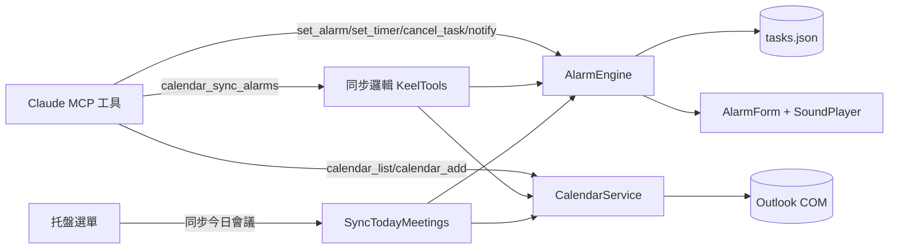
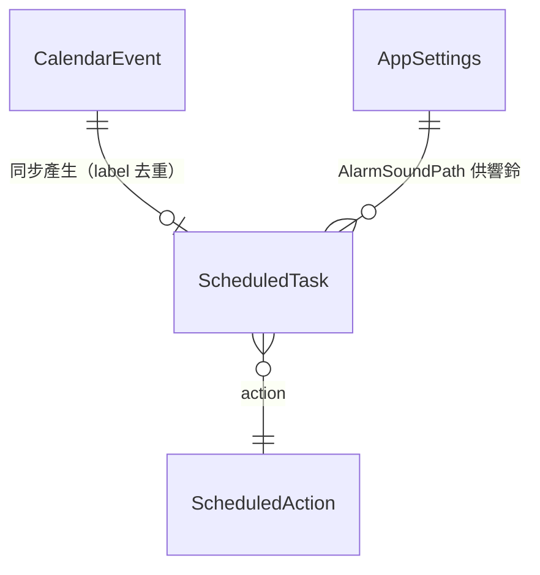
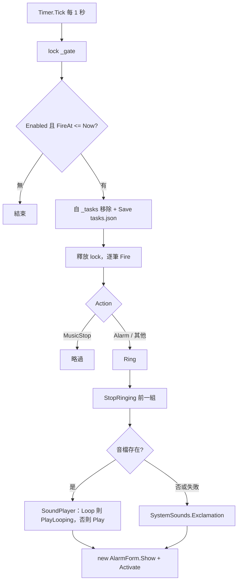
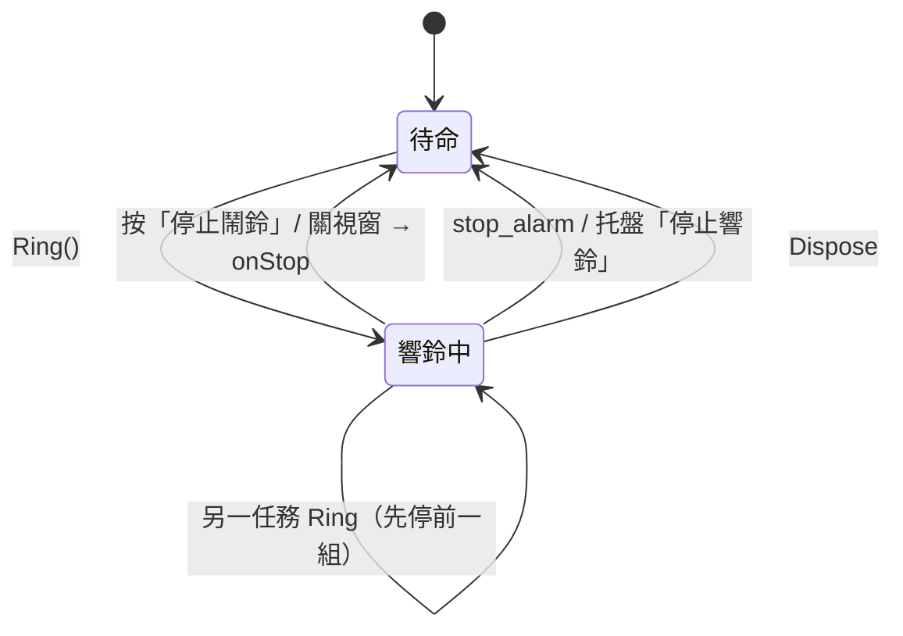
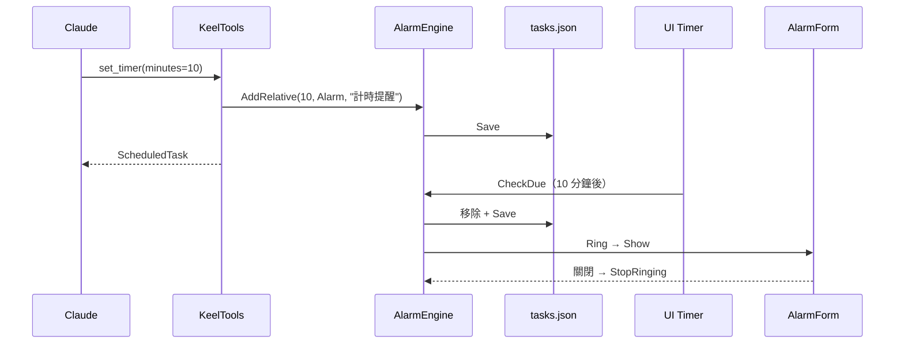
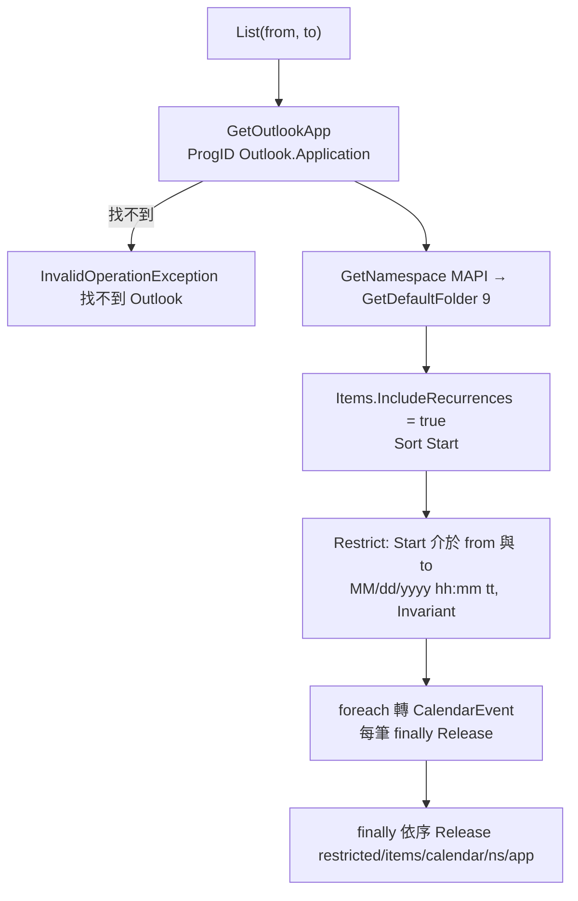
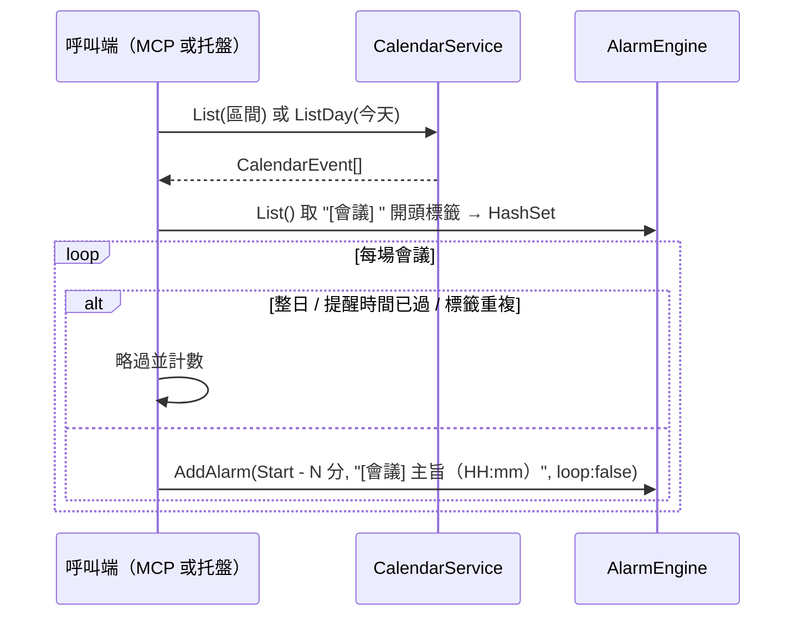

# 鬧鐘排程

## 目錄

- [文件資訊](#文件資訊)
- [系統概述](#系統概述)
- [共用資料結構](#共用資料結構)
- [AlarmEngine 鬧鐘引擎](#alarmengine-鬧鐘引擎)
- [CalendarService Outlook 行事曆](#calendarservice-outlook-行事曆)
- [附錄](#附錄)

---

## 文件資訊

| 項目 | 內容 |
|------|------|
| 系統名稱 | Keel Assistant（系統匣常駐助理） |
| 模組位置 | `Alarm/`、`Calendar/` |
| 業務邏輯位置 | `Alarm/AlarmEngine.cs`、`Calendar/CalendarService.cs`；同步邏輯在 `Api/KeelTools.cs`（`calendar_sync_alarms`）與 `TrayApplicationContext.SyncTodayMeetings` |
| 最後更新 | 2026/11/12 |

### 版本歷史

| 版本 | 日期 | 異動內容 | 異動人員 |
|------|------|----------|----------|
| 1.0 | 2026/11/12 | 初版。記錄 2026/11/10 移除音樂模組的影響：`AlarmEngine` 建構子拿掉 `stopMusic` callback；`Fire` 遇到 `ScheduledAction.MusicStop` 直接略過（不可落入 default 響鈴）；`set_timer` 不再能建立 MusicStop 任務；列舉值保留只為讓舊 `tasks.json` 能反序列化。 | Arlen |

### 所有相關程式位置

```
KeelAssistant/
├── Alarm/
│   ├── AlarmEngine.cs        # 排程引擎：Timer、tasks.json、響鈴
│   ├── AlarmForm.cs          # 響鈴時的置頂視窗
│   └── AlarmForm.resx        # 表單資源（未使用 InitializeComponent）
├── Calendar/
│   └── CalendarService.cs    # Outlook COM 查詢 / 新增；CalendarEvent
├── Api/KeelTools.cs          # 鬧鐘、行事曆相關 MCP 工具
├── TrayApplicationContext.cs # 托盤鬧鐘選單、SyncTodayMeetings
├── Models/Models.cs          # ScheduledAction、ScheduledTask、AppSettings.AlarmSoundPath
└── assets/alarm.wav          # 預設響鈴音檔
```

---

## 系統概述

### 簡介

`AlarmEngine` 是記憶體排程引擎。UI 執行緒上的 `System.Windows.Forms.Timer` 每秒檢查到期任務，到期就播放音檔並彈出 `AlarmForm`。任務存在 `tasks.json`，程式重啟後復原；離線期間到期的任務在啟動時補觸發。

`CalendarService` 以 COM late-binding 讀寫本機 Outlook 行事曆。它與鬧鐘的關係是「會議同步」：把 Outlook 會議轉成「開始前 N 分鐘」的單次鬧鐘，避免 Outlook 沒開時漏掉會議。

**定位**：Keel 的提醒中樞。Claude 透過 MCP 工具設定提醒；Arlen 透過托盤選單查看與取消。

### 模組關係圖



### 核心功能列表

- ⭐ 每秒到期檢查 + `tasks.json` 持久化，重啟後補觸發
- ⭐ Outlook 會議自動同步成鬧鐘，以標籤去重
- ✅ 絕對時間鬧鐘、相對計時、即時通知
- ✅ 查詢與新增 Outlook 行程（含週期性會議展開）
- ❌ 週期性鬧鐘（每天重複）：不支援，觸發後即移除
- ❌ 刪改 Outlook 行程：不支援

### 技術堆疊

| 項目 | 內容 |
|------|------|
| 開發框架 | .NET 8 WinForms |
| ORM | 本模組無此項目 |
| 資料庫 | 無；`tasks.json`（System.Text.Json） |
| 服務形式 | 托盤常駐 + MCP 工具 |
| 日誌系統 | 無（錯誤吞掉或轉例外） |
| 音效 | `System.Media.SoundPlayer`（wav）；失敗退回 `SystemSounds.Exclamation` |
| 外部整合 | Outlook COM（`Outlook.Application` ProgID） |
| MQ 系統 | 本模組無此項目 |

---

## 共用資料結構

### ScheduledTask（tasks.json 一筆）

| 欄位名稱 | 資料型態 | 說明 | 備註 |
|---------|---------|------|------|
| id | string | 任務 Id（PK） | `Guid.NewGuid().ToString("N")[..8]`，8 碼 |
| fireAt | DateTime | 觸發時間 | 本地時間 |
| label | string | 標籤 | 會議同步者為 `[會議] {主旨}（HH:mm）`，用來去重 |
| action | ScheduledAction | 動作 | 以字串序列化（`JsonStringEnumConverter`） |
| loop | bool | 是否循環響鈴 | `AddRelative` 時 Alarm 為 true；會議同步為 false |
| enabled | bool | 是否啟用 | 程式一律建 true；只有 true 的會被觸發 |

### ScheduledAction

| 值 | 說明 | 狀態 |
|----|------|------|
| Alarm | 響鈴（音檔 + 視窗） | ✅ 使用中 |
| MusicStop | 原為「停止音樂」 | 🔑 僅相容保留：舊 `tasks.json` 若含此值，刪除列舉會讓整份檔案反序列化失敗（`Load` 吞例外 → 所有排程遺失）。到期時直接略過，不可再新增 |

### CalendarEvent

| 欄位 | 型態 | 說明 |
|------|------|------|
| Id | string | Outlook EntryID |
| Subject / Location | string | Trim 後的主旨／地點 |
| Start / End | DateTime | 原生時間，供回推「開始前 N 分鐘」 |
| IsAllDay | bool | 整日事件（同步時跳過） |
| StartText / EndText | string | `yyyy/MM/dd HH:mm` 顯示用 |



---

## AlarmEngine 鬧鐘引擎

### 核心功能列表

- ⭐ `CheckDue`：每秒在 lock 內取出到期任務、移除並 Save，再在 lock 外觸發
- ⭐ 啟動時 `Load()` 後立即 `CheckDue()`，補觸發離線期間到期者
- ✅ `AddAlarm(fireAt, label, loop)`、`AddRelative(minutes, action, label)`
- ✅ `List()`（依 FireAt 排序的複本）、`Cancel(id)`
- ✅ `Notify(message)`：立即響一次，不入排程
- ✅ `StopRinging()`：停音效並關視窗
- ✅ 同一時間只保留一組響鈴資源

### 系統架構

#### 專案結構

```
Alarm/
├── AlarmEngine.cs   # 引擎
└── AlarmForm.cs     # 360x200 置頂視窗、「停止鬧鈴」按鈕；關閉時呼叫 onStop
```

#### 核心執行流程



#### 響鈴狀態



#### 多執行緒架構

| 執行緒 | 動作 | 保護 |
|--------|------|------|
| UI 執行緒 | Timer Tick、Fire、Ring、StopRinging、Notify | `stop_alarm`／`notify` 經 `UiDispatcher` 切回 |
| MCP 執行緒池 | AddAlarm、AddRelative、List、Cancel | `lock (_gate)`；不碰 UI，所以不需切執行緒 |

#### 整合架構序列圖



### 模組專屬資料結構

| 成員 | 說明 |
|------|------|
| `_tasks` | `List<ScheduledTask>`，以 `_gate` 保護 |
| `_player` / `_alarmForm` | 目前響鈴資源，同時只一組 |
| `JsonOpts` | 縮排、`UnsafeRelaxedJsonEscaping`（中文直出）、列舉存字串 |

### 核心業務邏輯

- **檔案位置**：`Alarm/AlarmEngine.cs`
- **核心概念**：一次性任務。觸發即移除，所以檔案裡只會有「未來的」任務。
- **關鍵限制**：
  - 🔑 `MusicStop` 不可刪除也不可再使用（見共用資料結構）。
  - 多筆同時到期時，每筆 `Ring` 都會先 `StopRinging`，畫面上只留最後一筆的視窗與音效。
  - `Load` 遇到壞檔吞例外，視為無任務；下一次 `Save` 會覆寫原檔。
  - `Save` 寫入失敗也吞掉，只影響持久化，不影響執行期。
  - 音檔路徑：絕對路徑直接用；相對路徑以 exe 目錄為基準。
  - `Notify` 建的任務不加入 `_tasks`、不 Save。
- **相對計時的 Loop**：`AddRelative` 以 `action == Alarm` 決定 Loop，因此 `set_timer` 一律循環響鈴，需人工停止。

### API 規格

本模組由以下 MCP 工具使用，完整規格（參數、回應、驗證、測試案例）見 [`MCP主機與工具.md` 的鬧鐘 / 計時類](MCP主機與工具.md#keeltools-mcp-工具集)。

| 工具 | 引擎方法 | 寫 tasks.json |
|------|----------|:-----------:|
| list_tasks | `List()` | ❌ |
| set_alarm | `AddAlarm` | ✅ |
| set_timer | `AddRelative(min, Alarm, label)` | ✅ |
| cancel_task | `Cancel` | ✅（有移除時） |
| stop_alarm | `StopRinging`（UI） | ❌ |
| notify | `Notify`（UI） | ❌ |
| calendar_sync_alarms | `List` + `AddAlarm(loop:false)` | ✅ |

托盤操作：選單列出每筆任務（`MM/dd HH:mm 標籤 (剩 …)`），子選單「取消此任務」；另有「停止響鈴」。

### 測試案例

| 測試場景 | 輸入條件 | 預期結果 | 驗證重點 |
|----------|----------|----------|----------|
| 重啟復原 | 設 30 分後鬧鐘，重啟 exe | 托盤仍列出該任務 | Load |
| 離線補觸發 | 關閉 exe 跨過觸發時間再開 | 啟動即響鈴，任務自檔案移除 | 建構子 CheckDue |
| 舊 MusicStop 任務 | tasks.json 手動放入 `"action":"MusicStop"` 已過期的一筆 | 不響鈴，任務被移除，其他任務正常 | 相容處理 |
| 壞檔 | tasks.json 內容非 JSON | 視為無任務，不當機 | Load 吞例外 |
| 無音檔 | AlarmSoundPath 指向不存在檔案 | 系統提示音 + 視窗 | 退回 |
| 同時到期 | 兩筆同分鐘 | 只留最後一筆視窗 | 資源唯一 |
| 關視窗即停 | 按視窗右上 X | 音效停止 | OnFormClosed → onStop |

### 認證與安全機制

本模組無此項目（本機記憶體與檔案，無認證需求）。

### 例外處理

| 情境 | 處理 |
|------|------|
| 讀檔失敗 / 壞檔 | 吞掉，空排程 |
| 寫檔失敗 | 吞掉 |
| SoundPlayer 失敗 | 改播系統音 |
| 參數錯誤 | 由 KeelTools 拋 `ArgumentException` |

### 外部系統整合

本模組無此項目（只用本機音效）。

### 資料庫架構

| 項目 | 說明 |
|------|------|
| 主要資料表 | 無；持久化檔 `{exe 目錄}\tasks.json`（`ScheduledTask` 陣列） |
| 外部 Web Service 依賴 | 無 |
| 資料庫連線 | 無 |

---

## CalendarService Outlook 行事曆

### 核心功能列表

- ⭐ COM late-binding（`dynamic`），不需 Office PIA、不綁 Outlook 版本
- ⭐ 與鬧鐘整合：`calendar_sync_alarms`、托盤「同步今日會議」
- ✅ `List(from, to)`：`IncludeRecurrences = true` 展開週期性會議，`Sort("[Start]")`，`Restrict` 篩選
- ✅ `ListDay(day)`：當天 00:00 至 23:59:59
- ✅ `Add(...)`：建立行程，回傳 EntryID
- ✅ 每個 COM 物件用完 `Marshal.FinalReleaseComObject`
- ❌ 修改、刪除行程

### 系統架構

#### 查詢流程



#### 與鬧鐘同步的關係



| 比較 | calendar_sync_alarms（MCP） | SyncTodayMeetings（托盤） |
|------|---------------------------|--------------------------|
| 區間 | `start`（預設現在）+ `offsetHours`（預設 24） | 今天整天 |
| 提前分鐘 | `minutesBefore`（預設 10） | 固定 10 |
| 執行緒 | 整段包在 `ui.Send` | 托盤點擊已在 UI 執行緒 |
| 回報 | 各類略過計數 JSON | 氣泡顯示新增數 |
| 去重 | 標籤（同一實作邏輯，兩處各自實作） | 同左 |

### 模組專屬資料結構

見[共用資料結構](#共用資料結構)的 `CalendarEvent`。常數：`OlFolderCalendar = 9`、`OlAppointmentItem = 1`、`RestrictDateFormat = "MM/dd/yyyy hh:mm tt"`。

### 核心業務邏輯

- **檔案位置**：`Calendar/CalendarService.cs`
- **核心概念**：薄 COM 包裝，只做「查」與「塞」。
- **關鍵限制**：
  - 🔑 必須在 STA（UI）執行緒呼叫，MCP 端經 `UiDispatcher`。類別註解仍寫「透過 HttpApiServer.RunOnUi」，那是舊名稱，實際為 `UiDispatcher`。
  - `Restrict` 只比對 `[Start]`，所以「開始時間在區間前、仍在進行中」的會議不會列出。
  - `Restrict` 日期字串固定美式格式 + InvariantCulture，避免地區設定干擾。
  - 去重靠標籤，主旨或開始時間改變後會被視為新會議；舊的提醒不會自動刪除。
  - `Add`：`reminder > 0` 才設 `ReminderSet`；null 或 0 沿用 Outlook 預設。
  - 🔑 `calendar_sync_alarms` 整段跑在 UI 執行緒；Outlook 回應慢時會延遲鬧鐘 Timer 與錄音 pump。
- **執行邏輯**：`Activator.CreateInstance` 對 Outlook 是 single-instance server，已開啟則取得現有實例。

### API 規格

| 工具 | 方法 | 說明 |
|------|------|------|
| calendar_list | `List` | 區間查詢 |
| calendar_sync_alarms | `List` + AlarmEngine | 同步成鬧鐘 |
| calendar_add | `Add` | 新增行程 |

完整參數、回應、驗證與測試案例見 [`MCP主機與工具.md` 的行事曆類](MCP主機與工具.md#keeltools-mcp-工具集)。

### 測試案例

| 測試場景 | 輸入條件 | 預期結果 | 驗證重點 |
|----------|----------|----------|----------|
| 週期性會議 | 每週例會在區間內 | 列出當次 | IncludeRecurrences |
| 未安裝 Outlook | 無 ProgID | `找不到 Outlook，請確認本機已安裝…` | 例外訊息 |
| 同步跳過整日 | 區間含整日事件 | `skippedAllDay` 加 1 | — |
| 同步跳過已過 | 會議 5 分鐘後開始、minutesBefore=10 | `skippedPast` 加 1 | 提醒時間已過 |
| 重複同步 | 同步兩次 | 第二次 `skippedDup` 等於第一次 `added` | 標籤去重 |
| 不殘留行程 | 呼叫後關閉 Outlook | 無殘留 OUTLOOK.EXE | FinalRelease |

### 認證與安全機制

使用目前 Windows 使用者的 Outlook 設定檔，無額外認證。Restrict 篩選字串只由程式組出的日期構成，不含使用者輸入，無注入風險。

### 例外處理

| 情境 | 訊息 |
|------|------|
| 查詢失敗 | `讀取 Outlook 行事曆失敗：{原訊息}`（InvalidOperationException，保留 inner） |
| 新增失敗 | `新增 Outlook 行程失敗：{原訊息}` |
| 單筆讀取失敗 | 會中斷整個查詢（只有 Release 在 finally） |

### 外部系統整合

| 服務 | 設定項目 | 呼叫的方法 |
|------|----------|-----------|
| Outlook 桌面版（COM） | 無 | `GetNamespace("MAPI")`、`GetDefaultFolder(9)`、`Items.Restrict`、`CreateItem(1)`、`Save()` |

### 資料庫架構

本模組無此項目（資料存於 Outlook 信箱）。

---

## 附錄

### 代碼對照表

| 類別 | 代碼 | 說明 |
|------|------|------|
| ScheduledAction | Alarm | 響鈴 |
| ScheduledAction | MusicStop | 相容保留，到期略過 |
| Outlook 常數 | 9 | olFolderCalendar |
| Outlook 常數 | 1 | olAppointmentItem |
| 標籤前綴 | `[會議] ` | 會議同步鬧鐘，用於去重 |

### 外部元件參考

| 元件 | 功能 |
|------|------|
| Outlook.Application（COM） | 行事曆讀寫 |
| System.Media.SoundPlayer | 播放 wav |
| System.Text.Json | tasks.json 序列化 |

### 常見問題排查

| 問題現象 | 可能原因 | 排查步驟 | 解決方案 |
|----------|----------|----------|----------|
| 重啟後鬧鐘全不見 | tasks.json 壞檔或含未知列舉值 | 打開 tasks.json 檢查 | 修正 JSON；不可刪 `MusicStop` 列舉 |
| 鬧鐘沒聲音 | 音檔不存在或非 wav | 檢查 `AlarmSoundPath` | 換 wav 檔（失敗會退回系統音） |
| 兩個提醒只看到一個 | 同時到期，後者覆蓋前者 | 看 tasks.json 時間 | 錯開時間 |
| 會議沒同步到 | 整日事件、提醒時間已過、開始時間早於區間 | 看回傳的 skipped 計數 | 調整 start／minutesBefore |
| 會議改時間後響兩次 | 舊標籤不會自動刪除 | `list_tasks` | `cancel_task` 刪舊的 |
| 讀取行事曆失敗 | Outlook 未安裝或設定檔未建立 | 手動開 Outlook | 完成 Outlook 設定 |
| 同步時程式短暫卡住 | Outlook COM 回應慢（UI 執行緒） | — | 縮小 offsetHours |

### 名詞解釋

| 名詞 | 定義 |
|------|------|
| 一次性任務 | 觸發後即從排程移除的任務 |
| 補觸發 | 啟動時對已過期任務立即觸發一次 |
| late-binding | 以 `dynamic` 在執行期解析 COM 成員，不需型別庫 |
| EntryID | Outlook 項目的唯一識別碼 |
| Restrict | Outlook Items 的篩選方法 |

### 相關文件

- `_Docs/MCP主機與工具.md`（工具 API 規格）
- 專案 `CLAUDE.md`、`README.md`

### 環境特殊說明

- 需安裝桌面版 Outlook 才能使用行事曆功能；鬧鐘功能不受影響。
- `fireAt` 為本地時間，未處理時區與日光節約。
- 顯示格式 `yyyy/MM/dd HH:mm`；Outlook Restrict 用 `MM/dd/yyyy hh:mm tt`（Invariant）。
